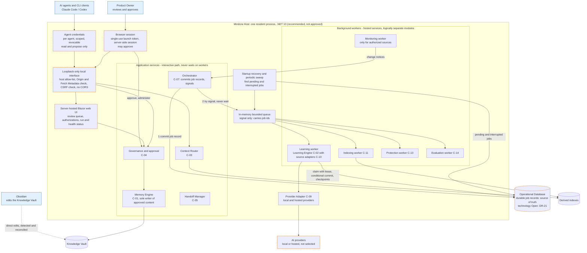
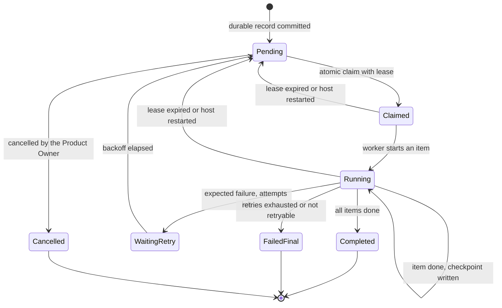
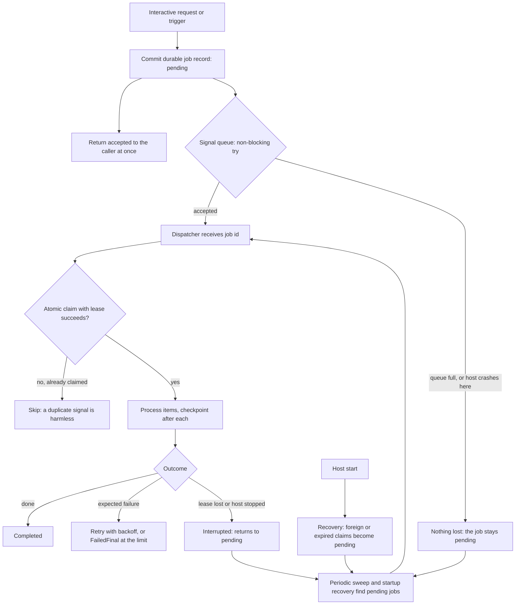

# DR-07 Decision Paper — Runtime and Process Architecture

**Document ID:** MIN-DP-007
**Version:** 0.3 (draft). Supersedes v0.2 and v0.1, which are **preserved unchanged** at `docs/03-design/DR-07-DECISION-PAPER-v0.2.md` and `docs/03-design/DR-07-DECISION-PAPER.md`.
**Date:** 2026-11-16 (technical facts re-verified on this date; **no new external source was needed for v0.3**)
**Status:** **Draft for Product Owner review. Nothing in this paper is approved.** It does not close DR-07 or ADR-002 and changes no controlled document.
**Prepared against:** SDD MIN-SDD-001 v1.4.2; Product Owner Decision Register MIN-PODR-001 v0.3; ADR register MIN-ASM-ADR-001 v0.8; readiness assessment MIN-ASM-RDY-001 v0.9 (all re-read for this revision; none modified).
**Scope guard:** Stage One — Learning. CareerOps, Gmail, job discovery, Google Sheets, cloud deployment and MCP server implementation are outside Stage One and are not dependencies. **DR-21, DR-04 and DR-27 are not decided or started here.** Where this paper needs something from the Operational Database, it states a *requirement the store must meet* (an input to DR-21), not a technology.

**Evidence tags:** **[V]** verified technical fact (source in §19, verified 2026-11-16) · **[A]** architecture analysis · **[As]** assumption to confirm · **[R]** recommendation (proposal) · **[O]** open Product Owner question.
Sub-decision labels (D07-A to D07-G) exist **only in this paper**; they are not decision-register IDs.

---

## Change log (v0.2 → v0.3)

Only three review findings were addressed. The proposed architecture, all other v0.2 corrections and all recommendations are unchanged and remain **unapproved**.

| # | Review finding | Gap in v0.2 | v0.3 correction | Sections |
|---|---|---|---|---|
| 1 | Q2a ambiguity | "UI closed" did not separate closing the browser, stopping the host process, and logging out of Windows | New table of three distinct events (**E1** browser closed, **E2** host process stopped, **E3** Windows sign-out) with what stops under each hosting form. Q2a is split into **Q2a(i)** and **Q2a(ii)**; Q2b and Q2c are restated in terms of the events | 6.2, 17 |
| 2 | Durable job fencing | v0.2 said a stale worker "must find its token stale and stop before committing". That is a **check-then-act** race: the lease can expire after the check and before the commit. v0.2 also did not say how a stale worker is kept from publishing canonical vault changes | **Fencing at commit, not before:** results are written in one atomic transaction that is conditional on the claim token still matching. **Workers have no authority to write canonical vault content.** Canonical changes occur only through an **approved-change application** by C-01 under a single writer, an exclusive write lock, a base-version precondition and an idempotent change id, with crash recovery. The limits of a file system are stated. Failure cases tabulated. Requirement on DR-21 extended (conditional commit) | 8.3, new 8.3.1, 13, 16, 20 |
| 3 | Implementation gates | No separation of decisions needed before a first build from decisions that can wait | New §18A classifies every sub-decision and open question as **before the first milestone**, **just in time inside it**, or **deferred until the capability is built**; a gate column is added to §20. The first milestone is a **candidate only** (assessed in `MIN-ASM-DTA-001`) | 18A, 20 |

## Change log (v0.1 → v0.2) — carried forward unchanged from v0.2

| # | Review point | What was wrong or missing in v0.1 | Correction in v0.2 | Sections |
|---|---|---|---|---|
| 1 | Operating system | Q1 assumed "Windows 10 and 11". Windows 10 Home/Pro support ended 2025-10-14 **[V]** | Default assumption is **Windows 11**. Windows 10 is considered only if a Windows 10 LTSC/ESU requirement is explicitly established. Cross-platform portability of core libraries stays an architectural consideration, **not** a requirement | 4, 5.5, 17 (Q1) |
| 2 | Durable queue and recovery | v0.1 said "signal, then queue" but did not define recovery, the crash window, claiming, duplicates, or queue-full behaviour, and cited a producer-waits queue sample | Durable job records are the **source of truth**; the in-memory queue only **signals**. Defined: startup recovery, periodic sweep, atomic claim with lease, idempotency, duplicate dispatch, queue-full behaviour with **no blocking of interactive requests** | 8.3, 9, 14 |
| 3 | Local interface security | One "installation secret" for everything; loopback presented as a main control | D07-G split into **G1 browser session**, **G2 agent credentials**, **G3 transport and host-boundary controls**. Host validation, Origin/Fetch Metadata, CORS and CSRF are separate controls. Loopback is **not** claimed to be sufficient. Human-only approval preserved | 6.3, 11 |
| 4 | Worker failure behaviour | v0.1 said the default exception behaviour was *not verified* and proposed an open-ended supervisor loop | **Verified: `StopHost` is the default since .NET 6 [V].** Separated expected per-job failures from unhandled worker exceptions. Replaced the restart-forever supervisor with **bounded retries, backoff, health reporting and a defined fatal path** (all parameters proposals, not set) | 8.4 |
| 5 | Q2 hosting requirement | One question covered three different needs | Split into **Q2a** (UI closed, user logged in), **Q2b** (user logged off), **Q2c** (automatic backups without interactive login), with consequences for per-user versus Windows Service hosting | 6.2, 17 |
| 6 | D07-H | Presented as a decision needing approval | Module boundaries and testability follow from PO-D06 (approved). Re-classified as **derived engineering standards**, not a decision request | 2, 18, 20 |
| 7 | .NET 10 versus 11 | Compared on support dates only | Re-verified on 2026-11-16: unchanged. **Added a verified feature difference:** .NET 11 ships automatic CSRF protection by default **[V]**. Recommendation unchanged, with the trade-off stated | 5.2 |
| 8 | Framework-dependent deployment | Conflated roll-forward with patch delivery | Separated: **roll-forward** (the host picks the latest *already installed* patch) versus **delivery** (how a patch reaches the machine). Recommendation made conditional | 5.4 |
| 9 | Blazor mode | "Blazor web UI" left the hosting and render mode unclear | Clarified **server-side hosting** (static SSR and/or interactive server rendering); WebAssembly and Auto are not proposed. Per-screen choice deliberately left to a later evaluation | 7 |
| 10 | Agent-assisted capture without MCP | Not explained | Explained how Stage One captures through IF-05 and IF-09 without an MCP server | 6.4 |
| 11 | Open parameters | Implicit | Listed explicitly: nothing numeric is proposed | 8.6 |
| 12 | Evidence | v0.1 list | Corrected and extended (Windows lifecycle, `BackgroundService` default, roll-forward, render modes, CSRF, host filtering, CORS) | 19 |

---

## 1. Executive summary

| Sub-decision | Recommendation **[R]** | Confidence | What it depends on |
|---|---|---|---|
| D07-A .NET version | **.NET 10 (LTS)**, `net10.0`. .NET 8 and 9 are out of support since 2026-11-10 **[V]**. .NET 11 has the **same** end of support as .NET 10 and is six days old **[V]**; it does add default CSRF protection **[V]** | High | Q8 (library support) |
| D07-B Hosting | **One resident host process** (ASP.NET Core on the Generic Host) holding the UI, the local interface and the workers. Per-user first; the same host installable as a **Windows Service** if **Q2b or Q2c** is "yes" | Medium | **Q2a, Q2b, Q2c** |
| D07-C UI | **Server-hosted Blazor web UI** in the browser. Render mode (static SSR, interactive server, or a mix) chosen per screen later. No WebAssembly. No MAUI | Medium | Q5 |
| D07-D Workers | **`BackgroundService` hosted services** driven by **durable job records**; an in-memory bounded queue only **signals**; startup recovery plus periodic sweep; atomic claim with lease; bounded retries; defined fatal path | High | DR-21 must offer atomic claim (requirement) |
| D07-E Communication | Direct interfaces for requests; durable job records plus signal queue for background work; minimal in-process events; no broker, no IPC | High | none |
| D07-F Runtime delivery | **Framework-dependent**, with an explicit patch-delivery plan (roll-forward alone installs nothing) | Medium | Q9 |
| D07-G1 Browser session | One-time launch token exchanged for a short-lived server-side session; CSRF, Origin/Fetch Metadata and Host validation as separate controls; no CORS | Medium | Q11 |
| D07-G2 Agent credentials | **Per-agent, scoped, revocable** credentials limited to **read** and **propose**; never usable for **approve** or **administer** | Medium | Q3, DR-14 |
| D07-G3 Transport | Loopback-only HTTP **plus** the controls above. Loopback alone is **not** treated as security | Medium | Q3 |

**Why this is still the simplest design that fits.** PO-D06 fixed the shape. The additions in this revision are not new mechanisms; they are the specific rules that make the chosen mechanisms safe: a durable source of truth behind the queue, a defined failure ladder, and separate credentials for the browser and for agents.

**Still unresolved and decisive:** the operating-system default (Q1), what must survive closing the browser, an explicit exit of the Mindora host, or signing out of Windows (Q2a to Q2c; the three events are defined in §6.2), how agents call Mindora (Q3), and the Stage One UI scope (Q5). §17 states the assumption used for each and what changes if it is wrong.

**Not recommended (unchanged):** microservices or a message broker; a separate worker process now; a third-party job scheduler; .NET MAUI; a Windows Service as the *default*; .NET 11 now; gRPC or other IPC (§14).

---

## 2. Exact DR-07 scope

From SDD §18 and the readiness assessment: *Runtime and process architecture specifics (ADR-002): .NET version; hosting model; UI framework; background worker technology and implementation details; other runtime-specific choices (database technology is decided with DR-21).*

**Already approved by PO-D06 (not open):** local-first modular monolith; .NET / C# primary language; logically separated background workers in the same deployment; independently testable components; non-blocking background learning; no premature microservices or unnecessary multi-language complexity.

**Covered here as decisions for the Product Owner:** D07-A, D07-B, D07-C, D07-D (including the durable job model and failure behaviour), D07-E, D07-F, and D07-G1 to G3 (local interface security, an "other runtime-specific choice").

**Not a decision request:** module boundaries, testability rules and dependency rules. PO-D06 already approved a modular monolith, logically separated workers and independently testable components. The specifics are **derived engineering standards** (§18); they need no separate approval unless a genuinely unresolved technical choice appears (none does today).

**Excluded:** database and index technology (DR-21); watcher, scheduler and connector technology (DR-24); providers and models (DR-05, DR-23); direct-input promotion (DR-27); governance rules (DR-04).

---

## 3. Current approved architectural constraints

| Constraint | Source | Effect on DR-07 |
|---|---|---|
| Hybrid persistence; derived indexes rebuildable; no silent overwrite; Operational Database technology open | PO-D01 | The runtime must not assume a database. Job state needs a durable store whose technology DR-21 decides |
| Explicit Product Owner approval; AI cannot change policy | PO-D02 | Approval must be reachable only by the human, never through an agent credential (§6.3) |
| Provider-independent AI; sensitive data local unless authorized | PO-D03 | The runtime hosts the Provider Adapter and its authorization checks |
| Four acquisition modes; read-only by default; monitoring only when authorized | PO-D04 | Agent-assisted capture is a Stage One mode; monitoring needs a resident host |
| Knowledge graph, ids, provenance | PO-D05 | Retrieval must stay responsive while learning runs |
| Local-first modular monolith; .NET / C#; logical workers in one deployment; testable; non-blocking; no premature microservices | PO-D06 | The frame for this paper |
| Automatic local backups; independent encrypted backups; external storage needs authorization | PO-D07 | Something must run backups automatically (Q2c) |
| Continuous evaluation; AI cannot change learning policy | PO-D08 | An evaluation worker runs in the background |
| One user, one active vault | SDD §2.4 *[Assumption]* | No multi-user or multi-machine design |

---

## 4. Existing architecture assessment

| Topic | In SDD v1.4.2 | Gap relevant to DR-07 |
|---|---|---|
| Process shape | §3.2a, §12.1: one deployment; interactive host; five logical worker roles; workers never write approved canonical vault content; interactive requests take precedence | **How long the process lives** is not stated (Q2a to Q2c) |
| Runs and recovery | §6.3: per-item checkpoints; idempotency key = adapter + locator + fingerprint + pipeline version + configuration version; deterministic candidate identity; resume after interruption; provider calls retried with **bounded backoff**; non-retryable failures pause the run. §3.8a run states: planned, running, checkpointed, interrupted, completed, failed | Run-level recovery is designed. **Dispatch-level** recovery (what happens to a job that was accepted but never started, or started and lost) is not, and IF-09 already promises `status=queued`, so durable intake is needed |
| Orchestrator | C-07: run state, checkpoints, priorities; "never retries a non-idempotent step automatically" | The queue mechanism is Open; no claim or lease model |
| Interfaces | §11: IF-01 to IF-13; transport (library, CLI, local HTTP) Open; §12: no network listener unless ADR-002 selects a local service, then localhost only | No authentication model separating a browser from agents |
| Authorization | §13.2: tiers read, propose, approve, administer; approve is human-only | How tiers map to credentials is undefined |
| UI | §3.2a UI node "framework Open" | Mandatory screens undefined except the review queue |
| Platform | None | **No operating system is stated anywhere** |
| Packaging and updates | None | No runtime-delivery or update model |

The recommendations use the exception SDD §12 already allows (a local service on localhost only). ADR-002 is the place to record it.

---

## 5. Runtime and version alternatives (D07-A, D07-F)

### 5.1 Verified facts **[V]** (source V1, page last updated 2026-11-10, re-read 2026-11-16)

- **.NET 11:** released 2026-11-10, **STS**, latest 11.0.0, end of support **2028-11-14**.
- **.NET 10:** released 2025-11-11, **LTS**, latest 10.0.15 (2026-11-10), end of support **2028-11-14**.
- **.NET 9 and .NET 8: out of support since 2026-11-10.**
- LTS: three years; STS: two years; a new major release every November; even numbers are LTS.
- A system must be on the latest patch to qualify for support. The last six months of support is the *maintenance* phase (security fixes only).
- On Windows, supported .NET versions can be patched automatically through Microsoft Update; framework-dependent apps benefit, self-contained apps remain responsible for updating their own runtime.

### 5.2 Alternatives

| Option | Advantages | Disadvantages |
|---|---|---|
| **V1: .NET 10 (LTS)** | In support to 2028-11-14 **[V]**; mature patch level **[V]**; the next LTS (.NET 12) follows the annual November cadence **[V]** (its date is not yet published) | Lacks .NET 11 features |
| **V2: .NET 11 (STS)** | Newest platform. **Verified difference relevant to Mindora's web UI:** automatic Cross-Site Request Forgery (CSRF) protection, based on the `Sec-Fetch-Site` and `Origin` headers, is enabled by default for apps built with `WebApplication.CreateBuilder` **[V]** (source V15) | **Same end of support as .NET 10** **[V]**, so no extra support time; released six days ago with only 11.0.0 **[V]**; library and tool maturity unproven **[A]** |
| V3: .NET 8 or 9 | Familiar to many libraries **[A]** | **Out of support** **[V]**; Microsoft strongly recommends not using out-of-support software **[V]** |

**Reassessment.** The support comparison in v0.1 is confirmed. The new verified difference narrows the gap but does not reverse it: on .NET 10 the same protection is available through the token-based antiforgery middleware or through explicit header validation **[A]**, at a modest implementation cost; .NET 11 offers it by default but costs maturity. Because both versions end support on the same date, choosing .NET 10 does **not** force an earlier migration, and choosing .NET 11 does **not** extend support. **[R] .NET 10**, with .NET 11 a defensible alternative if the Product Owner prefers built-in CSRF defaults over runtime maturity.

### 5.3 Target framework, SDK and runtime **[A]**

| Item | Meaning | Recommended value |
|---|---|---|
| Target framework | The moniker fixing available APIs | `net10.0` for libraries. A Windows-specific moniker only for a project that needs Windows-only APIs (Microsoft's Windows-service sample uses `net10.0-windows` **[V]**) |
| SDK | Build toolset | .NET 10 SDK at the latest patch |
| Runtime | What executes the app: the .NET runtime plus the ASP.NET Core shared framework | 10.0.x at the latest patch (10.0.15 on 2026-11-10 **[V]**) |

### 5.4 Runtime delivery: roll-forward versus patch delivery (D07-F)

These are different mechanisms and v0.1 conflated them.

| Mechanism | What it does | Verified |
|---|---|---|
| **Roll-forward** | When a framework-dependent app starts, the host chooses the **latest patch version already installed on the machine** for the requested runtime. The default policy (`Minor`) may also move to a higher minor version if the requested one is absent. **If no acceptable runtime is installed, the app does not run.** Roll-forward installs nothing | **[V]** source V13 |
| **Patch delivery** | How a newer patch gets onto the machine. On Windows, supported .NET versions can be patched through Microsoft Update; a manual or package-manager install is also possible **[A]** | **[V]** for Microsoft Update (source V1). Coverage of every installation method was not verified |
| **Self-contained** | The runtime ships inside the app; Mindora must republish to update it **[V]** (source V1) | **[V]** |

| Option | Advantages | Disadvantages |
|---|---|---|
| **Framework-dependent** | Smaller; the machine's installed runtime is patched centrally; roll-forward uses the newest installed patch **[V]** | Requires the runtime on the machine; Mindora's support depends on the user keeping patches current **[V]**; a missing runtime stops the app **[V]** |
| Self-contained | No machine runtime dependency | Mindora owns the update path for every runtime patch **[V]**; larger |

**[R] D07-F: framework-dependent, conditional** on a stated patch-delivery plan: the runtime installed through a channel that Microsoft Update patches (to be confirmed in a spike), and a startup check that reports a missing or outdated runtime. If others will install Mindora, or no reliable patch channel exists (Q9), self-contained becomes the safer choice. This is a Product Owner decision because it determines who is responsible for runtime security patches.

### 5.5 Operating system assumption (corrects v0.1)

**Verified facts [V]:**
- **Windows 10 Home, Pro, Pro Education and Pro for Workstations reached end of support on 2025-10-14** (source V9).
- Windows 10 Enterprise LTSC 2021 reaches end of servicing on **2027-01-12**, about eight weeks after the verification date; only Windows 10 IoT Enterprise LTSC 2021 runs to 2032-01-13 (source V10).
- Windows 11 Home and Pro versions are serviced for 24 months from release, Enterprise for 36 (source V11), so a Windows 11 machine must keep moving to a serviced version.
- .NET does not test or support OS versions that the OS publisher no longer supports (source V2). The .NET 10 supported-OS list (a snapshot last updated 2026-04-06) names Windows 11 versions and a few Windows 10 enterprise or IoT editions; it must be re-read at decision time because some of the Windows 10 entries have since ended or are about to.

**Assumption used [As]:** **Windows 11 (a version still in servicing) is the default Stage One target.** A Windows 10 target is considered only if a Windows 10 LTSC or Extended Security Updates requirement is **explicitly established** by the Product Owner. Consumer Windows 10 ESU is reported by secondary sources to have ended in October 2026; that was not verified from Microsoft and is **not relied on**.

**Portability.** .NET 10 supports macOS and several Linux distributions (source V2). That does **not** make cross-platform a Mindora requirement, and **no cross-platform requirement is proposed or approved**. As an *architectural consideration*, core libraries target `net10.0` and keep Windows-specific code in the host project, so portability stays possible at low cost. Choices in this paper are labelled Windows-specific where they are (Windows Service, WPF shell).

**Evaluation against Mindora:** local-first and background processing are core Generic Host capabilities **[V, §8.1]**; library compatibility cannot be verified without a candidate list **[O: Q8]**; no performance comparison is available, so none is claimed (§12). Plan the move to .NET 12 (LTS) after its release and before 2028-11-14 **[R]**.

**[R] D07-A: .NET 10 LTS, `net10.0`.**

---

## 6. Hosting model alternatives (D07-B, D07-G)

### 6.1 Verified facts **[V]**
- The Generic Host runs hosted services in worker apps and in web apps (source V4).
- A worker app can run as a **Windows Service**: add `Microsoft.Extensions.Hosting.WindowsServices`, call `AddWindowsService`; logs can go to the Windows Event Log; for service recovery options to apply, the process must exit with a **non-zero code** on failure (source V3).
- Kestrel binds loopback with `ListenLocalhost` or an `IPAddress.Loopback` endpoint; `localhost` binds both IPv4 and IPv6 loopback and **Kestrel fails to start if the port is in use**; with no configuration it binds `http://localhost:5000` (source V7). Unix sockets are supported; a named-pipe endpoint exists in the Kestrel configuration API (seen in the .NET source only).
- **Kestrel does not validate the `Host` header by default (all hosts allowed).** Microsoft calls host filtering *critical* to prevent DNS-rebinding and host-header attacks (source V16).

### 6.2 Alternatives and the three parts of Q2

| Option | How it works | Advantages | Disadvantages |
|---|---|---|---|
| **H1: On-demand process** | The user starts Mindora; it stops when the user stops it | Simplest; runs as the user | Nothing runs when stopped |
| **H2: Windows Service** (the same single process) | `AddWindowsService`; starts at boot | Runs with no one logged in; recovery options **[V]** | Needs installation rights; a service account must reach the user's vault and user-profile sources; per-user credential protection may behave differently in a service context **[A, not verified]** |
| **H3: Per-user resident process started at logon** | The same single process, registered to start when the user logs on | Runs as the user; stays up while logged in, **independent of any browser tab or window** | Ends at logoff **[A]**; needs a startup registration (not researched) |
| H4: Two processes (UI shell and background host) | Separate processes linked by IPC | Isolation | More parts; against PO-D06's no-premature-distribution direction **[A]** |
| H5: Library and command line only | Runs on demand | Minimal | No live monitoring; no review UI |

**Three different events must not be confused (clarified in v0.3).** The v0.2 wording "UI closed" could mean any of them.

| Event | What it is | What happens to background work |
|---|---|---|
| **E1. Close the browser tab or window** (U1) | Only the **client** goes away. The Mindora host process keeps running | **Nothing stops** under H1, H2 and H3, because the host is a separate process from the browser **[A, by design of U1]**. The browser session may expire, which only affects the UI (§6.3) |
| **E2. Stop the Mindora host process** | The process ends: an explicit "exit" command, end-task, a crash, a fatal worker failure (§8.4), or a reboot | **All workers stop.** Interrupted jobs return to `pending` at the next start (§8.3). Under **H1** nothing restarts until the user starts Mindora; under **H3** the host starts again at the next logon; under **H2** a service stop also stops it, and the operating system's recovery options may restart it after a failure **[V mechanism, A policy]** |
| **E3. Sign out of Windows** | The user's session ends | A **per-user** process (H1, H3) ends with the session **[A, not verified here]**; a **Windows Service** (H2) is not tied to the user's session **[A, not verified here]**. Locking the screen or switching user is **not** the same as signing out; its effect on per-user processes was **not verified** |

**Q2, restated with unambiguous consequences:**

| Question | If **no** | If **yes** |
|---|---|---|
| **Q2a(i).** Must background work **keep running after you close the browser** (E1), while you remain signed in? | Mindora could stop work when the UI closes. This would need the host tied to a window (U2-style), which is **not** the recommended design | The recommended design already satisfies it: with U1 the host is independent of the tab **[A]**. **No hosting change** is needed |
| **Q2a(ii).** Is a deliberate **"Exit Mindora"** (E2) allowed to stop all background work, with in-flight jobs returned to `pending` and resumed at the next start? | You want work to continue even after an explicit exit: that is only possible with a Windows Service (H2) | The default. An explicit exit stops the host within the shutdown window (30 s by default **[V]**); jobs checkpoint after each item (§8.3) and resume later |
| **Q2b.** Must background work **continue after you sign out** of Windows (E3), with the machine on? | **H3** (per-user at logon) | **H2** (Windows Service). This brings the account, vault-access and credential-store work (§11) |
| **Q2c.** Must **automatic backups** (PO-D07) run **without any interactive login**? | Backups run inside the host while you are signed in (H3) | The protection worker needs H2. The whole host would run as one service, not two hosts; a separate scheduled task outside the host would split the design and is **not recommended** without a need **[A, not researched]** |

**[R] D07-B:** one resident host. **If Q2b and Q2c are both "no": H3 (per-user at logon), with H1 acceptable for development.** **If either is "yes": H2 from the start.** Either way the same host and configuration, so the choice is reversible. The default assumption used for the other sections is H3 **[As]**.

### 6.3 Local interface security (D07-G, split)

**Loopback binding is not treated as security.** It keeps the listener off the network **[V]** but not away from other processes on the machine, from other local users, or from a web page in the user's browser. Kestrel also validates no `Host` by default **[V]**. The controls below are separate and each addresses a different threat. v0.1 proposed one shared "installation secret"; that is withdrawn, because a secret reachable by browser JavaScript and also held by every agent would make any one compromise a compromise of all.

**Three client classes with separate mechanisms:**

| Class | Who | Needs |
|---|---|---|
| **Browser session** (human) | The Product Owner in a browser | Authentication of a human; CSRF defence; may use the full tier set including **approve** and **administer** |
| **Agent and command-line clients** | Claude Code, Codex or a command-line tool running locally | Per-client identity; **read** and **propose** only |
| **Anything else** | Any other local process, any web page | Must be refused |

**D07-G1: browser session (proposal)**

| Control | Proposal | Threat addressed | Status |
|---|---|---|---|
| Session establishment | The host, started by the user, produces a **single-use launch token** delivered through the user's own session (for example opened with the user's browser). The browser exchanges it once for a **short-lived server-side session** carried in a cookie that page JavaScript cannot read and that is not sent cross-site **[A]**. No long-lived secret is placed in page JavaScript | Other local processes reaching the UI; token theft by script | **[A]**; lifetimes and re-authentication rules Open (Q11) |
| Host validation | Configure an explicit allow-list (`localhost` and the loopback addresses). **Required, not optional**, because the default allows all hosts **[V]** | DNS rebinding and host-header attacks **[V]** (source V16) | **[V]** that it is needed |
| Origin and Fetch Metadata validation | Reject state-changing requests whose `Sec-Fetch-Site` is not same-origin (or whose `Origin` does not match). Browsers set these headers and page script cannot forge them **[V]** | Cross-site requests from a malicious page in the user's browser | **[V]** mechanism. It protects against **browser-borne** attacks only; a non-browser local process can send any headers **[A]** |
| CSRF protection | **.NET 10:** token-based antiforgery (or explicit header validation). **.NET 11:** the automatic middleware is on by default **[V]** (source V15) | Forged form posts and actions | **[V]** versions; the choice follows D07-A |
| CORS | **No CORS policy** for the UI: same-origin only. Microsoft states CORS is **not a security feature; it relaxes security** **[V]** (source V17) | Over-broad cross-origin access | **[V]** |
| Tier enforcement | **Approve and administer require this authenticated browser session.** No agent credential can obtain them | Agent or script approving its own proposals (PO-D02) | **[R]**; human-only approval preserved |

**D07-G2: agent credentials (proposal)**

| Aspect | Proposal |
|---|---|
| Identity | One **credential per agent or client**, not one shared secret. Each carries a tier ceiling (**read** and/or **propose**) and optionally a project scope |
| Issuing | Created by the human in the browser session (administer tier). Shown **once**; the host stores only a **non-reversible hash** **[A]** |
| Storage on the agent side | In the **OS credential store**, or an environment variable or a file readable only by the user, consistent with SDD §12 ("never in the vault, Git or logs") |
| Least privilege | Default **read**; **propose** only where capture is wanted. **Approve and administer are not grantable to an agent credential** |
| Rotation | A credential has an expiry and can be rotated by the human at any time; the old one stops working at once. Rotation interval **Open** |
| Revocation | Immediate, by the human, from the UI; also on suspected exposure. Revoking one agent does not affect the browser session or other agents |
| Audit | Every call carries the credential's identity and is audited (SDD §11 common rules; IF-08) |
| Never | The same value is never given to browser JavaScript; credentials are not placed in prompts or instruction files |

**D07-G3: transport and boundary (proposal)**
- Loopback-only HTTP on a configurable port; **no external bind** (SDD §12).
- A **named pipe with an access-control list** is a stronger local-identity alternative for the command-line client on Windows; **not decided**, to be evaluated.
- TLS on loopback is optional; the residual local-eavesdropping risk is low but not nil **[A]**.
- **Residual risk, stated plainly:** a process running as **the same user** (including a compromised agent) can read that user's files and may be able to observe a launch token. Loopback, headers and tokens cannot fully prevent a same-user compromise **[A]**. The mitigation is that **approval needs an explicit action in an authenticated browser session**, and the question whether a further confirmation step is needed for approvals is **[O: Q11]**.

### 6.4 Stage One agent-assisted capture without an MCP server

MCP server implementation is **outside Stage One** (SDD §13.2; PO-D04). Agent-assisted capture is still a Stage One mode, because it uses the **same interfaces** Stage One exposes locally (IF-04, IF-05, IF-09), not MCP:

| Path | How it works | Notes |
|---|---|---|
| **Command-line client** | The agent runs a shell command that calls the local interface with the agent's own credential and submits a summary or handoff (IF-09, IF-05) | Needs the agent to be able to run commands. Whether each agent can is **unverified (DR-14)** |
| **Local HTTP call** | The agent calls the local interface directly | Needs the agent to make HTTP requests; same credential rules |
| **File-based capture** | The agent (or the user) writes a Markdown file into the capture inbox (SDD §4.9); Mindora reads it as a manual or file-import source | Needs no listener and no credential, but only works when the file is written and later read; shows the provenance as submitted by the user or agent |
| **Manual paste** | The user submits text in the UI | Always available |

A later MCP server would be a thin adapter in front of the same IF-04, IF-05 and IF-09, so nothing above is thrown away. Which of these a given agent can actually use is **not verified** and belongs to DR-14; it also decides whether Stage One needs a listener for agents at all (Q3). Agents may only **propose**: they cannot approve (SDD §13.2).

**[R] D07-B and D07-G summarized in §20.**

---

## 7. UI framework alternatives (D07-C)

### What Stage One needs **[A]**
Obsidian remains the human editor for vault content. Mindora must still provide a **review queue** (approve, reject, defer, clarify, supersede), **authorizations** (sources, monitoring, external processing, external backup), **run and health status** (§8.4), and **evaluation reports**. Reviewing candidates and differences in a terminal would be poor, and putting review decisions into Markdown would blur the authority split between the vault and the Operational Database.

### Verified facts **[V]**
- Blazor Hybrid renders Razor components into an embedded web view; `BlazorWebView` exists for .NET MAUI, WPF and Windows Forms (source V6).
- .NET MAUI supports Android, iOS, macOS (Mac Catalyst) and Windows (WinUI 3); Tizen via Samsung; **Linux is not an officially supported MAUI target**; WPF, AppKit and Linux/GTK backends exist only as experimental `maui-labs` packages not covered by the MAUI support policy (source V5).
- Avalonia (third party) targets Windows, macOS and Linux (source V8).
- **A Blazor Web App has four render modes (source V14):** *Static Server* (static server-side rendering, **no interactivity**), *Interactive Server* (interactive server-side rendering using Blazor Server), *Interactive WebAssembly* (client-side, needs a separate client project) and *Interactive Auto* (server first, then client). A mode can be set globally or per component; prerendering is on by default for interactive components.

### Alternatives

| Option | Advantages | Disadvantages |
|---|---|---|
| **U1: Server-hosted Blazor web UI in the browser** | One technology; no native toolkit; decoupled from the host's lifetime; extendable | Needs the host running; fewer native desktop features; needs the §6.3 controls |
| U2: Blazor Hybrid in a WPF shell | Native window, tray, dialogs; same Razor components **[V]** | Windows-only; extra project and a web-view dependency (not researched); adds little to Stage One's needs |
| U3: .NET MAUI Blazor Hybrid | One codebase across Windows and macOS **[V]** | Mobile out of scope; no official Linux **[V]**; heavy toolchain |
| U4: Native XAML (WPF or WinUI) | Best native feel **[A]** | Second UI stack; Windows-only |
| U5: Command line and Obsidian only | Smallest | Fails the review workflow |
| U6: Avalonia (third party) | Cross-platform native **[V]** | Non-Microsoft dependency for a need not stated |

### Clarifying the proposed Blazor mode **[R, deliberately not a final selection]**

- **Proposed:** a **server-hosted Blazor Web App** in which all Mindora logic stays on the server in the host. **Server-side rendering only:** *Static Server* for pages that do not need live updates (for example history and reports) and *Interactive Server* where live status or immediate review actions are valuable. **Interactive WebAssembly and Auto are not proposed**: they ship application code to the browser, need a separate client project, and add nothing Mindora needs **[A]**.
- **Not decided here:** which screens use which mode. That depends on Q5 and needs a small evaluation (responsiveness, circuit behaviour with a single user, how forms and CSRF behave in each mode). The choice also interacts with D07-A: static server-side form handling and CSRF differ between .NET 10 and .NET 11 **[V]** (source V15).
- **Not a Microsoft-ecosystem preference:** U1 is recommended because it is the least additional technology (the host already exists and already serves the local interface), not because Blazor is part of .NET.

**[R] D07-C: U1.** A native shell (U2) can be added later without changing any application service. If Q5 requires native behaviour in Stage One, choose U2.

---

## 8. Background worker alternatives (D07-D)

### 8.1 Verified facts **[V]** (sources V4, V3, V12)
- `BackgroundService` is a base class for long-running `IHostedService` work through `ExecuteAsync`. Hosted services start **sequentially**; `StartAsync` must be short. A hosted service is a **singleton** (scoped services need a created scope).
- The cancellation token has a **default 30-second** shutdown timeout, configurable. `ExecuteAsync` must finish promptly when cancelled or the service is shut down ungracefully.
- **If the process fails unexpectedly, `StopAsync` might not be called.**
- Microsoft's queued-background-task sample uses a **bounded queue; when it is full the producer waits for space**. That wait behaviour is acceptable in the sample and is **not acceptable on Mindora's interactive path** (§8.3).
- **Since .NET 6, an unhandled exception from `ExecuteAsync` is logged and, by default, the host is stopped** (`BackgroundServiceExceptionBehavior.StopHost`). The previous behaviour (`Ignore`) can be restored by configuration. Microsoft's reason for the default: unhandled exceptions should not be ignored; they indicate a problem that needs attention.

### 8.2 Alternatives

| Option | How it works | Advantages | Disadvantages |
|---|---|---|---|
| **W1: Hosted-service workers fed by durable job records; in-memory queue as signal** | Each role is a `BackgroundService`; work exists first as a durable job record; a bounded queue only signals | Built into the platform **[V]**; no new dependency; recoverable; logically independent modules | Shared process: a runaway worker affects the host (mitigated §8.5) |
| W2: Separate worker process | Second host for workers | OS-level isolation | More processes and IPC; contrary to PO-D06 until needed **[A]** |
| W3: Third-party job scheduler | Library with persistent jobs and retries | Rich features **[A, not verified]** | Brings its own store (pre-empts DR-21); scheduling is DR-24 |
| W4: OS scheduler launches command-line runs | Windows Task Scheduler | No resident worker code | No live monitoring; fragmented state |
| W5: Distributed workflow framework | External orchestration | Strong durability | Far beyond a single-user local app |

### 8.3 Durable job model, recovery and queue behaviour **[R, requirements for review]**

**Principle.** **Durable job records are the source of truth. The in-memory bounded queue is only a wake-up signal carrying job identifiers.** Losing the queue (full, cleared, crashed) never loses work.

**Logical attributes a job must keep (not a schema):** job id, type, priority, state, earliest-start time, attempt count, claim owner (host instance and worker), claim token or attempt number, lease expiry, last checkpoint reference, last error summary, and a link to the SDD run. **Requirements the Operational Database must meet (inputs to DR-21, which is not decided here):** committed creation of a job record; an **atomic claim** (only one claimant can take a job, with a lease); atomic state transitions; a **conditional commit** (one transaction that applies a worker's results only if its claim token still matches, see §8.3.1); and a query for jobs by state and age. A store that cannot provide an atomic claim would constrain DR-21.

**Mapping to SDD §3.8a:** a job is the *unit of dispatch* of a run. `pending` corresponds to *planned*; claimed and running correspond to *running* and *checkpointed*; an interrupted job returns to `pending` and resumes from the last checkpoint (*interrupted*, then *running*); `failed_final` corresponds to *failed*. This should be reconciled with §3.8a if approved.

**Enqueue sequence (never blocks the interactive caller):**
1. The caller or the orchestrator **commits a durable job record** (`pending`).
2. The caller gets "accepted" **immediately**. (This matches IF-09's `status=queued`.)
3. The orchestrator then tries a **non-blocking signal** to the queue. **It never waits for queue capacity.** If the signal does not fit (queue full), nothing else happens: the job simply remains `pending`.

**Crash window between steps 1 and 3.** The job record exists but was never signalled. It is found by the **startup recovery** and the **periodic sweep** below, so it cannot be lost.

**Startup recovery.** Before workers take work, the host runs a short recovery step (kept short because `StartAsync` must be short **[V]**; heavy scanning happens in `ExecuteAsync`):
- Jobs left `claimed` or `running` by a **previous host instance**, or with an **expired lease**, are marked interrupted and returned to `pending` (recording the attempt).
- All `pending` jobs become eligible for dispatch.
- Recovery does not rely on any stop handler having run **[V]** (`StopAsync` may not run after a crash).

**Periodic sweep.** A dispatcher also scans for `pending` jobs and expired leases at an interval (Open). It wakes workers when the queue has drained, and so recovers from missed or dropped signals.

**Claiming, duplicates and fencing.**
- A worker takes a job only by an **atomic claim with a lease**. If another worker holds it, the claim fails and the worker **skips** the job. A job can therefore be signalled twice (original signal plus sweep) without being processed twice.
- Each claim has a **claim token**: an attempt number that only increases, so an older token can never match again. The token is enforced **inside the commit**, not by an earlier check; a preliminary check alone is **not** sufficient (§8.3.1).
- Lease duration, renewal interval and sweep interval are **Open parameters**.

#### 8.3.1 Fencing: stopping a stale or expired worker from publishing

**The problem.** A worker can pause (garbage collection, a suspended machine, a slow call) after checking that it still holds its claim. Its lease then expires, the dispatcher gives the job to another worker, and the first worker resumes and commits. A check *before* the commit does not prevent this: the claim can be lost between the check and the commit (a time-of-check to time-of-use race). Renewing the lease with a heartbeat only makes it less likely. **v0.2 relied on the early check; v0.3 does not.**

**Rule 1: fence inside the commit.** Everything a worker publishes (checkpoint, candidates, evidence, the job's new state) is written in **one atomic transaction in the Operational Database that is conditional on the claim still being valid**: the job row is updated only if its stored claim token equals the worker's token and its state is still `running`. If the condition fails, the transaction writes nothing and the worker stops. Because the token only increases, a stale worker's token can never match again **[A]**. This is a **requirement on DR-21's store** (a transaction that combines a conditional update with the result writes); it is not a technology choice.

**Rule 2: workers have no authority over canonical content.** Workers never write approved canonical Knowledge Vault content (SDD §12.1; C-01 is the sole application-controlled writer). A worker's output is **candidates and evidence in the Operational Database**, which are not canonical. A stale worker therefore **cannot publish a canonical change by any path**; its worst outcomes are a rejected commit, or a duplicate candidate that deterministic identity absorbs (SDD §6.3).

**Rule 3: canonical changes happen only through an approved-change application by C-01.** After human approval, the approved change is stored as a durable **approved-change record** (a unique change id, the target record, the base version or fingerprint it was approved against, and a reference to the approved content). C-01 applies it under four independent protections, none of which depends on any worker's lease:

| Protection | What it does |
|---|---|
| **Single writer** | One host instance only (single-instance enforcement; mechanism Open **[A]**) and one serialized in-process write path in C-01 |
| **Exclusive write lock** | One lock held around the whole sequence: verify the base version, write a temporary file, atomically replace the record, verify. This stops Mindora's own components and a second Mindora instance from interleaving |
| **Base-version precondition** | The write proceeds only if the on-disk version still equals the approved base version (SDD §7.13 rule V3). Otherwise it is blocked and becomes a difference candidate. A stale approval therefore cannot overwrite a newer version |
| **Idempotent change id** | The change id is recorded in the record's version history and in the database. Applying the same change id again does nothing |

**Crash safety of the apply step.** The approved-change record moves `approved` → `applying` → `applied`. At startup, any `applying` record is **reconciled** by comparing the vault with the record: if the vault already carries the change id it is marked `applied`; otherwise the precondition is evaluated again. It is never rewritten blindly. If the apply step is executed as a job for retry purposes, Rule 1 fences that job's record, **and** Rule 3 independently protects the vault, so a duplicate executor cannot apply twice.

**What a file system cannot give (stated plainly).** A file system has no compare-and-swap between "check the version" and "replace the file". The lock stops Mindora's own components, but it **cannot stop a human editing the file in that instant**. Mitigations: re-check the fingerprint immediately before the atomic replace; keep the previous version in history so nothing is lost; detect and record the edit afterwards (SDD §7.13 V2 to V4). The remaining window is small and is accepted explicitly **[A]**.

| Case | Outcome |
|---|---|
| Stale worker commits after losing its lease | Conditional commit fails; nothing is written; the worker stops |
| Two workers claim the same job | Atomic claim: one succeeds, the other skips |
| Stale worker tries to change canonical content | Not possible: no authority; only C-01 after approval |
| The same approved change applied twice | Second application is a no-op (change id) |
| Crash during an apply | Startup reconciliation using the change record and the vault |
| A human edits the record during an apply | Precondition and re-check; previous version preserved; edit recorded (SDD §7.13) |
| An old host process survives while a new one starts | The single-instance protection refuses the second host; mechanism Open |

**Idempotency.** Execution is **at least once** by design. Safety comes from SDD §6.3: item idempotency keys and deterministic candidate identity mean that re-running an item produces nothing new. A **non-idempotent step is never retried automatically** (C-07). Calls to an external provider may repeat after an interruption and may therefore cost twice; they are recorded and bounded, not hidden.

**Queue full.** The queue is bounded to limit memory and signal storms, not to protect correctness. When full: interactive requests are unaffected (they only commit a record); pending work stays durable; the dispatcher drains it in batches as capacity returns; the **count of pending jobs and the age of the oldest** are reported as health indicators (§8.4). Using Microsoft's "producer waits" pattern on the interactive path is **not proposed**.

**Ordering and fairness.** Claims are taken by priority then age; the policy is Open.

### 8.4 Failure behaviour and health **[R, all parameters require review]**

**Two classes of failure, handled differently:**

| Class | Examples | Handling | Where |
|---|---|---|---|
| **Expected per-job failure** | Unparseable file, provider timeout or rate limit, schema validation failure, source unavailable | Caught **at the job boundary**. Recorded with cause. Retried only if the failure is retryable **and** the step is idempotent, up to a **retry limit** with **backoff**; then `failed_final` (a quarantined job needing human attention). The worker continues with other jobs | Inside the job handler |
| **Unhandled worker exception** | A programming error escapes the job handler; corrupted state; the store is unavailable; out of memory | **Not swallowed.** By default the host **stops** (`StopHost`) **[V]**: this is retained. The failure is logged and recorded, and the process exits with a **non-zero code** (which also lets a Windows Service's recovery options act **[V]**) | Escapes `ExecuteAsync` |

**Reassessing v0.1's supervisor loop.** An automatic restart of a failed worker, without limit, would hide faults and could loop forever. It is **withdrawn**. In its place:

1. **Job-level containment first.** Most failures should be caught at the job boundary so one bad job does not take down a worker.
2. **Bounded worker-loop restarts.** If a worker loop itself fails unexpectedly, it may be restarted **a limited number of times within a limited window**, each time with **backoff**, and each restart is logged and shown as **degraded health**. When the limit is reached, the failure becomes **fatal**: the exception is allowed to escape and the host stops by default. *(Limit, window and backoff values are not proposed here; they are Open and need the Product Owner's review.)*
3. **Do not set `Ignore`.** Configuring the host to ignore worker exceptions would restore the behaviour Microsoft changed because it hid errors **[V]**.
4. **Health reporting.** Each worker reports `healthy`, `degraded` (retrying or restarted) or `failed` (fatal). The UI shows pending-job count, oldest pending age, `failed_final` jobs, and the last error. Health is visible to the Product Owner and written to the log.
5. **After a fatal stop.** The host does not restart itself indefinitely. Under a Windows Service, the **operating system's recovery options** may restart it a limited number of times **[V mechanism, A policy]**; under a per-user process, the Product Owner restarts it. On start, **startup recovery** (§8.3) returns interrupted jobs to `pending` and processing resumes from checkpoints.
6. **Poison jobs.** A job that repeatedly fails is quarantined as `failed_final` with its error, so it cannot cause a restart loop.

**Consequence to state plainly:** because `StopHost` is retained, a worker bug that escapes containment will stop the interactive host. This is intentional (faults are not hidden), and it is acceptable only because jobs are durable and recovery is defined. If the Product Owner prefers that the interactive host stay up after a worker fatal failure, the alternative is a **separate worker process (W2)**, not `Ignore` **[A]**; that would revisit §14 and is a reason to confirm Q7 and Q12.

### 8.5 Responsiveness rules **[A]**
- Interactive requests never wait on a worker or a queue (§8.3).
- Long operations take a cancellation token and check it often; shutdown must complete within the shutdown timeout **[V]**, so work is item-sized with a checkpoint after each item (SDD §6.3).
- Each worker has a configurable concurrency limit; CPU-bound steps are limited separately so they cannot starve the interactive host. **No limit is proposed**; measurement and the Product Owner's targets (DR-11) are needed.

### 8.6 Parameters left open (nothing numeric is proposed)
Lease duration and renewal; sweep interval; queue capacity; per-worker concurrency; retry limit per job; backoff curve and cap; worker-loop restart limit and window; shutdown timeout (default 30 s **[V]**); health thresholds; claim priority policy.

**[R] D07-D: W1 with the durable job model (§8.3) and the failure ladder (§8.4).** Revisit W2 only on measured harm to responsiveness or stability, or if the Product Owner requires the interactive host to survive worker fatal failures (Q12).

---

## 9. Internal component communication alternatives (D07-E)

| Option | How it works | Advantages | Disadvantages |
|---|---|---|---|
| **C1: Direct dependency injection and interfaces** | A component calls another through an interface in the process | Simplest; testable with stand-ins (PO-D06); synchronous results | Tight call chains if overused |
| **C2: Durable job record plus in-memory signal** | Producer commits a job record, then makes a **non-blocking** signal; workers claim jobs (§8.3) | Decouples interactive from background work; recoverable after a crash; **no waiting on queue capacity** | Two places hold work state; the **durable record always wins** |
| **C3: Minimal in-process event dispatch** | A small typed publish-and-subscribe interface | Loose coupling for notifications ("candidate created", "record approved, refresh index") | Hidden control flow if overused; no third-party mediator needed **[A]** |
| C4: External broker | Separate messaging infrastructure | Strong decoupling | Distributed-systems cost for a single-user local app; contradicts PO-D06 |
| C5: Inter-process communication | Named pipes or gRPC between processes | Needed only with H4 or W2 | Unnecessary in one process |

**[R] D07-E:** **C1** for requests and queries; **C2** for background dispatch; **C3** only for a few notifications. No C4 or C5.

---

## 10. Comparative decision matrix

Ratings are qualitative (Good, Fair, Poor) architecture analysis **[A]**, not benchmarks.

### Hosting (sensitivity to Q2 shown)

| Option | PO-D06 fit | Simplicity | Resource use | Security | Needs fit: survive E1 only (browser closed) | Needs fit: survive E3 or backups without login (Q2b, Q2c) | Migration risk |
|---|---|---|---|---|---|---|---|
| H1 on-demand | Good | Good | Good | Fair | Poor | Poor | Low |
| H2 Windows Service | Good | Fair | Fair | Fair (account and access work) | Good | **Good** | Low |
| **H3 per-user at logon** | Good | Good | Good | **Good** (runs as the user) | **Good** | Poor | Low |
| H4 two processes | Fair | Poor | Fair | Good | Good | Good | Medium |
| H5 CLI only | Fair | Good | Good | Good | Poor | Poor | Low |

### UI

| Option | PO-D06 fit | Simplicity | Maintainability | Native desktop | Accessibility | Needs fit | Risk |
|---|---|---|---|---|---|---|---|
| **U1 server-hosted Blazor in browser** | Good | **Good** | Good | Fair | Good | Good | Low |
| U2 Blazor in WPF | Good | Fair | Fair | Good | Fair | Good | Low |
| U3 MAUI Blazor Hybrid | Fair | Poor | Fair | Fair | Fair | Fair | Medium (no official Linux **[V]**) |
| U4 native XAML | Fair | Fair | Fair | Good | Poor | Fair | Medium |
| U5 CLI and Obsidian | Good | Good | Good | Poor | Poor | **Poor** | Low |
| U6 Avalonia | Fair | Fair | Fair | Good | Fair | Fair | Medium |

### Workers and communication

| Option | PO-D06 fit | Complexity | Recoverability | Interactive safety | Added dependencies | Needs fit |
|---|---|---|---|---|---|---|
| **W1 hosted services, durable jobs, signal queue** | **Good** | Low | **Good** (durable records, leases, checkpoints) | **Good** (never waits) | None | Good |
| W1 with a producer-waits queue (v0.1 wording, withdrawn) | Good | Low | Fair | **Poor** (can block) | None | Fair |
| W2 separate process | Fair | Medium | Good | Good | None | Good |
| W3 scheduler library | Fair | Medium | Good | Good | Library plus a store | Fair |
| W4 OS scheduler | Poor | Low | Poor | Fair | None | Poor |
| W5 workflow framework | Poor | High | Good | Good | Infrastructure | Fair |
| **C1 + C2 (+ minimal C3)** | **Good** | Low | Good | Good | None | Good |
| C4 broker | Poor | High | Good | Good | Infrastructure | Fair |

### Worker failure policy

| Policy | Hides faults | Loops forever | Recoverable | Interactive host survives a worker bug | Assessment |
|---|---|---|---|---|---|
| `Ignore` unhandled exceptions | **Yes** | No | Poor | Yes | Not proposed **[V]** (Microsoft changed the default for this reason) |
| Restart a failed worker without limit (v0.1) | Partly | **Yes** | Fair | Yes | Withdrawn |
| **Job-level containment, bounded restarts with backoff, then fatal `StopHost`** | No | No | **Good** (durable jobs, startup recovery) | **No**, by design | **Recommended, parameters for review** |
| Separate worker process | No | Depends | Good | **Yes** | The alternative if the interactive host must survive worker fatals (Q12) |

### Objective support check

| Mindora objective | Supported by the recommended set |
|---|---|
| Persistent learning, extraction, entities, relationships, provenance | Yes. Runs are durable, checkpointed, resumable; nothing in the runtime limits the model |
| Multi-source acquisition | Yes. Adapters run as modules under the learning worker; authorized monitoring needs a resident host |
| Human approval workflows | Yes. Approval is human-only, through the authenticated browser session (§6.3) |
| Background knowledge processing | Yes, with the stated limits; measurement is needed (§12) |
| Context retrieval and session continuity | Yes **while the host is running** (Q2a to Q2c, Q3) |
| Local-first privacy | Yes. Loopback-only, no cloud dependency; separate controls for browser and agents |
| Model-independent AI | Yes. The Provider Adapter is a module behind an interface |
| Extension without premature complexity | Yes. Service install, native shell, worker process and an MCP adapter are additions at the edges |

---

## 11. Security and privacy assessment

**No single control is sufficient.** The table lists each control with the threat it addresses and what it does **not** address.

| Control | Threat addressed | Does **not** address | Evidence |
|---|---|---|---|
| Loopback-only binding | Network exposure | Other local processes; other local users; a malicious web page; DNS rebinding | **[V]** binding behaviour |
| Host allow-list (host filtering) | DNS rebinding, host-header attacks | Non-browser local callers | **[V]** needed because all hosts are allowed by default |
| Origin and Fetch Metadata validation | Cross-site requests from a page in the user's browser | A non-browser local process, which can send any headers | **[V]** browsers set them; script cannot forge **[A]** for non-browser limit |
| CSRF protection (token-based on .NET 10; automatic on .NET 11) | Forged actions through the user's browser session | Stolen credentials; local processes | **[V]** |
| No CORS policy (same-origin only) | Over-broad cross-origin access | Anything else; CORS is not a security feature | **[V]** |
| Browser session (single-use launch token, server-side session) | A different local process using the UI | A compromised process running as the same user | **[A]** |
| Per-agent scoped credentials (read, propose) | An agent exceeding its role; one leaked credential affecting all | A compromised agent misusing its own legitimate scope (it can propose, not approve) | **[A]** |
| Human-only approve and administer | An agent approving its own proposals (PO-D02) | Same-user compromise stealing a browser session (§6.3 residual risk; Q11) | PO-D02, **[A]** |
| Audit of every call | Undetected misuse | Prevention | SDD §11 |

| Topic | Assessment | Tag |
|---|---|---|
| Windows Service (H2) | Raises account, vault-access and credential-store questions; verify before choosing (§18) | A (not verified) |
| Per-user process (H3) | Runs with the user's own rights and credential store; simplest least-privilege fit | A |
| Secrets | OS credential store or environment variable; never in the vault, Git or logs (SDD §12) | SDD |
| Logging | Windows Event Log is available when run as a service **[V]**; logs must be redacted | V, A |
| Runtime patching | Support requires the latest patch **[V]**; delivery path per §5.4 | V |
| Data classification | Unchanged: PO-D03 and PO-D07 gates apply in any hosting model | PO |

Privacy position: no hosting option sends data off the machine by itself. Only the Provider Adapter under PO-D03 authorization, and authorized external backup, do.

---

## 12. Performance and resource considerations

**No performance figure is claimed.** What would have to be measured, on target hardware **[A]**:

| Question | Why it matters | How (planning only) |
|---|---|---|
| Interactive latency while a learning run is active | PO-D06 "must not block"; no numeric target exists (DR-11) | A fixture run with a representative corpus while issuing scripted interactive requests |
| Behaviour when the queue is full and pending jobs accumulate | The queue-full rule must not slow interactive requests (§8.3) | Fill the queue deliberately; time interactive requests; check pending-job drain |
| **Recovery time** after a crash and **start-up cost** of the recovery scan with many pending jobs | Startup must stay short **[V]**; recovery must not delay the interactive host | Interrupt runs at random points; measure time to first interaction and to full recovery |
| Claim contention and lease expiry under slow items | Duplicate execution risk | Slow-item scenarios with several workers |
| Idle and peak memory of the resident host | A resident process stays in memory | Working set across the fixture scenarios |
| Throughput per stage at different concurrency | Sets concurrency limits | Per-stage item rate |
| Local AI provider in or out of process | Can dominate CPU, memory or GPU | Measure with and without (DR-23) |
| Server-hosted Blazor interactive behaviour with one user | Informs the render-mode choice per screen | Small evaluation, per screen |
| .NET 10 versus .NET 11 differences | None verified | Only if .NET 11 is seriously considered |

**Prerequisite:** the Product Owner's targets (DR-11) for responsiveness, memory and background CPU; without them "not blocked" can be observed but not accepted.

---

## 13. Technical risks and mitigations

| Risk | Impact | Mitigation | Residual |
|---|---|---|---|
| A worker escapes job containment and the host stops (`StopHost`) | Interactive service lost until restart | Job-level containment; bounded restarts; durable jobs; startup recovery; if unacceptable, W2 (Q12) | Medium by design |
| Job lost between record creation and signal | Work never runs | The record is created **first**; sweep and startup recovery find it | Low |
| Duplicate execution (double signal, lease expiry) | Wasted work, duplicate effects | Atomic claim with lease; **claim token enforced inside the commit** (not by an early check); idempotency keys (SDD §6.3) | Low; provider calls may repeat |
| A stale worker publishes after losing its lease | Conflicting or stale results | Conditional commit (§8.3.1 Rule 1); workers cannot write canonical content (Rule 2) | Low |
| A stale or duplicate apply changes the vault | Overwritten or duplicated canonical change | Single writer, exclusive lock, base-version precondition, idempotent change id, startup reconciliation (§8.3.1 Rule 3) | Low; a human edit in the instant between check and replace is a small accepted window |
| Queue full | Delay | Pending work stays durable; interactive path unaffected; health reports pending age | Low |
| Store cannot provide an atomic claim | The model fails | Make atomic claim a **requirement for DR-21**; otherwise a different claim design | Open until DR-21 |
| Poison job causes a restart loop | Repeated crash | Retry limit, backoff, quarantine as `failed_final` | Low |
| Local listener abused | Unauthorized read or propose | Layered controls (§6.3, §11); no external bind | Low-Medium (same-user compromise remains) |
| Same-user process steals a browser session | Unauthorized approval | Human action in an authenticated session; Q11 on step-up confirmation | Open |
| Resident process not running when needed | No monitoring or backups; agents unanswered | Choose H3 or H2 by Q2a to Q2c | Depends on answers |
| Service account cannot reach vault or credentials | Learning and backups fail | H3 first; if H2, test access and credential store | Medium if H2 |
| Windows 10 machine in use | Unsupported OS | Default Windows 11; explicit LTSC or ESU requirement needed otherwise (Q1) | Depends on Q1 |
| Runtime patches not reaching the machine | Out of support, security exposure | Explicit delivery plan; startup check; self-contained if no reliable channel (Q9) | Medium |
| .NET end-of-support schedule | Forced migration | .NET 10 to 2028-11-14; plan .NET 12 | Low |
| Library lacks `net10.0` support | Blocks a feature | Check candidates (Q8) | Unknown |
| Over-building | Delay | Recommend none now; explicit triggers to revisit (§14) | Low |

---

## 14. Recommended architecture

### Summary **[R]**
**One resident Mindora Host on .NET 10**, built on the Generic Host and ASP.NET Core. It holds a **server-hosted Blazor web UI**; a **loopback-only local interface** protected by **separate** browser-session and agent-credential controls plus host, origin and CSRF validation; the **application services**; the **Learning Engine** with source adapters; the **Provider Adapter**; and **hosted-service workers** driven by **durable job records**, with an in-memory queue used only as a signal. Start it **per user** (H3) unless Q2b or Q2c requires a **Windows Service** (H2). Workers use job-level containment, bounded retries and a defined fatal path.

### Conceptual component diagram
Conceptual only. **No component shown has been implemented.** Technology labels are recommendations, not approvals. Dotted orange outlines mark choices that depend on unresolved decisions.

### Job lifecycle (conceptual; to be reconciled with SDD §3.8a if approved)

### Enqueue, signal, claim and recovery (conceptual)

### What I recommend against, and why

| Not recommended | Reason | Reconsider when |
|---|---|---|
| Microservices, broker, IPC | PO-D06; single user and machine | Never for Stage One |
| A separate worker process now | In-process limits, checkpoints and durable jobs meet the stated need | Measured harm, or Q12 requires the interactive host to survive worker fatals |
| A third-party scheduler | Brings its own store (pre-empts DR-21); scheduling is DR-24 | Scheduling outgrows hosted-service timers |
| `Ignore` for worker exceptions, or an unbounded restart loop | Hides faults **[V]** or loops forever | Never |
| One shared secret for browser and agents | One compromise exposes all | Never |
| .NET MAUI | Extra platforms out of scope; no official Linux **[V]** | A mobile or multi-platform client is required |
| Windows Service as the default | Account and permission work, needed only for Q2b or Q2c | Q2b or Q2c answered yes |
| .NET 11 now | Same end of support as .NET 10 **[V]**; six days old **[V]** | A needed feature (for example default CSRF protection) outweighs maturity |
| WebAssembly or Auto Blazor modes | Ship app code to the browser; separate client project; no need | A client-side requirement appears |

---

## 15. Consequences and trade-offs

If the recommendations are approved:

**Gains:** one process and one technology to build, test, debug and patch; a verified support horizon to 2028-11-14 **[V]**; a job model that survives crashes and a full queue without blocking the user; failures that are visible instead of hidden; separate, revocable agent credentials; reversible choices (service install, native shell, worker process).

**Costs and constraints:**
- Mindora works only while the host runs; Q2a to Q2c decide how long that is.
- Because `StopHost` is kept, a worker fault that escapes containment stops the interactive host until restart; recovery is defined, but availability is not continuous.
- The job model puts **requirements on DR-21** (atomic claim, transactions, queries by state). That is a constraint, not a decision.
- A browser UI needs the layered controls of §6.3; a same-user compromise is a residual risk that no local control removes.
- Framework-dependent delivery makes security patching depend on a delivery path that must be set up (§5.4).
- .NET 10 means a planned upgrade before late 2028; choosing it forgoes default CSRF protection.
- Windows 11 as default narrows the target; core libraries stay OS-neutral to keep options open.

**Reversibility:** native shell (UI), service install (hosting), worker process (workers), a `net12.0` target (runtime), a named pipe for the command-line client (transport) are all additions at the edges.

---

## 16. Proposed ADR and documentation updates (not applied)

No controlled document was modified. If the Product Owner approves, these updates would follow, each needing its own approval:

| Document | Proposed update |
|---|---|
| ADR-002 | Record the approved sub-decisions D07-A to D07-F. It stays open until the Product Owner approves it |
| ADR-009 | Record D07-G1 to G3: separate browser and agent authentication, scoped revocable agent credentials, human-only approval |
| ADR-010 | Record hosting and start-up behaviour (D07-B) and the runtime-delivery plan (D07-F) |
| SDD §6.3, §3.8a, C-07, §12.1 | Add the durable job model, claim and recovery rules, the failure ladder and health reporting; reconcile run states with job states |
| SDD §7.13, C-01, C-04 | Add the approved-change record and its apply protocol (single writer, lock, base-version precondition, idempotent change id, startup reconciliation) from §8.3.1 |
| SDD §11 and §13.2 | Record the local interface, transport and credential model |
| DR-21 definition (when that session starts) | Add the job-store requirements in §8.3 as inputs; **not done now** |
| Readiness assessment, DR table | Update DR-07 only as the Product Owner decides |
| Correction log | Record the update |

---

## 17. Questions requiring Product Owner confirmation

| # | Question | Assumption used | If the answer differs |
|---|---|---|---|
| **Q1** | Which operating systems must Stage One support? Is any **Windows 10 LTSC or Extended Security Updates** requirement established? | **Windows 11 (a serviced version) is the default.** No Windows 10 requirement. No cross-platform requirement | If Windows 10 LTSC is required: the LTSC 2021 edition ends servicing 2027-01-12 **[V]**, so only IoT Enterprise LTSC 2021 (to 2032) is long-lived. If macOS or Linux is required: avoid Windows-only parts; U1 gains weight; MAUI still lacks Linux **[V]** |
| **Q2a(i)** | Must background work keep running when you **close the browser** (E1) while still signed in? | Yes (the host is independent of the browser tab) | If no: the host would have to be tied to a window; not recommended. No hosting change is needed for "yes" |
| **Q2a(ii)** | May a deliberate **"Exit Mindora"** (E2) stop all background work, with in-flight jobs returning to `pending` and resuming at the next start? | Yes | If no: only a Windows Service (H2) can keep working after an exit |
| **Q2b** | Must background work continue after you **sign out of Windows** (E3), with the machine on? | No | If yes: H2 (Windows Service) from the start |
| **Q2c** | Must **automatic backups** run **without an interactive login**? | No: backups run while you are signed in | If yes: the protection worker needs H2; the whole host would run as one service rather than two hosts |
| **Q3** | How will agents call Mindora in Stage One (command line, local HTTP, file-based)? | Command line and local HTTP | If file-based only: agents need no listener or credential; the UI still does. Which agents can do which is DR-14 and unverified |
| **Q4** | Is one user on one machine the only Stage One case? (SDD §2.4) | Yes | Multi-device changes hosting and security |
| **Q5** | Which screens must the Stage One UI have? Is native desktop behaviour (tray, notifications, file dialogs) required? | Review queue, authorizations, run and health status, reports; a browser UI is acceptable | If native behaviour is required: U2 |
| **Q6** | Will a local AI model run inside the Mindora process or as a separate service? (DR-23) | Not decided | An in-process heavy model strengthens the case for W2 |
| **Q7** | What are the acceptable limits for interactive latency, memory and background CPU? (DR-11) | None assumed | Without targets "not blocked" can only be observed |
| **Q8** | Are there required libraries whose `net10.0` support must be checked first? | Unknown | A library without support could change D07-A |
| **Q9** | Who installs and updates Mindora, and who is responsible for runtime security patches? | Only you, with the runtime patched through Microsoft Update | If others install it or no reliable patch channel exists: self-contained delivery |
| **Q10** | Any accessibility requirements for the UI? | None stated | Favours the browser's accessibility support or constrains U2 |
| **Q11** | Is the residual risk that a process running as your own user could observe a launch token acceptable, or must approvals need an extra confirmation step (re-authentication or similar)? | Approval needs an explicit action in an authenticated browser session; no extra step | An extra step adds friction but narrows this risk |
| **Q12** | When a background worker fails fatally, should Mindora (a) stop and wait for you, or (b) keep the interactive host running and only stop the worker? | (a): stop, recover on restart | If (b): the case for a **separate worker process (W2)** strengthens, because the platform default stops the whole host **[V]** |

---

## 18. Implementation implications (planning only)

Nothing here authorizes work. These are consequences **if** the Product Owner approves the decisions and separately authorizes the next stage.

1. **Before any build:** resolve Q1 to Q12; approve the sub-decisions; update ADR-002, ADR-009, ADR-010 and the SDD (§16).
2. **Pre-implementation checks to authorize separately** (small, throwaway, no product code): confirm the patch-delivery path for a framework-dependent runtime; confirm credential-store behaviour under a service account if H2 is possible; check candidate libraries for `net10.0`; per-screen Blazor render-mode evaluation; evaluate a named pipe for the command-line client; check whether candidate stores can provide an **atomic claim** (feeding DR-21 when that session starts); run the §12 measurements.
3. **Dependencies on other decisions:** the job store waits for DR-21; scheduling and watchers for DR-24; provider process model for DR-23; thresholds for DR-11; agent capability for DR-14.
4. **Order:** D07-A and D07-B first (DR-21 and the backup design depend on whether the host is always on and under which account); then D07-G (credentials), because it shapes IF-04, IF-05 and IF-09 use.

### 18A. Implementation gates: before the first milestone versus just in time (proposal)

The first implementation milestone is a **candidate only** and is **not approved**. It is assessed in `MIN-ASM-DTA-001` (a vertical slice of knowledge acquisition and persistence: import or submit, preserve evidence, extract candidates with an AI provider, review, approve or reject, persist in the Knowledge Vault, retrieve). This section classifies **only the DR-07 sub-decisions and questions** against that candidate. The classification is a proposal; the Product Owner may reclassify any row.

| Class | Meaning |
|---|---|
| **Before milestone 1** | Needed before the first build starts, because the milestone's code depends on it |
| **Just in time** | Frame decided before; detail decided inside milestone 1 when the code that needs it is written |
| **Deferred** | Not needed until the capability is built in a later milestone |

| Item | Class | Why | If deferred, what is assumed |
|---|---|---|---|
| D07-A .NET 10 target | **Before milestone 1** | Fixes the target framework, SDK and every library check | n/a |
| D07-B hosting | **Before milestone 1**, in its **minimal** form: one resident host, run per user | The slice needs a running host for the UI and background extraction | The Windows Service form (H2) is **deferred**; the same host can become a service later |
| D07-C UI | **Before milestone 1**: a server-hosted Blazor web UI with server-side rendering | The slice includes the review screen | The per-screen render mode is **just in time** |
| D07-D1 job model, recovery, fencing | **Before milestone 1**, in its **core** form: durable job records, signal queue, startup recovery, atomic claim, conditional commit | Extraction runs as a background job; the model drives the store requirements | Priority policy, sweep interval, lease values: just in time |
| D07-D2 failure ladder | **Structure before milestone 1** (job-level containment, retry limits, `StopHost` retained, health reporting); **parameters just in time** | Failures will occur during the first build | Retry limit, backoff, restart window set during the milestone and shown to the Product Owner |
| D07-E communication | **Before milestone 1** | Trivial and structural | n/a |
| D07-G1 browser session and CSRF | **Before milestone 1** | The slice has a browser UI that can approve | Session lifetimes: just in time |
| D07-G3 transport: loopback HTTP | **Before milestone 1** | The UI is served over it | Named pipe for a command-line client: **deferred** |
| D07-F runtime delivery | **Just in time** (packaging) | Development runs from the SDK | Framework-dependent assumed for development |
| D07-G2 agent credentials; Q3 | **Deferred** | Agent capture is not in the slice | No agent calls Mindora in milestone 1 |
| Q1 OS default | **Before milestone 1** (confirmation) | Sets the development and test machine | Windows 11 |
| Q2a(i), Q2a(ii) | **Before milestone 1** (confirmation; both satisfied by the default) | The default design already answers them | Yes and yes |
| Q2b, Q2c (service, backups without login) | **Deferred** | Backups and service hosting are not in the slice | Per-user host; backups not in milestone 1 |
| Q5 UI scope | **Before milestone 1**, for the slice only | The slice needs a review screen | Review screen only; other screens deferred |
| Q6 local model placement | **Before milestone 1 only if** the chosen first provider is a local model (DR-23) | A heavy local model changes process isolation | A hosted or light provider, authorized under PO-D03 |
| Q7 limits and targets (DR-11) | **Just in time** | The slice is first observed, not accepted against numbers | Observation only; no pass or fail threshold |
| Q8 library compatibility | **Before milestone 1**, for the libraries the slice uses | A library without `net10.0` support would block it | Check only the slice's libraries |
| Q9 install and update | **Deferred** | No distribution in the slice | Development machine only |
| Q10 accessibility | **Deferred** | Not needed for a first working slice | None |
| Q11 approval step-up | **Just in time**, **before real sensitive data is used** | The slice approves through an authenticated browser session | A no-extra-step approval on non-sensitive test data |
| Q12 worker fatal behaviour | **Just in time** | The default (stop the host, recover on restart) is acceptable for a first slice | Default `StopHost` retained |

**Outside DR-07 but gating the same slice** (named here only so the dependency is visible; not decided here): the Operational Database technology (DR-21), including the conditional-commit requirement of §8.3.1; selection of the first AI provider and model (DR-05, DR-23); the vault location (DR-08); the entity-type subset (ADR-006); and, **if manual submission is part of the slice, the promotion policy for direct user statements (DR-27)**.

### Derived engineering standards (not a decision request)

PO-D06 already approved a modular monolith, logically separated workers and independently testable components. The rules below are **derived** from it and need no separate approval; the Product Owner may object. The only residual choices are tooling (test framework, dependency-rule test library), which are engineering selections to be recorded in the engineering standards when implementation is authorized, **not DR-07 decisions**.

| Standard | Derived from |
|---|---|
| One host project plus one module per component group (learning, indexing, protection, evaluation, monitoring, governance, memory, context, handoff, provider adapter) | PO-D06 modular monolith; logically separated workers |
| Interfaces and shared contracts separate from implementations; no module reaches into another module's data except through its interface | PO-D06 independently testable components |
| Workers communicate only through job records, the Operational Database and public interfaces | PO-D06 logically separated workers; SDD §12.1 |
| Each component testable with stand-ins (provider, adapter, store) without a network | PO-D06; SDD §12.1 |
| Automated dependency-rule tests keep the boundaries enforced | PO-D06 independently testable components |
| Job handlers are idempotent; non-idempotent steps are not retried automatically | SDD §6.3; C-07 |
| Core libraries target `net10.0` and stay OS-neutral; Windows-specific code lives in the host project | Architectural consideration (§5.5), not a requirement |

---

## 19. Evidence log

All sources read on **2026-11-16**. "Official" means published by Microsoft or the .NET project.

| ID | Source | What it established | Status |
|---|---|---|---|
| V1 | .NET and .NET Core official support policy, https://dotnet.microsoft.com/en-us/platform/support/policy/dotnet-core (last updated 2026-11-10; **re-read for v0.2**) | Dates, LTS and STS terms for .NET 8 to 11; latest patches; latest-patch requirement; maintenance phase; Microsoft Update patching of framework-dependent apps; self-contained apps own their runtime updates | Official; verified |
| V2 | .NET 10 supported OS versions, https://github.com/dotnet/core/blob/main/release-notes/10.0/supported-os.md (snapshot 2026-04-06) | Windows, macOS and Linux versions supported; OS versions out of support by the publisher are not tested or supported | Official; verified; **re-read at decision time** |
| V3 | Create a Windows Service using BackgroundService, https://learn.microsoft.com/dotnet/core/extensions/windows-service | `AddWindowsService`; the hosting package; Event Log; non-zero exit for service recovery; `net10.0-windows` in the sample | Official; verified |
| V4 | Background tasks with hosted services in ASP.NET Core, https://learn.microsoft.com/aspnet/core/fundamentals/host/hosted-services | Hosted service mechanics; sequential start; 30-second default shutdown timeout; `StopAsync` may not run on failure; singleton lifetime; bounded queued tasks where a full queue makes the producer wait | Official; verified |
| V5 | .NET MAUI supported platforms, https://learn.microsoft.com/dotnet/maui/supported-platforms; `dotnet/maui-labs`, https://github.com/dotnet/maui-labs | MAUI platforms; experimental backends outside the support policy | Official; verified |
| V6 | ASP.NET Core Blazor Hybrid, https://learn.microsoft.com/aspnet/core/blazor/hybrid | `BlazorWebView` for MAUI, WPF, Windows Forms | Official; verified |
| V7 | Kestrel endpoints, https://learn.microsoft.com/aspnet/core/fundamentals/servers/kestrel/endpoints; source listing https://source.dot.net/Microsoft.AspNetCore.Server.Kestrel.Core/KestrelConfigurationLoader.cs.html | Loopback binding; `localhost` binds IPv4 and IPv6; fails if the port is in use; default `http://localhost:5000`; Unix sockets; named-pipe endpoint exists | Official; verified; named pipes from source only |
| V8 | Avalonia supported platforms, https://docs.avaloniaui.net/docs/supported-platforms | Third-party UI targeting Windows, macOS, Linux | Third party; verified |
| **V9** | Windows 10 Home and Pro lifecycle, https://learn.microsoft.com/lifecycle/products/windows-10-home-and-pro; announcement https://learn.microsoft.com/lifecycle/announcements/windows-10-22h2-end-of-support-update; Message Center item MC1172447 (read through a mirror) | **Windows 10 reaches end of support 2025-10-14** (Home, Pro, Pro Education, Pro for Workstations, Enterprise, Education, IoT Enterprise); existing LTSC releases continue per their lifecycles | Official; verified |
| **V10** | Windows client supported versions (release health), https://learn.microsoft.com/windows/release-health/supported-versions-windows-client | Windows 10 Enterprise LTSC 2021 ends servicing **2027-01-12**; only IoT Enterprise LTSC 2021 runs to **2032-01-13** | Official; verified |
| **V11** | Windows lifecycle FAQ, https://learn.microsoft.com/lifecycle/faq/windows | Windows 11 Home and Pro: 24 months from release; Enterprise and Education: 36 months | Official; verified |
| **V12** | Unhandled exceptions from a BackgroundService, https://learn.microsoft.com/dotnet/core/compatibility/core-libraries/6.0/hosting-exception-handling | **Since .NET 6 the exception is logged and by default the host is stopped (`StopHost`)**; `Ignore` can be set; rationale: unhandled exceptions should not be ignored | Official; verified |
| **V13** | Select the .NET version to use, https://learn.microsoft.com/dotnet/core/versions/selection | Framework-dependent roll-forward: the host chooses the latest **installed** patch; default `Minor`; no acceptable runtime installed means the app does not run; self-contained includes the runtime | Official; verified |
| **V14** | ASP.NET Core Blazor render modes, https://learn.microsoft.com/aspnet/core/blazor/components/render-modes | Static Server, Interactive Server, Interactive WebAssembly, Interactive Auto; per-component or global; prerendering default | Official; verified |
| **V15** | Prevent Cross-Site Request Forgery in ASP.NET Core, https://learn.microsoft.com/aspnet/core/security/anti-request-forgery; migration .NET 10 to 11, https://learn.microsoft.com/aspnet/core/migration/100-to-110; breaking change, https://learn.microsoft.com/aspnet/core/breaking-changes/11/blazor-server-side-rendering-deferred-cross-site-request-forgery-protection | **.NET 11 enables automatic CSRF protection by default** using `Sec-Fetch-Site` and `Origin`; browsers set those headers and page script cannot override them; the token-based antiforgery system remains for older needs; Blazor static SSR defers validation to middleware in .NET 11 | Official; verified |
| **V16** | Kestrel host filtering, https://learn.microsoft.com/aspnet/core/fundamentals/servers/kestrel/host-filtering; security considerations, https://learn.microsoft.com/aspnet/core/fundamentals/servers/kestrel/security-considerations | Kestrel largely ignores the host name and does not validate `Host` headers; by default all hosts are allowed; host filtering is critical to prevent DNS rebinding and host-header attacks | Official; verified |
| **V17** | Enable Cross-Origin Requests (CORS) in ASP.NET Core, https://learn.microsoft.com/aspnet/core/security/cors | CORS relaxes the same-origin policy; it is **not a security feature**; an API is not safer by allowing CORS | Official; verified |

**Not verified in this session** (stated as analysis or left open): coverage of Microsoft Update for every runtime installation method; consumer Windows 10 ESU status (secondary reports only, not relied on); Windows Service account and credential-store behaviour; the behaviour of per-user processes at logoff and of Task Scheduler without a login (general knowledge); the effect of sign-out, screen lock and fast user switching on per-user processes; session-cookie attribute behaviour; named-pipe documentation on Microsoft Learn; WebView2 runtime requirements; `System.Threading.Channels` and `PeriodicTimer` documentation; third-party scheduler features; library compatibility; any performance or resource figure; whether a given AI agent can run commands or make HTTP calls (DR-14).

---

## 20. Product Owner decision table

**Status for every row: Recommendation, not approved. Nothing is approved. DR-07 and ADR-002 stay open.** Approval by the Product Owner is required for every row.

| Ref | Decision question | Recommended option | Alternatives | Technical justification | Consequences | Approval required | Current status | Implementation gate (proposal) |
|---|---|---|---|---|---|---|---|---|
| D07-A | Which .NET target? | .NET 10 LTS, `net10.0` | .NET 11 STS; .NET 8 or 9 | In support to 2028-11-14 and mature **[V]**; .NET 11 has the same end date, is new, and adds default CSRF protection **[V]**; 8 and 9 are out of support **[V]** | Upgrade to .NET 12 before 2028-11-14; token-based or explicit CSRF defence needed on .NET 10 | Yes | Recommendation, not approved | Before milestone 1 |
| D07-B | How is the host run? | One resident process; per-user at logon (H3) unless Q2b or Q2c is yes, then Windows Service (H2) | H1 on demand; H4 two processes; H5 CLI only | Same host in both forms, so reversible **[A]**; Windows Service survives logoff **[A]**; service recovery needs non-zero exit **[V]** | Depends on Q2a to Q2c; startup registration or service installation needed | Yes | Recommendation, not approved (depends on Q2a to Q2c) | Before milestone 1 (minimal per-user host); service form deferred |
| D07-C | Which UI framework and mode? | Server-hosted Blazor web UI (U1); server-side rendering only; per-screen mode chosen after a small evaluation | U2 WPF shell; U3 MAUI; U4 native XAML; U5 CLI only; U6 Avalonia; WebAssembly or Auto modes | Least additional technology; the shell can be added later; MAUI has no official Linux **[V]**; render modes verified **[V]** | Needs the host running; security controls of §6.3; CSRF differs by .NET version | Yes | Recommendation, not approved (depends on Q5) | Before milestone 1 (U1, server-side rendering); per-screen mode just in time |
| D07-D1 | How do workers get work and recover? | Hosted-service workers; **durable job records as source of truth; in-memory queue as signal only**; startup recovery and periodic sweep; atomic claim with lease; claim token; idempotent items; queue full never blocks interactive requests | Producer-waits queue; W2 separate process; W3 scheduler library; W4 OS scheduler; W5 workflow framework | Built into the platform **[V]**; closes the crash window and duplicate-dispatch cases; matches SDD §6.3 and IF-09 `queued` | Requirements on DR-21 (atomic claim, transactions, state queries); parameters Open (§8.6) | Yes | Recommendation, not approved | Before milestone 1 (core); parameters just in time |
| D07-D2 | How do workers fail? | Job-level containment; bounded retries with backoff; bounded worker-loop restarts with degraded health; then **fatal `StopHost`** (default retained); poison jobs quarantined; health reporting | `Ignore`; unbounded restart loop; separate worker process | `StopHost` is the default and the rationale is to not hide faults **[V]**; bounded behaviour avoids loops **[A]** | A worker bug that escapes containment stops the interactive host; limits and windows need the Product Owner's review (Q12) | Yes | Recommendation, not approved (parameters Open) | Structure before milestone 1; parameters just in time |
| D07-E | How do components communicate? | Direct interfaces; durable job plus signal for background work; minimal in-process events | Broker; IPC | Simplest that meets the need **[A]** | Discipline at module boundaries | Yes | Recommendation, not approved | Before milestone 1 |
| D07-F | How is the runtime delivered? | Framework-dependent, **with** a stated patch-delivery plan and a startup check | Self-contained | Roll-forward uses only already installed patches **[V]**; patches arrive through Microsoft Update on Windows **[V]** | Mindora depends on a delivery path that must be set up; self-contained if no reliable channel (Q9) | Yes | Recommendation, not approved | Just in time (packaging) |
| D07-G1 | How is a human browser session authenticated and protected? | Single-use launch token to a short-lived server-side session; host allow-list; Origin and Fetch Metadata validation; CSRF protection; no CORS; approve and administer only here | One shared secret; CORS-based design | Each control covers a separate threat **[V]**; loopback alone is insufficient **[V]** | Same-user compromise remains a residual risk (Q11) | Yes | Recommendation, not approved | Before milestone 1 |
| D07-G2 | How are agents authenticated and limited? | Per-agent scoped credentials, read and propose only, hashed at rest, rotatable, revocable, audited, never given to page JavaScript | One shared installation secret | Least privilege; separate revocation **[A]** | Credential issuing and storage design; depends on how each agent calls Mindora (Q3, DR-14) | Yes | Recommendation, not approved | Deferred (agent capture) |
| D07-G3 | What transport and boundary? | Loopback-only HTTP plus the G1 and G2 controls | Named pipe with ACL; Unix socket | Loopback keeps the listener off the network **[V]**; named pipe is stronger for local identity **[A]** | Named pipe not researched on Microsoft Learn; decide after a short evaluation | Yes | Recommendation, not approved | Before milestone 1 (loopback HTTP); named pipe deferred |
| Q1 to Q12 | See §17 | n/a | n/a | n/a | n/a | Yes | Open Product Owner questions | See §18A |

**Derived engineering standards (§18) are not decision-request rows:** they follow from PO-D06 and request no approval.

**Not marked approved:** none of the above. **Not closed:** DR-07, ADR-002, and every other DR and ADR. **Not started:** DR-21, DR-04, DR-27.

---

*End of MIN-DP-007 v0.2 (draft). This paper prepares a decision. The decision belongs to the Product Owner. No code, scaffolding, configuration, schema or package was created, and nothing is implemented. v0.1 is preserved unchanged.*
