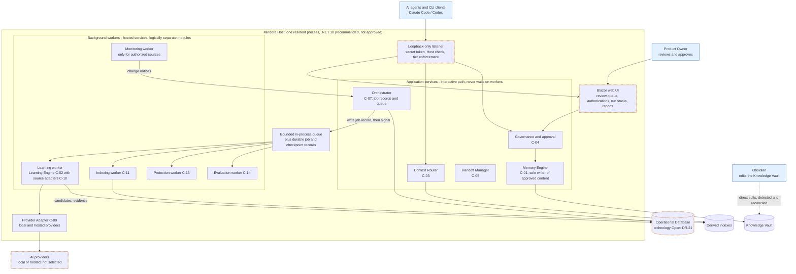

# DR-07 Decision Paper — Runtime and Process Architecture

**Document ID:** MIN-DP-007
**Version:** 0.1 (draft)
**Date:** 2026-11-16 (technical facts verified on this date)
**Status:** **Draft for Product Owner review. Nothing in this paper is approved.** It does not close DR-07 or any ADR, and it changes no controlled document.
**Prepared against:** SDD MIN-SDD-001 v1.4.2; Product Owner Decision Register MIN-PODR-001 v0.3; ADR register MIN-ASM-ADR-001 v0.8; readiness assessment MIN-ASM-RDY-001 v0.9.
**Location:** `docs/03-design/DR-07-DECISION-PAPER.md` (new, separate paper; the SDD, ADR register and Decision Register were not modified).
**Scope guard:** Stage One — Learning. CareerOps, Gmail, job discovery, Google Sheets, cloud deployment and MCP server implementation are outside Stage One and are not dependencies here. DR-21 (database and index technology), DR-04 and DR-27 are not decided or started here.

**Evidence tags used throughout**

| Tag | Meaning |
|---|---|
| **[V]** | Verified technical fact, with the source in §19 and verified on 2026-11-16 |
| **[A]** | Architecture analysis (reasoning, not a verified fact) |
| **[As]** | Assumption, to be confirmed |
| **[R]** | Recommendation (a proposal; not approved) |
| **[O]** | Open question for the Product Owner |

Sub-decision labels D07-A to D07-H are labels used **only in this paper**. They are not decision-register IDs.

---

## 1. Executive summary

DR-07 asks five technology questions that PO-D06 left open. My recommendations, in one line each:

| Sub-decision | Recommendation **[R]** | Confidence |
|---|---|---|
| D07-A .NET version | Target **.NET 10 (LTS)**, `net10.0`. .NET 8 and 9 went out of support on 2026-11-10 **[V]**. .NET 11 is supported until the same date as .NET 10, so it adds nothing for support length and is six days old **[V]** | High |
| D07-B Hosting model | **One resident host process** (ASP.NET Core on the .NET Generic Host) containing the UI, the agent interface and the workers. Start it **per user** (at logon or on demand) first, and keep the host able to run as a **Windows Service** later without redesign | Medium. Depends on question Q2 |
| D07-C UI framework | A **Blazor web UI served by the host and opened in the browser**. Defer any native shell (WPF BlazorWebView). Do not use .NET MAUI | Medium. Depends on Q5 |
| D07-D Background workers | **`BackgroundService` hosted services inside the host**, fed by a **bounded in-process queue**, with **durable job and checkpoint records** as the source of truth | High |
| D07-E Internal communication | **Direct dependency injection and interfaces** for requests; a **bounded in-process queue** for background work; a minimal in-process event dispatcher only where needed. **No broker, no IPC, no microservices** | High |

**Why this is the simplest design that satisfies Mindora.** PO-D06 already fixed the shape (modular monolith, workers in one deployment, no premature microservices). The facts I verified show that a single .NET host can run a web UI, a local interface for agents and long-running workers in one process **[V]**, and that the hosted-service model has two properties that Mindora's design must account for: a default 30-second shutdown window, and no guarantee that stop logic runs if the process dies **[V]**. Mindora's checkpointed, idempotent runs (SDD §6.3) already answer that. So the recommended runtime adds almost no new mechanism.

**What I could not decide responsibly.** Four requirements are missing from the documentation and change the answer: the **target operating systems** (Q1), whether Mindora must **run when no one is logged in** (Q2), **how agents will call Mindora** (Q3, DR-14), and **which screens a Stage One UI must have** (Q5). I give a recommendation with each assumption stated, and I say what changes if the answer differs (§17).

**Not recommended, and why (challenging complexity):** microservices or a message broker; a separate worker process now; a third-party job scheduler; .NET MAUI; a Windows Service as the default; .NET 11 now; gRPC or other IPC. Reasons are in §14.

---

## 2. Exact DR-07 scope

From SDD §18 and the readiness assessment (identical text):

> DR-07 — Runtime and process architecture specifics (ADR-002): .NET version; hosting model; UI framework; background worker technology and implementation details; other runtime-specific choices (database technology is decided with DR-21).

**Already approved by PO-D06 and therefore not open:** local-first modular monolith; .NET / C# as primary language; logically separated background workers in the same deployment; independently testable components; non-blocking background learning; no premature microservices or unnecessary multi-language complexity.

**This paper covers:** D07-A .NET version; D07-B hosting model; D07-C UI framework; D07-D background worker technology and details; D07-E internal communication; and under "other runtime-specific choices": D07-F runtime delivery (framework-dependent or self-contained), D07-G local access protection for the host's interfaces, D07-H module boundaries and testability rules.

**Excluded:** database and index technology (DR-21); watcher and scheduler technology, connectors and monitoring policy (DR-24); provider, model and embedding selection (DR-05, DR-23); promotion of direct user input (DR-27); governance rules (DR-04).

---

## 3. Current approved architectural constraints

| Constraint | Source | How it limits DR-07 |
|---|---|---|
| Hybrid persistence; derived indexes rebuildable; no silent overwrite; Operational Database technology Open | PO-D01 | The runtime must not assume a database. Worker state must live behind an interface until DR-21 |
| Explicit Product Owner approval for authoritative knowledge; AI cannot change policy | PO-D02 | Governance and approval run in the interactive path and must never be bypassed by a worker |
| Provider-independent AI; local and hosted providers behind a Provider Adapter; sensitive data local unless authorized | PO-D03 | The runtime must host the adapter and its authorization checks; a local provider may be heavy on CPU or memory |
| Four acquisition modes; read-only by default; monitoring only when authorized | PO-D04 | A resident process is needed for authorized monitoring; none is needed without it |
| Knowledge graph, ids, provenance, retrieval | PO-D05 | Retrieval must stay responsive while learning runs |
| Local-first modular monolith; .NET / C#; logical workers in one deployment; testable; non-blocking; no premature microservices | PO-D06 | The frame for this whole paper |
| Automatic local backups; encrypted backups; external storage needs authorization | PO-D07 | Something must run backups automatically, including when the interface is closed |
| Continuous evaluation; AI cannot change policy | PO-D08 | An evaluation worker runs in the background and reports to the Product Owner |
| One user, one active vault | SDD §2.4 *[Assumption]* | No multi-user or multi-machine concurrency design is needed |

---

## 4. Existing architecture assessment

What the SDD already fixes and what it leaves open:

| Topic | Already in SDD v1.4.2 | Gap relevant to DR-07 |
|---|---|---|
| Process shape | §3.2a and §12.1: one deployment, an interactive host and five logical worker roles (learning, indexing, protection, evaluation, monitoring); workers never write approved canonical vault content; interactive requests take precedence | No statement of **how long the process lives** (only while a UI is open, at logon, or always) |
| Worker behaviour | §6.3: per-item checkpoints, deterministic item and candidate keys, resume after interruption; run states in §3.8a; scenarios AS-15, AS-32, AS-69 | Resource limits and responsiveness targets are Open (DR-11). No NFR figure exists, so "does not block" cannot yet be measured |
| Orchestrator | C-07 owns run state, queue and priorities | The queue mechanism is Open (stated in §12.1) |
| Interfaces | §11: IF-01 to IF-13; "Transport (library, CLI, local HTTP) is Open (ADR-002)"; §12: "No network listener unless ADR-002 selects a local service, in which case it binds to localhost only" | Transport and authentication for the local interface are not decided; no model for protecting a local listener from other local processes |
| Authorization | §13.2 tiers (read, propose, approve, administer); approve is human-only | How a caller's identity reaches the host is not defined |
| UI | §3.2a shows a UI node marked "framework Open" | **Which screens are needed in Stage One is not defined.** The review queue (PO-D02) is the only UI that is clearly mandatory |
| Platform | None | **No operating system is stated anywhere in the documentation** |
| Packaging and updates | None | No installer, update or runtime-delivery model |
| Observability | §14.1 lists local logs and run reports | No logging or diagnostics approach |

Consistency check: the recommendations below do not contradict any approved decision. They would use the exception that SDD §12 already allows (a local service bound to localhost only), so ADR-002 would be the place to record it.

---

## 5. Runtime and version alternatives (D07-A)

### Verified facts **[V]**
Source V1 (official .NET support policy, page last updated 2026-11-10):

- **.NET 11**: released 2026-11-10, **STS**, latest patch 11.0.0, end of support **2028-11-14**.
- **.NET 10**: released 2025-11-11, **LTS**, latest patch 10.0.15 (2026-11-10), end of support **2028-11-14**.
- **.NET 9 and .NET 8**: **out of support** since **2026-11-10**.
- LTS gets three years of support and STS two years; a new major release ships every November; even-numbered releases are LTS.
- Supported systems must stay on the latest patch to qualify for support.
- Framework-dependent applications on Windows receive .NET updates through Microsoft Update; self-contained applications are responsible for updating their own runtime.

Source V2 (.NET 10 supported-OS list, snapshot last updated 2026-04-06): .NET 10 is supported on specified Windows 10 and 11 versions, Windows Server, macOS 14, 15 and 26, and several Linux distributions. OS versions that are out of support by their publisher are not tested or supported by .NET.

### Alternatives

| Option | How it works | Advantages | Disadvantages |
|---|---|---|---|
| **V1: .NET 10 (LTS)** | Target `net10.0`; SDK 10 builds it; runtime 10.0.x runs it | In support until 2028-11-14 **[V]**; mature patch level (10.0.15) **[V]**; the next LTS (.NET 12) is expected in the November 2027 release under the annual cadence **[V]** (cadence verified; the .NET 12 date is not yet published) | Not the newest runtime and library set |
| **V2: .NET 11 (STS)** | Target `net11.0` | Newest features and performance work **[A]** | Same end-of-support date as .NET 10 **[V]**, so no longer support; released six days ago, with only the 11.0.0 patch **[V]**; library and tool compatibility less proven **[A]** |
| **V3: .NET 8 or .NET 9** | Older targets | Familiar to many libraries **[A]** | **Out of support** **[V]**. Microsoft strongly recommends not using out-of-support software **[V]** |
| .NET Framework 4.8 | Legacy Windows-only runtime | None relevant | Not modern .NET; conflicts with the PO-D06 direction **[A]**. Not considered further |

### Distinguishing target framework, SDK and runtime **[A]**

| Item | What it is | Recommended value |
|---|---|---|
| Target framework | The moniker in the project file that fixes the APIs available | `net10.0` for all libraries. Use a Windows-specific moniker (`net10.0-windows`) only for a project that needs Windows-only APIs. Microsoft's Windows-service example uses `net10.0-windows` **[V]**, but a hosting package does not force the whole solution to be Windows-only **[A, to confirm in a spike]** |
| SDK | The build toolset on developer and build machines | .NET 10 SDK, kept at the latest patch |
| Runtime | What runs the app: .NET runtime and the ASP.NET Core shared framework (needed because the host uses Kestrel) | 10.0.x at the latest patch (10.0.15 on 2026-11-10 **[V]**) |

### Evaluation against Mindora
- **Windows desktop compatibility:** .NET 10 supports current Windows 10 and 11 editions **[V]**. The exact editions that Mindora must support depend on Q1.
- **Local-first and background processing:** both are core capabilities of the Generic Host **[V, §7]**.
- **Library compatibility:** cannot be verified now. No candidate library list exists. Each library for parsing, Git, AI abstraction and the database (DR-21) must be checked for `net10.0` support **[O: Q8]**.
- **Performance and resource use:** no verified comparison between .NET 10 and 11 is available to me. Any claim of a difference would be invented. A benchmark on target hardware is the only responsible basis (§12).
- **Upgrade path:** plan the move to .NET 12 (LTS) after its release and before 2028-11-14 **[R]**.

**[R] D07-A: .NET 10 (LTS), `net10.0`.** Revisit .NET 11 only if a required library or feature needs it.

---

## 6. Hosting model alternatives (D07-B and D07-G)

### Verified facts **[V]**
- The .NET Generic Host runs hosted services in Worker Service apps and in web apps (source V4).
- A worker app can run as a **Windows Service** by adding the `Microsoft.Extensions.Hosting.WindowsServices` package and calling `AddWindowsService`; logging can go to the Windows Event Log; for Windows' recovery options to apply, the process must exit with a non-zero code on failure (source V3).
- Kestrel binds to loopback with `ListenLocalhost` or an `IPAddress.Loopback` listener. If `localhost` is used it tries to bind **both IPv4 and IPv6 loopback**, and **fails to start if the port is in use** on either. With no configuration it binds `http://localhost:5000` (source V7).
- Kestrel can also listen on a Unix socket (`ListenUnixSocket`) (source V7). A named-pipe endpoint exists in Kestrel's configuration API (seen in the .NET source listing; the Microsoft Learn page for it was not retrieved, so treat as partly verified).

### Alternatives

| Option | How it works | Advantages | Disadvantages |
|---|---|---|---|
| **H1: Desktop-launched single process** | The user starts Mindora; one process hosts UI, agent interface and workers; it stops when closed | Simplest; runs as the user, so it can read the user's vault and sources; no installer privileges | Nothing runs when it is closed: no authorized monitoring, no automatic backups, agents get no answer |
| **H2: Windows Service (same single process)** | `AddWindowsService` configuration; starts at boot; UI is a browser to the local listener | Always on; survives logoff; recovery options **[V]** | Needs installation with elevated rights **[A]**; a service account must be given access to the user's vault and user-profile sources, and per-user credential protection may behave differently in a service context **[A, not verified here]**; harder to debug |
| **H3: Per-user background process started at logon, no service** | The same single process, registered to start when the user logs on; optional tray icon | Runs as the user; always on while logged on; no service account issues; easy to move to H2 because the host code is identical **[A]** | Stops at logoff; needs a startup registration mechanism (not researched here) |
| **H4: Two processes (UI shell and background host)** | A background host plus a separate UI process, linked by IPC | Process isolation; the UI can crash independently | More moving parts and an IPC contract; a step toward the distributed design PO-D06 wants to avoid **[A]** |
| **H5: Library and CLI only, no resident host** | Commands run on demand, scheduled externally | Minimal footprint | No live monitoring; the PO-D06 "background learning" and PO-D07 "automatic backups" need an external scheduler; no place for a review UI |

Cloud hosting is not considered. PO-D06 and the Stage One boundary exclude it.

### Local access protection (D07-G) **[A]**
A resident host with a local listener raises a new question: other processes on the same machine can reach a loopback port. Options:

| Option | Notes |
|---|---|
| **Loopback HTTP plus a per-installation secret token** (required on every call, including the UI) | Simple, works for browsers and command-line clients and future agents. Needs Host-header checks and no cross-origin access to reduce browser-based attacks **[A]** |
| Named pipe with an access control list (Windows) | Strong local identity; not usable from a browser; Windows-specific |
| Unix socket | Not relevant on Windows; useful if macOS or Linux are targeted (Q1) |

The existing tier model (read, propose, approve, administer; SDD §13.2) must be enforced at the host boundary, whichever option is used.

**[R] D07-B:** one resident host process. Start it **per user** (H3, with H1 as the on-demand variant) first. Build it so the same host can be installed as a Windows Service (H2) by configuration only. **This hinges on Q2.** If Mindora must run when the user is logged off, choose H2 from the start.
**[R] D07-G:** loopback-only binding plus a per-installation secret token on every request; no external bind, as SDD §12 already requires.

---

## 7. UI framework alternatives (D07-C)

### What Stage One actually needs **[A]**
Obsidian is the human editor for vault content. The UI that Mindora itself must provide is small but mandatory: the **review queue** (approve, reject, defer, clarify, supersede), **authorizations** (sources, monitoring, external processing, external backup), **run status**, and **evaluation reports**. A richer UI is not a Stage One requirement unless the Product Owner says so (Q5). Reviewing candidates and differences in a terminal would be poor, and putting review decisions into Markdown would blur the authority split between the vault and the Operational Database.

### Verified facts **[V]**
- **Blazor Hybrid:** Razor components run natively and render into an embedded web view. Support is built into .NET MAUI through `BlazorWebView`; Blazor also provides `BlazorWebView` controls for **WPF** and **Windows Forms** (source V6).
- **.NET MAUI** supports Android, iOS, macOS (via Mac Catalyst) and Windows (WinUI 3); Tizen is provided by Samsung. **Linux is not an officially supported MAUI target** (source V5). A WPF-based Windows backend, a macOS AppKit backend and Linux/GTK drivers exist only in the **experimental** `maui-labs` repository, which says those packages are **not covered by the MAUI support policy** (source V5).
- Avalonia, a **third-party** framework, targets Windows, macOS and Linux (source V8).

### Alternatives

| Option | How it works | Advantages | Disadvantages |
|---|---|---|---|
| **U1: Blazor web UI served by the host, opened in the browser** | The host serves Razor components; the user opens a local address | One technology (C# and Razor); no native toolkit; works wherever a browser and .NET run (OS-neutral); the UI is decoupled from the host lifecycle; easy to extend | Needs the host to be running; no native tray, notifications or file dialogs without extra work **[A]**; the local listener needs protection (§6) |
| **U2: Blazor Hybrid in a WPF shell** | A WPF window embeds `BlazorWebView` **[V]** and shares the same Razor components | Native window, tray and dialogs; the same Razor UI as U1 **[A]** | Windows-only; extra project and a web-view runtime dependency (not researched here); native shell adds nothing to Stage One's needs |
| **U3: .NET MAUI Blazor Hybrid** | MAUI app with `BlazorWebView` | One codebase for Windows and macOS (and mobile) **[V]** | Mobile is out of scope; no official Linux **[V]**; heavy toolchain for a desktop-only need **[A]** |
| **U4: Native XAML (WPF or WinUI) without web UI** | Rich native controls | Best native feel **[A]** | A second UI technology and skill set; Windows-only; no reuse by a future browser client |
| **U5: Command-line or text UI only, plus Obsidian** | No graphical UI | Smallest | Fails the review-diff and authorization workflows **[A]** |
| **U6: Other (Avalonia, third-party)** | Cross-platform native UI **[V]** | True cross-platform desktop including Linux | Adds a non-Microsoft dependency and learning cost for a need not yet stated |

Not considered: Electron, Tauri or other web-shell stacks, because they add JavaScript or Rust to the toolchain, contrary to the PO-D06 direction on multi-language complexity.

**[R] D07-C:** **U1**. It is the least new technology: the host already exists and already speaks HTTP to the same loopback address agents would use. A native shell (U2) can be added later **without changing any application service**, because the UI only calls the same interfaces. I do not recommend MAUI: its extra platforms are outside Stage One and Linux is not supported **[V]**. This is **not** a recommendation to use Blazor because it is part of .NET; it is a recommendation to avoid a second UI stack. If the Product Owner needs native desktop behaviour in Stage One (Q5), choose U2.

---

## 8. Background worker alternatives (D07-D)

### Verified facts **[V]** (source V4)
- A **hosted service** implements `IHostedService`; `BackgroundService` is a base class for long-running work through `ExecuteAsync`.
- Hosted services start **sequentially**; `StartAsync` must be short, and no further service starts until it finishes. `ExecuteAsync` must not hold the start-up path with long blocking work.
- On shutdown the host waits for `ExecuteAsync` to complete; the cancellation token has a **default 30-second** shutdown timeout, configurable (`ShutdownTimeout`). An implementation that does not finish promptly is shut down ungracefully.
- **If the process fails unexpectedly, `StopAsync` might not be called.** Shutdown logic cannot be relied on.
- A hosted service is a **singleton**, so scoped services need an explicitly created scope.
- Microsoft documents a **queued background task** pattern: a bounded queue feeds a hosted service; if the queue is full, the producer waits for space.
- Microsoft's Windows-service tutorial notes that unhandled exceptions are governed by a configurable behaviour (Ignore or StopHost) and recommends exiting with a non-zero code for service recovery (source V3). **The default behaviour was not verified in this session.**

### Alternatives

| Option | How it works | Advantages | Disadvantages |
|---|---|---|---|
| **W1: `BackgroundService` inside the host, bounded in-process queue, durable job and checkpoint records** | Each worker role is a hosted service; the orchestrator writes a job record, then signals the queue; workers dequeue, process item by item, checkpoint, and resume from records after a restart | Built into the platform **[V]**; no extra dependency; matches SDD §6.3 and C-07; workers stay logically independent behind interfaces; same deployment | Shares the process: a runaway worker can use memory or CPU, and a hard crash stops all workers (mitigated in §13) |
| **W2: Separate worker process (second executable, same package)** | A second host runs the workers; the interactive host talks to it through the database or IPC | OS-level isolation of memory, priority and crashes **[A]** | More processes, IPC and lifecycle management; a step toward what PO-D06 says to avoid until needed **[A]** |
| **W3: Third-party job scheduler library** | A library provides persistent jobs, retries and schedules | Rich scheduling features **[A, not verified here]** | Adds a dependency that usually needs its own storage, which would pre-empt DR-21 **[A]**; scheduling technology is DR-24, not DR-07 |
| **W4: Operating-system scheduler launches command-line runs** | Windows Task Scheduler starts jobs | No resident worker code | No live monitoring; fragmented state; hard to share the interactive priority rule **[A]** |
| **W5: Durable workflow or distributed job frameworks** | External orchestration services | Strong durability **[A]** | Far beyond a single-user local app **[A]** |

### How workers stay logically independent while sharing one deployment **[A]**
1. Each worker role (learning, indexing, protection, evaluation, monitoring) lives in its **own module** and is reachable only through a small interface (start, stop, enqueue, status). No module references another module's internals.
2. Workers **communicate only through the job queue, the Operational Database and public interfaces**, never by direct calls into each other.
3. Work is **item-sized with a checkpoint after each item**, so stopping within the shutdown window loses at most one item, and a crash loses at most one item too (consistent with SDD §6.3 and the verified fact that stop logic may not run).
4. Every worker has a **supervisor loop**: an unhandled failure in one worker is caught, recorded and restarted with back-off, and does not stop the interactive host. This is needed because the default failure behaviour was not verified **[V gap]**.
5. Because of 1 and 2, moving a worker into its own process later (W2) changes **hosting only**, not code structure.

### Responsiveness rules **[A]**
- Interactive requests never wait on a worker queue.
- Long operations take a cancellation token and check it often.
- Each worker has a configurable concurrency limit; CPU-bound steps (for example parsing) are limited separately so they cannot starve interactive work. **The limits are numbers that need measurement and the Product Owner's target (DR-11); none is proposed here.**

**[R] D07-D: W1.** Revisit W2 only if measurement shows that a worker harms interactive responsiveness or stability and in-process limits cannot fix it. Scheduling and watcher technology are decided under DR-24, but W1 can host timers and watchers as hosted services, so DR-24 will not force a change.

---

## 9. Internal component communication alternatives (D07-E)

| Option | How it works | Advantages | Disadvantages |
|---|---|---|---|
| **C1: Direct dependency injection and interfaces** | A component calls another through an interface in the same process | Simplest; easy to test with stand-ins (PO-D06); synchronous results | Tight call chains if overused; cross-module calls need discipline |
| **C2: Bounded in-process queue plus durable job records** | Producer writes a job record, signals a bounded queue; worker consumes | Decouples interactive from background work; back-pressure when full **[V]**; recoverable after a crash because the record is durable | Two places hold work state (queue and record), so the record must win after a restart |
| **C3: Minimal in-process event dispatch** | A small typed publish-and-subscribe interface inside the process | Loose coupling for notifications (for example "candidate created", "record approved, refresh index") | Hidden control flow if overused; a third-party mediator library is not needed **[A]** |
| **C4: External broker (message queue or streaming service)** | Separate messaging infrastructure | Strong decoupling and durability | Distributed-systems infrastructure for a single-user local app; contradicts PO-D06 **[A]** |
| **C5: Inter-process communication** (named pipes, gRPC) | Calls between processes | Needed only with H4 or W2 | Unnecessary while the monolith is one process **[A]** |

**[R] D07-E:** **C1** for requests and queries; **C2** for background dispatch; **C3** only for a few notifications (index refresh after approval, UI progress). No C4 or C5.

---

## 10. Comparative decision matrix

Ratings are **qualitative** (Good, Fair, Poor) and are architecture analysis **[A]**, not benchmarks. "Needs fit" means support for Mindora's actual needs: persistent learning, multi-source acquisition, background processing, human approval, retrieval, session continuity for agents, local-first privacy and model-independent AI.

### Hosting

| Option | PO-D06 fit | Simplicity | Resource use | Maintainability | Security | Needs fit | Migration risk |
|---|---|---|---|---|---|---|---|
| H1 on-demand process | Good | Good | Good | Good | Fair | **Poor** (no monitoring or backups when closed) | Low |
| H2 Windows Service | Good | Fair | Fair | Fair | Fair | Good (always on) | Low |
| **H3 per-user logon process** | Good | Good | Good | Good | **Good** (runs as the user) | Good while logged on | Low |
| H4 two processes | Fair | Poor | Fair | Fair | Good | Good | Medium |
| H5 CLI only | Fair | Good | Good | Good | Good | **Poor** | Low |

### UI

| Option | PO-D06 fit | Simplicity | Maintainability | Native desktop | Browser and accessibility | Needs fit | Risk |
|---|---|---|---|---|---|---|---|
| **U1 Blazor web in browser** | Good | **Good** | Good | Fair | Good | Good | Low |
| U2 Blazor in WPF | Good | Fair | Fair | Good | Fair | Good | Low |
| U3 MAUI Blazor Hybrid | Fair | Poor | Fair | Fair | Fair | Fair | Medium (no official Linux **[V]**) |
| U4 native XAML | Fair | Fair | Fair | Good | Poor | Fair | Medium |
| U5 CLI and Obsidian only | Good | Good | Good | Poor | Poor | **Poor** (review workflow) | Low |
| U6 Avalonia | Fair | Fair | Fair | Good | Fair | Fair | Medium (third party) |

### Workers and communication

| Option | PO-D06 fit | Complexity | Resource use | Recoverability | Dependencies added | Needs fit |
|---|---|---|---|---|---|---|
| **W1 hosted services + queue + durable records** | **Good** | Low | Shared process | Good (checkpoints) | None | Good |
| W2 separate worker process | Fair | Medium | Isolated | Good | None | Good |
| W3 scheduler library | Fair | Medium | Shared | Good | One library plus its store | Fair |
| W4 OS scheduler | Poor | Low | Low | Poor | None | Poor |
| W5 workflow framework | Poor | High | High | Good | Infrastructure | Fair |
| **C1 + C2 (+ minimal C3)** | **Good** | Low | Low | Good | None | Good |
| C4 broker | Poor | High | High | Good | Infrastructure | Fair |
| C5 IPC | Fair | Medium | Low | Fair | Protocol | Poor now |

### Objective support check

| Mindora objective | Supported by the recommended set (.NET 10, one resident host, Blazor web UI, hosted-service workers, C1 + C2) |
|---|---|
| Persistent learning, knowledge extraction, entity and relationship intelligence, provenance | Yes. Learning runs are durable, checkpointed and resumable; nothing in the runtime limits the model |
| Multi-source acquisition | Yes. Adapters run as modules under the learning worker; authorized monitoring needs a resident host (H3 or H2) |
| Human approval workflows | Yes. Approval stays in the interactive path (UI through the host); workers cannot approve |
| Background knowledge processing | Yes, with the stated limits. Measurement is needed (§12) |
| Context retrieval and session continuity | Yes **while the host is running**. This is why Q2 and Q3 matter |
| Local-first privacy | Yes. Loopback-only listener, no cloud dependency; provider calls governed by PO-D03 |
| Model-independent AI | Yes. The Provider Adapter is a module behind an interface; a local provider may run in or out of process (DR-23) |
| Extension without premature complexity | Yes. Worker extraction (W2), a native shell (U2), a service install (H2) and a later MCP adapter are all additions at the edges |

---

## 11. Security and privacy assessment

| Topic | Assessment | Tag |
|---|---|---|
| Local listener | A resident host exposes a port. Loopback binding keeps it off the network **[V]** but not away from other local processes or from a web page in the user's browser | A |
| Access protection | Per-installation secret token on every call; Host-header validation; no cross-origin access; tier checks at the host boundary (SDD §13.2). Agents get the **read** and **propose** tiers only; approval is possible only through the human UI session | R |
| Windows Service (H2) | Running as a service raises the privilege and account questions: which account, what access to the vault and sources, how user-level secrets are reached. Recommend a least-privilege dedicated or the user's own account; verify credential-store behaviour in a spike | A (not verified) |
| Per-user process (H3) | Runs with the user's own rights and credential store; the simplest least-privilege fit | A |
| Secrets | Held in the OS credential store or environment variables (SDD §12), never in the vault, Git or logs | SDD |
| Logging | Windows Event Log is available when running as a service **[V]**. Logs must be redacted so no secret or sensitive content is logged | V, A |
| Dependencies and updates | A framework-dependent app receives .NET patches through Microsoft Update on Windows; a self-contained app must be updated by Mindora **[V]**. Systems must stay on the latest patch to qualify for support **[V]** | V |
| Browser UI risk | A local web UI can be targeted by malicious web pages if the listener accepts unauthenticated requests. Token plus Host validation addresses it | A |
| Data classification | Unchanged: PO-D03 gate and PO-D07 rules apply in any hosting model | PO |

Privacy position: no hosting option sends data off the machine by itself. Only the Provider Adapter, under PO-D03 authorization, and authorized external backup do.

---

## 12. Performance and resource considerations

**No performance figure is claimed in this paper.** I did not run or find a benchmark relevant to Mindora, so none is stated.

What matters and what would have to be measured on target hardware **[A]**:

| Question | Why it matters | How to measure (planning only) |
|---|---|---|
| Interactive latency (review queue, retrieval) while a learning run is active | PO-D06 "must not block"; the SDD has no numeric target (DR-11) | A fixture run with a representative corpus while issuing scripted interactive requests |
| Memory of the resident host when idle and during a large repository scan | A resident process stays in memory | Observe working set across the fixture scenarios |
| Start-up time of the host and time to first interaction | Affects the on-demand variant (H1) | Time from launch to first successful call |
| Throughput of the parsing and extraction stages | Sets sensible concurrency limits | Per-stage item rate at different concurrency settings |
| Effect of a local AI provider in or out of process | A local model can dominate CPU, memory or GPU | Measure with and without the model on the same hardware (DR-23) |
| Shutdown and recovery behaviour | The 30-second window and the possibility that stop logic does not run **[V]** | Interrupt runs at random points and check resume correctness (SDD scenario AS-32) |
| .NET 10 versus .NET 11 differences | None verified | Only if .NET 11 is seriously considered |

**Prerequisite:** the Product Owner's targets (DR-11) for responsiveness, memory and acceptable footprint. Without them, "not blocked" can be observed but not accepted.

---

## 13. Technical risks and mitigations

| Risk | Impact | Mitigation | Residual |
|---|---|---|---|
| A runaway worker consumes CPU or memory in the shared process | Interactive slowdown | Per-worker concurrency limits; cooperative cancellation; measure; keep W2 as a planned escape hatch | Needs DR-11 targets |
| Hard crash or power loss stops all workers | Lost in-flight item; delayed learning | Per-item checkpoints and idempotent keys (SDD §6.3); durable job records; stop logic is not relied on **[V]** | At most one item re-done |
| Unhandled exception in a hosted service stops the host | Interactive host goes down | Supervisor loop per worker; verify the default failure behaviour in a spike **[V gap]** | Low after verification |
| Local listener abused by another local process or web page | Unauthorized read or propose | Loopback only; secret token; Host validation; tier checks | Low |
| Resident process not running when needed | Agents get no context; no monitoring or backups | Choose H3 (logon start) or H2 (service) per Q2 | Depends on Q2 |
| Service account cannot reach the vault or user-profile sources | Learning and backups fail | Prefer H3 first; if H2, test access and credential store in a spike | Medium if H2 |
| .NET end-of-support schedule | Forced migration | .NET 10 to 2028-11-14 **[V]**; plan .NET 12 move; stay on latest patch **[V]** | Low |
| Library not available for `net10.0` | Blocks a feature | List candidate libraries and check support before ADR approval (Q8) | Unknown |
| Interactive UI under-specified | Rework | Resolve Q5 before choosing U1 or U2 | Medium |
| Over-building (service, IPC, scheduler, broker) | Delay; complexity | Recommend none now (§14); each has an explicit trigger for revisiting | Low |

---

## 14. Recommended architecture

### Summary **[R]**
**One resident Mindora Host on .NET 10**, built on the Generic Host and ASP.NET Core. The host contains: a **Blazor web UI**; a **loopback-only, token-protected interface** for the UI and for agents and command-line clients; the **application services** (governance, context, memory, handoff, orchestrator); the **Learning Engine** with the source adapters; the **Provider Adapter**; and **background workers as hosted services** fed by a **bounded in-process queue** with **durable job records**. Start it **per user** first; keep it installable as a **Windows Service**.

### Conceptual component diagram
Conceptual only. **No component shown here has been implemented**, and every technology label is a recommendation, not an approval. Orange dotted outlines mark choices that depend on unresolved decisions.

### What I recommend against, and why (challenging complexity)

| Not recommended | Reason | When to reconsider |
|---|---|---|
| Microservices, message broker, IPC | PO-D06; single user, single machine; adds failure modes without a need | Never for Stage One |
| A separate worker process now | In-process limits and checkpoints satisfy the stated need; extraction later is mechanical (§8) | Measured harm to responsiveness or stability that limits cannot fix |
| A third-party job scheduler | New dependency that usually brings its own store, pre-empting DR-21; scheduling is DR-24 | Scheduling needs outgrow timers in hosted services |
| .NET MAUI | Extra platforms are out of Stage One; no official Linux **[V]** | A mobile or multi-platform client becomes a requirement |
| Windows Service as the default | Account, permission and credential-store complexity; only needed if Mindora must run while logged off (Q2) | Q2 answered "yes" |
| .NET 11 now | Same support end as .NET 10 **[V]**; six days old **[V]** | A required feature or library needs it |
| gRPC or other IPC | No second process to talk to | A second process appears |

---

## 15. Consequences and trade-offs

If the recommendations are approved:

**Gains:** one technology and one process to build, test, debug and patch; a verified support horizon to 2028-11-14 **[V]**; a clear path to a service install, a native shell or a separate worker process without redesign; no new infrastructure; testability through interfaces and stand-ins.

**Costs and constraints:**
- Mindora works only while the host runs. Learning from monitoring, automatic backups and agent retrieval depend on that (Q2, Q3).
- A browser-based UI needs the local listener to be protected and has fewer native desktop features than a native shell.
- All workers share one process's memory and fate; the mitigations rely on per-item checkpoints and on measured limits that the Product Owner has not yet set.
- Choosing .NET 10 means a planned upgrade by late 2028.
- Choosing a Windows-first deployment (if confirmed) lowers cost now, but the core libraries should stay OS-neutral so macOS or Linux remain possible **[R]**.

**Reversibility:** every recommendation is reversible at modest cost because the application services sit behind interfaces: native shell (UI), service install (hosting), worker process (workers), a new `net12.0` target (runtime).

---

## 16. Proposed ADR and documentation updates (not applied)

I did **not** modify the SDD, the ADR register or any other controlled document. If the Product Owner approves, these updates would follow, each requiring its own approval:

| Document | Proposed update |
|---|---|
| ADR-002 | Record the approved sub-decisions D07-A to D07-H. ADR-002 stays open until the Product Owner approves it; its closure is the Product Owner's decision |
| ADR-009 | Record the local access protection model (D07-G) and the human-only approval path through the UI |
| ADR-010 | Record the hosting model and the start-up behaviour (D07-B), and the runtime-delivery choice (D07-F) |
| SDD §12.1, §3.2a, §11, C-07 | Replace "Open" runtime items with the approved choices; record the listener and transport (SDD §11 "Transport Open"); add module-boundary and testability rules (D07-H) |
| Readiness assessment and DR table | Update DR-07 status only as the Product Owner decides |
| Correction log | Record the update |

---

## 17. Questions requiring Product Owner confirmation

These are the unresolved requirements that prevent a fully responsible recommendation. I have stated an assumption for each so the paper is usable, and I say what changes.

| # | Question | Assumption used | If the answer differs |
|---|---|---|---|
| **Q1** | Which operating systems must Stage One support? **No document states one.** | Windows 10 and 11 are the primary target; core libraries stay OS-neutral | If macOS or Linux are required: avoid Windows-only choices; U1 gains weight; U2 and H2 become Windows-only options; MAUI still lacks Linux **[V]** |
| **Q2** | Must background learning, authorized monitoring and automatic backups run when **no one is logged in** or the UI is closed? | Only while the user is logged on | If yes: choose H2 (Windows Service) from the start and plan the account and permission work |
| **Q3** | How will agents call Mindora in Stage One: command line, local HTTP, or file-based? (Related to DR-14; MCP is future-stage.) | Local HTTP and a command-line client on the same listener | If file-based only: no listener is needed for agents; the host still needs one for the UI |
| **Q4** | Is one machine and one user the only Stage One case? (SDD §2.4 assumes yes.) | Yes | Multi-device changes hosting, synchronization and security |
| **Q5** | Which screens must the Stage One UI provide? My minimum: review queue, authorizations, run status, reports. Is a native desktop feel (tray, notifications, file dialogs) required? | A browser UI is acceptable | If native behaviour is required: choose U2 |
| **Q6** | Will a local AI model run inside the Mindora process or as a separate local service? (Related to DR-23.) | Not decided | An in-process heavy model raises the case for W2 |
| **Q7** | What are the acceptable limits for interactive latency, memory and background CPU use? (DR-11 has none.) | None. No number assumed | Without targets, the "not blocked" rule cannot be accepted, only observed |
| **Q8** | Are there required libraries (document parsers, Git access, database, AI abstraction) whose `net10.0` support must be checked first? | Unknown | A library that lacks support could change D07-A |
| **Q9** | Who installs and updates Mindora: only the Product Owner, or others? | Only the Product Owner | If others: self-contained delivery and an update path need design |
| **Q10** | Any accessibility requirements for the UI? | None stated | Would favour the browser's accessibility support (U1) or constrain U2 |

---

## 18. Implementation implications (planning only)

Nothing here authorizes work. These are the consequences to plan for **if** the Product Owner approves the decisions and separately authorizes the next stage.

1. **Before any build:** resolve Q1 to Q10; approve the sub-decisions; update ADR-002, ADR-009, ADR-010 and the SDD (§16).
2. **Pre-implementation checks to authorize separately** (small, throwaway, no product code): confirm the default behaviour of a failing hosted service; confirm credential-store behaviour under a service account if H2 is possible; check candidate library support for `net10.0`; run the §12 measurements on target hardware.
3. **Structural rules to adopt in the design:** one solution with a host project and one module per component group; interfaces and shared contracts separate from implementations; no module reads another module's data except through its interface; tests per module using stand-ins; automated dependency-rule tests. These implement PO-D06 "independently testable components".
4. **Dependencies on other decisions:** the job and checkpoint store waits for DR-21; scheduling and watchers for DR-24; the provider process model for DR-23; thresholds for DR-11.
5. **Order of dependency:** D07-A (.NET 10) and D07-B (hosting) first, because DR-21's choices (for example an embedded versus server database) and the backup design depend on whether the host is always on and under which account.

---

## 19. Evidence log

All sources were read on **2026-11-16**. "Official" means published by Microsoft or the .NET project.

| ID | Source | What it established | Status |
|---|---|---|---|
| V1 | .NET and .NET Core official support policy, https://dotnet.microsoft.com/en-us/platform/support/policy/dotnet-core (page last updated 2026-11-10) | Support dates and release types for .NET 8 to 11; LTS three years, STS two years; annual November cadence; latest patch levels; automatic patching of framework-dependent apps on Windows | Official; verified |
| V2 | .NET 10 supported OS versions, https://github.com/dotnet/core/blob/main/release-notes/10.0/supported-os.md (snapshot last updated 2026-04-06) | Windows, macOS and Linux versions supported by .NET 10 | Official (.NET repository); verified; the current table should be rechecked at decision time |
| V3 | Create a Windows Service using BackgroundService, https://learn.microsoft.com/dotnet/core/extensions/windows-service | `AddWindowsService`; the hosting package; Event Log logging; exit-code behaviour for service recovery; configurable unhandled-exception behaviour | Official; verified |
| V4 | Background tasks with hosted services in ASP.NET Core, https://learn.microsoft.com/aspnet/core/fundamentals/host/hosted-services | Hosted service and `BackgroundService` mechanics; sequential start; 30-second default shutdown timeout; `StopAsync` may not run on failure; singleton lifetime; bounded queued background tasks | Official; verified |
| V5 | .NET MAUI supported platforms, https://learn.microsoft.com/dotnet/maui/supported-platforms; and the experimental `dotnet/maui-labs` repository, https://github.com/dotnet/maui-labs | MAUI targets Android, iOS, macOS (Mac Catalyst), Windows (WinUI 3) and Tizen; experimental WPF, AppKit and Linux/GTK backends are not covered by the MAUI support policy | Official; verified |
| V6 | ASP.NET Core Blazor Hybrid, https://learn.microsoft.com/aspnet/core/blazor/hybrid | Blazor Hybrid via MAUI `BlazorWebView`; `BlazorWebView` for WPF and Windows Forms; components run natively and render into a web view | Official; verified |
| V7 | Configure endpoints for the ASP.NET Core Kestrel web server, https://learn.microsoft.com/aspnet/core/fundamentals/servers/kestrel/endpoints; and the Kestrel configuration loader source, https://source.dot.net/Microsoft.AspNetCore.Server.Kestrel.Core/KestrelConfigurationLoader.cs.html | Loopback binding; `localhost` binds IPv4 and IPv6 and fails if the port is in use; default `http://localhost:5000`; Unix socket support; a named-pipe endpoint exists | Official; verified. Named pipes: seen in source only |
| V8 | Avalonia supported platforms, https://docs.avaloniaui.net/docs/supported-platforms | Third-party UI framework targeting Windows, macOS and Linux | Third party; verified |

**Not verified in this session** (stated as analysis or left open): Blazor render-mode details; the `System.Threading.Channels` and `PeriodicTimer` documentation; the default behaviour of a failing hosted service; WebView2 runtime requirements; Windows Service account and credential-store behaviour; third-party scheduler features; library compatibility for any Mindora dependency; any performance or resource figure.

---

## 20. Product Owner decision table

**Status for every row: Recommendation only. Nothing is approved. DR-07 and ADR-002 stay open.** "Approval required" is yes for every row.

| Ref | Decision question | Recommended option | Alternatives | Technical justification | Consequences | Approval required | Current status |
|---|---|---|---|---|---|---|---|
| D07-A | Which .NET target? | .NET 10 LTS, `net10.0` | .NET 11 STS; .NET 8 or 9 | In support to 2028-11-14 and mature **[V]**; .NET 11 has the same end date and is new **[V]**; .NET 8 and 9 are out of support **[V]** | Upgrade to .NET 12 before 2028-11-14; library support must be checked (Q8) | Yes | Recommendation, not approved |
| D07-B | How is the host run? | One resident process, per user first (H3), installable as a Windows Service later (H2) | H1 on demand; H2 service now; H4 two processes; H5 CLI only | Always available while logged on, runs as the user, simplest; same host can become a service **[A]** | No operation while logged off unless H2 (Q2); needs a startup registration | Yes | Recommendation, depends on Q2 |
| D07-C | Which UI framework? | Blazor web UI in the browser (U1) | U2 WPF shell; U3 MAUI; U4 native XAML; U5 CLI only; U6 Avalonia | One technology and one process; the shell can be added later **[A]**; MAUI has no official Linux **[V]** | Needs the host running; less native behaviour; listener must be protected | Yes | Recommendation, depends on Q5 |
| D07-D | How do background workers run? | `BackgroundService` hosted services, bounded in-process queue, durable job and checkpoint records (W1) | W2 separate process; W3 scheduler library; W4 OS scheduler; W5 workflow framework | Built into the platform **[V]**; matches checkpointed design (SDD §6.3); logically independent modules | Shared process fate; supervisor loops and measured limits needed; store waits for DR-21 | Yes | Recommendation, not approved |
| D07-E | How do components communicate? | Direct DI and interfaces; bounded queue for background work; minimal event dispatch | Broker; IPC | Simplest that meets the need **[A]** | Discipline at module boundaries | Yes | Recommendation, not approved |
| D07-F | How is the runtime delivered? | Framework-dependent (runtime installed and patched through Microsoft Update on Windows) | Self-contained | Framework-dependent apps receive patches through Microsoft Update; self-contained apps own their runtime updates **[V]** | Requires the runtime on the machine; revisit if others install it (Q9) | Yes | Recommendation, not approved |
| D07-G | How is local access protected? | Loopback-only listener, per-installation secret token, Host check, tier enforcement | Named pipe with ACL; Unix socket | Keeps the listener off the network **[V]** and off unauthenticated local callers **[A]** | Token handling to design; agent clients must present it | Yes | Recommendation, not approved |
| D07-H | What module and testing rules apply? | One host plus one module per component group; interfaces and contracts separate; no cross-module data access; stand-ins; dependency-rule tests | None considered | Implements PO-D06 independently testable components **[A]** | Slightly more structure up front | Yes | Recommendation, not approved |
| Q1 to Q10 | See §17 | n/a | n/a | n/a | n/a | Yes | Open Product Owner questions |

**Not marked approved:** none of the above. **Not closed:** DR-07, ADR-002, and every other DR and ADR.

---

*End of MIN-DP-007 v0.1 (draft). This paper prepares a decision. The decision belongs to the Product Owner. No code, scaffolding, configuration, schema or package was created, and nothing is implemented.*
