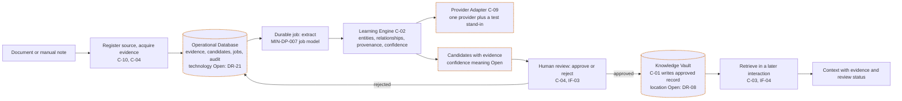

# Development Transition Assessment — Stage One (Learning)

**ID:** MIN-ASM-DTA-001 | **Version:** 0.1 (draft) | **Date:** 2026-11-16
**Status:** **Planning assessment for Product Owner and independent review. It is not authorization to implement, and it approves nothing.** Every item called "recommended", "proposed" or "candidate" is unapproved until the Product Owner approves it explicitly.
**Assesses:** MIN-SDD-001 v1.4.2; MIN-PODR-001 v0.3; MIN-ASM-ADR-001 v0.8; MIN-ASM-CR-001 v0.7; MIN-ASM-RTM-001 v0.9; MIN-ASM-RDY-001 v0.9; MIN-DP-007 v0.3. SRS v2.0 (MIN-SRS-001) is unchanged and is cited, not modified.
**Boundary:** documentation only. No code, scaffolding, configuration, schema or package exists or was created. No database or provider technology is selected here. CareerOps is not a Stage One dependency.

**Evidence vocabulary used here**

| Term | Meaning |
|---|---|
| **PO-confirmed** | A decision or direction the Product Owner stated (PO-D01 to PO-D08, the Stage One scope, the six source categories). Recorded in MIN-PODR-001 |
| **Proposed** | A design or recommendation in a document that the Product Owner has not approved |
| **Open** | A decision not yet made |
| **Assumption** | Something this assessment relies on and has not confirmed |
| **Implemented and verified** | **Nothing.** No software exists |

---

## 1. Purpose and the question answered

The documentation cycle has produced a large design (SDD v1.4.2), eight confirmed directions, 27 decision requests and 25 ADRs, all still open. This assessment answers a narrower question than the global readiness verdict: **what is already defined well enough to begin, what genuinely blocks a first build, and what can wait until its capability is built.** The aim is a controlled starting point without continuing the documentation cycle for its own sake.

**Relationship to the readiness assessment.** MIN-ASM-RDY-001 v0.9 records the verdict **NOT READY FOR IMPLEMENTATION** for the whole of Stage One, and that verdict stands as recorded. This assessment adds a **milestone-scoped view** and does not amend it. Whether the Product Owner replaces the global verdict with milestone gates is the Product Owner's decision (§9, item 6).

---

## 2. What is already sufficiently defined

"Sufficiently defined" means a developer could build to it without asking a further design question. Status is the document's, not an approval.

| Area | Where defined | Status | Assessment |
|---|---|---|---|
| Scope: Stage One is Learning; CareerOps and cloud are future-stage | PODR; SDD §1 | **PO-confirmed** | Clear |
| Six source categories and the connected-knowledge purpose | PODR; SDD §1, §4 | **PO-confirmed** | Clear |
| Directions PO-D01 to PO-D08 | PODR §4 | **PO-confirmed** | Clear. Directions only; they select no technology |
| Learning pipeline: observation, evidence, assertion, candidate; assertion kinds and promotion rules | SDD §5, §6 | Proposed | Detailed enough to implement a subset |
| Runs, checkpoints, idempotency keys, recovery | SDD §3.8a, §6.3 | Proposed | Detailed |
| Evidence identity, move resolution, retention, deletion | SDD §7.2 to §7.10 | Proposed | Detailed; parameters open |
| Vault write model (C-01 sole application-controlled writer; direct human edits detected and reconciled) | SDD §7.11, §7.13, S1 to S8 | Proposed, aligned to PO-D01 | Clear |
| Relationship and entity state vocabulary; epistemic classes; user confirmation separate from verification | SDD §5.3, §10 | Proposed | Clear |
| Governance tiers, review actions, human-only approval | SDD §13.2, IF-03, IF-13 | Proposed, aligned to PO-D02 | Clear for approve and reject; defer, clarify, supersede are specified |
| Component responsibilities C-01 to C-14 and interfaces IF-01 to IF-13 | SDD §9 and §11 | Proposed | Specified; transport open |
| Acceptance scenarios AS-01 to AS-72 | SDD §15 | Proposed | A usable basis for acceptance tests; they state expected outcomes, mostly without numeric thresholds |
| Runtime and process shape | SDD §12.1; MIN-DP-007 v0.3 | **Direction PO-confirmed (PO-D06)**; specifics proposed | Specifics need approval of the DR-07 gate set (§6) |
| Engineering quality gates and workflow discipline | Package `QUALITY-GATES.md`, `AI-ASSISTED-SDLC.md` (v0.1, supporting) | Draft | Usable as process input; see discrepancy DISC-02 |

---

## 3. Candidate first milestone: Knowledge Acquisition and Persistence

**Candidate only. Not approved.** The proposed vertical slice: import a document or submit information manually; acquire and preserve source evidence; use an AI provider to extract candidate knowledge; identify entities and relationships; preserve provenance and confidence; present candidates for human review; allow approval or rejection; persist approved knowledge in the Knowledge Vault; retrieve that knowledge in a later interaction.

### 3.1 Step-by-step mapping

| # | Step | SDD elements | Source category | Scenarios (basis for acceptance) | Decisions needed (see §4) |
|---|---|---|---|---|---|
| 1 | Import a document, or submit information manually | SA-1 document adapter (C-10); SA-6 manual input; IF-01, IF-02, IF-09; Source Registry (C-04) | 1 documents and files; 6 new information (manual) | AS-01, AS-09, AS-10, AS-23 (partly) | Source formats for the slice (ADR-020 subset). **If manual submission is included: DR-27** |
| 2 | Acquire and preserve source evidence | Evidence store in the Operational Database; evidence identity and fingerprints (§7.2 to §7.3); secret scan | 1, 6 | AS-09, AS-17, AS-21 | DR-21 (database) |
| 3 | AI provider extracts candidate knowledge | Learning Engine (C-02); Provider Adapter (C-09); IF-06; output schema with an evidence span for every claim; IF-13 authorization if the provider is hosted | 1, 6 | AS-16 | First provider and model (DR-05, DR-23 subset); extraction approach (ADR-019 subset); PO-D03 handling of sensitive data |
| 4 | Identify entities and relationships | Resolution ladder; relationships as candidates (ADR-021; PO-D05) | 1, 6 | AS-03 (partly), AS-11 | Entity-type and relationship-type **subset** (ADR-006) |
| 5 | Preserve provenance and confidence | Provenance fields; `confidence` field | 1, 6 | AS-04 | **The meaning of `confidence` is Open (ADR-019)**: needs a minimal definition for the slice |
| 6 | Present candidates for human review | Governance (C-04); IF-03; review screen | 1, 6 | AS-02, AS-19 (partly) | UI approach (DR-07 gate set); review screen scope |
| 7 | Approve or reject | IF-03 approve and reject; audit (IF-08); rejected candidate not reintroduced | 1, 6 | AS-02, AS-13 | Approval policy for the slice (see §4, B9) |
| 8 | Persist approved knowledge in the Knowledge Vault | Memory Engine (C-01); atomic write; versioned Markdown record; approved-change application (MIN-DP-007 §8.3.1, proposed) | 1, 6 | AS-12, AS-14, AS-22 | Vault location and layout (DR-08); record format (ADR-006 subset) |
| 9 | Retrieve in a subsequent interaction | Context Router (C-03); IF-04; retrieval from approved records | 1, 6 | AS-05, AS-06 (across a restart) | Whether a derived index is needed in the slice (§3.3) |

### 3.2 Minimum architecture (components in minimal form)

| Component | In the slice | Minimal form |
|---|---|---|
| Host, UI and local interface | **Yes** | One resident host; server-hosted web UI with a review screen; loopback interface with browser-session controls (MIN-DP-007 gate set) |
| C-01 Memory Engine | **Yes** | Writes approved records to the vault; version check; atomic write |
| C-02 Learning Engine | **Yes** | One extraction path for documents and manual notes; entity and relationship identification for the chosen subset; deterministic candidate identity |
| C-04 Governance and Source Registry | **Yes** | Register a source; review queue; approve and reject; audit; authorization record if a hosted provider is used |
| C-09 Provider Adapter | **Yes** | One adapter and one provider, plus a **stand-in provider** for tests (PO-D06 testability) |
| C-10 Source Adapters | **Yes** | Document adapter for the chosen formats; manual input |
| C-03 Context Router | **Yes** | Retrieve approved records for a request; mark confidence and review status in the output |
| C-07 Orchestrator and job model | **Yes** | Durable job records, signal queue, startup recovery, claim and conditional commit |
| Operational Database | **Yes** | Evidence, candidates, jobs, audit, source registry (DR-21 selects the technology) |
| C-11 Derived index | **Option** | Not required for a small corpus if retrieval reads approved records directly; a decision for the Product Owner (§3.3) |
| C-05 Handoff, C-06 Workflows and learning configuration, C-08 Agent interface, C-12 CareerOps (future), C-13 Protection, C-14 Evaluation | **No** | Excluded (§3.4) |

### 3.3 Points the slice forces

- **Retrieval without an index.** For a small approved corpus, retrieval can read approved records through their metadata. That keeps the slice small and avoids deciding index technology (DR-21) now; the trade-off is that it will not scale, and PO-D01's rebuildable-index direction is then deferred, not abandoned. The alternative is a minimal metadata and full-text index. **Product Owner decision.**
- **Manual submission touches DR-27.** If a typed statement can enter the slice, the question of whether it is promoted by the user's own act or reviewed like extracted candidates must be answered, at least for the milestone. The alternative is to **exclude manual submission from milestone 1** and import documents only; that avoids DR-27 without deciding it.
- **A hosted provider needs authorization.** PO-D03 keeps sensitive data local unless explicitly authorized. The slice either uses non-sensitive test documents with a hosted provider under a recorded authorization, or a local provider (which also raises the process-placement question, Q6 in MIN-DP-007).
- **No automatic backups in the slice.** PO-D07 backups are not part of it. Persisting real knowledge before backup exists is a risk to accept or to cover with a simple interim measure (see §8).

### 3.4 Excluded from the slice (not scope changes)

Agent-assisted capture and the agent interface (C-08); handoffs (C-05); the other four source categories (conversations, AI interactions, project work, technical environments); authorized monitoring; the derived index and graph traversal beyond what retrieval needs; backup, restore and deletion propagation (C-13); evaluation service and regression (C-14); learning-configuration guard (ADR-022); CareerOps and every future-stage item. **Stage One as a whole still supports all six source categories; the slice is an ordering, not a reduction.**

### 3.5 Conceptual flow of the slice

Conceptual only; nothing is implemented. Dotted orange outlines mark inputs that depend on an open decision.

---

## 4. Decisions

### 4.1 Genuinely blocking the first milestone

These need a Product Owner decision before a first build is authorized. Each can be decided in a **milestone-scoped** way (for the slice only) without closing the whole DR or ADR.

| ID | Decision | Why it blocks | Minimal decision that unblocks | Related |
|---|---|---|---|---|
| B1 | **Operational Database technology** (and its ability to do a conditional commit) | Evidence, candidates, jobs and audit have nowhere to live | Choose the technology; confirm atomic claim and conditional commit (MIN-DP-007 §8.3.1) | DR-21, ADR-001 |
| B2 | **First AI provider and model**, and how sensitive data is handled for the slice | Step 3 cannot run | One provider (hosted or local); the authorization or local-only rule for the test data | DR-05, DR-23, ADR-005; PO-D03 |
| B3 | **Vault location and layout** | Step 8 needs a place and a record structure | A configurable root path and a minimal folder layout; no synchronization | DR-08 |
| B4 | **Entity and relationship type subset and the Markdown record format** | Step 4 and step 8 need a defined set | A small subset of the 26 entity types and a few relationship types; the frontmatter fields for the slice | ADR-006, ADR-021 |
| B5 | **Source formats for the slice** | Step 1 needs a definition | For example Markdown and plain text first; PDF and DOCX later | ADR-020 |
| B6 | **Extraction approach, output schema and the meaning of confidence** | Steps 3 and 5 | AI structured output validated against a schema with an evidence span per claim; a minimal definition of `confidence` (for example a small categorical set), calibration left open | ADR-019, ADR-005 |
| B7 | **The DR-07 gate set**: .NET 10; one resident host per user; server-hosted web UI with server-side rendering; durable job model core; direct interfaces; browser-session controls; loopback HTTP | The runtime frame for every step | Approve the "before milestone 1" rows of MIN-DP-007 v0.3 §18A | DR-07, ADR-002, ADR-009 |
| B8 | **Manual submission: include it (and decide DR-27 for the slice) or exclude it** | Step 1 | Exclude manual submission from milestone 1, or decide the promotion path for the milestone | DR-27 |
| B9 | **Approval policy for the slice** | Step 7 | "Every candidate needs explicit human approval; no automatic updates in milestone 1" (consistent with PO-D02) | DR-04 (subset), ADR-018 |
| B10 | **Acceptance criteria and a small fixture** | Without them the milestone cannot be accepted | Approve the criteria in §6 and a small fixture of documents with expected outcomes | PO-D08 direction; DR-26 later |
| B11 | **Authorization of the milestone itself** | Nothing may start without it | A recorded Product Owner authorization after independent review | n/a |

**Scoped approval of ADRs.** The slice needs ADR decisions only to the extent it uses them (for example ADR-001 for the chosen database, ADR-002 for the runtime frame, ADR-005, ADR-006, ADR-019, ADR-020 subsets). The Product Owner can approve those **for milestone 1** and leave the rest of each ADR open. This is a proposal about process, not an approval.

### 4.2 Can be decided just in time during milestone 1

| Decision | Decided when | Interim assumption |
|---|---|---|
| Retry limits, backoff, worker-restart window, lease durations, sweep interval, queue capacity | When the job code is written | Defaults reviewed by the Product Owner; none set here (MIN-DP-007 §8.6) |
| Per-screen Blazor render mode | When the review screen is built | Server-side rendering only |
| Session lifetimes; CSRF mechanism on .NET 10 | When the UI is built | Browser-session controls of MIN-DP-007 §6.3 |
| Runtime delivery (framework-dependent or self-contained) | When packaging is first needed | Development from the SDK |
| Whether the slice needs a derived index | During the retrieval design | Direct retrieval from approved records |
| Interim protection of persisted knowledge (a simple manual copy or version control) | Before real knowledge is persisted | Test data only until then |
| Approval step-up (extra confirmation) | **Before real sensitive data is used** | Not required for test data |

### 4.3 Deferred until the relevant capability is built

| Capability | Decisions deferred | Trigger |
|---|---|---|
| Agent-assisted capture and the agent interface | Agent credentials (G2), Q3, DR-14, ADR-024 | Milestone that adds C-08 and session capture |
| Backup, restore, retention, deletion | DR-22, DR-20, DR-16, DR-11 (RPO, RTO), ADR-011, ADR-025 | Protection milestone, and **before the system holds data the Product Owner cannot afford to lose** |
| Service hosting and backups without login | Q2b, Q2c, Windows Service (H2) | Protection or availability milestone |
| Authorized monitoring and scheduling | DR-24, ADR-008 | Milestone that adds change-driven learning |
| Other source categories and technical inspection | DR-06, DR-15, ADR-023 | Milestones for those categories |
| Graph traversal and resolution algorithms | DR-25 | Retrieval and relationship intelligence milestone |
| Evaluation framework, dataset, thresholds | DR-26, DR-11, PO-D08 | After a human-reviewed baseline exists |
| Learning-configuration governance | DR-17, ADR-022 | When learning configuration becomes editable |
| Governance rules beyond approve and reject | DR-04 remainder, DR-12 | When automation or deferral workflows are built |
| Documentation layout | ADR-017, DR-18 | Any time |
| SRS identifiers and CR approvals | DR-01, CR-01 to CR-21 | When a revised SRS is authorized |

---

## 5. Dependencies between milestone 1 and other decisions

| Milestone need | Depends on | Notes |
|---|---|---|
| Durable jobs with fencing | **B1** (conditional commit) | If the chosen store cannot provide it, the job model needs a different claim design |
| Provider call | **B2**, PO-D03, IF-13 | A hosted provider needs a recorded authorization before any call |
| Review UI | **B7** | Browser-session controls apply from the first screen |
| Persisting approved knowledge | **B3**, **B4** | Vault layout and record format must exist before C-01 writes |
| Provenance and confidence fields | **B6** | `confidence` meaning is Open |
| Manual submission | **B8** (DR-27) | Or exclude it |
| Acceptance | **B10** | Needs a fixture that does not exist yet |
| Retrieval after a restart | B3, B1, the optional index decision | AS-06 style test |

---

## 6. Requirements that need measurable acceptance criteria

The SRS v2.0 has **no requirement identifiers and no measurable targets** (RTM: ambiguous §10.1; not covered §13.5). Criteria for milestone 1 can be of two kinds. **No numeric threshold is proposed here.**

**A. Criteria that can be stated now without a number (pass or fail against the fixture):**

| Criterion | Basis |
|---|---|
| Every approved record has at least one evidence reference that resolves to preserved source content | AS-04 |
| No vault write occurs without a recorded approval | PO-D02; AS-02, AS-19 |
| An approved record is retrievable after a restart; an unapproved candidate is not returned as approved knowledge | AS-05, AS-06 |
| Re-importing an unchanged document creates no duplicate evidence or candidates; an interrupted extraction resumes without duplicates | AS-09, AS-15 |
| A rejected candidate is not reintroduced as accepted | AS-13 |
| A secret inside a source is quarantined and never reaches the provider or the vault | AS-17 |
| A provider failure pauses the run; invalid provider output is rejected; no key appears in logs | AS-16 |
| An AI statement is never stored as verified fact | SDD §5.3 |
| A stale or duplicate executor cannot publish a result or change the vault (MIN-DP-007 §8.3.1) | Proposed |
| An external-processing authorization exists before a hosted provider call | PO-D03 |

**B. Criteria that need a Product Owner threshold (and a baseline first, per PO-D08):** extraction quality against the fixture (precision and recall style measures), confidence calibration, retrieval relevance, interactive responsiveness while extraction runs (DR-11), memory and CPU use, and review effort. For milestone 1 these should be **measured and reported, not pass or fail**, until a human-reviewed baseline exists and the Product Owner sets thresholds.

---

## 7. Contradictions and discrepancies that could materially affect implementation

Full list with sources and authority: `MINDORA-DOCUMENTATION-INDEX.md` §6. The ones that matter for starting:

| ID | Issue | Why it matters | Authoritative source |
|---|---|---|---|
| DISC-01 | SRS v2.0 contains CareerOps, Gmail, Sheets and other future-stage requirements | An implementer reading the SRS alone could build future-stage items | PO scope decisions; SDD v1.4.2; RTM (FUT classification) |
| DISC-02 | The v0.1 engineering package (its plan, `CLAUDE.md` and status file) directs inspecting and preserving CareerOps and uses a different phase order | If used as project instructions it contradicts the Stage One scope | PO scope decisions; SDD v1.4.2 |
| DISC-03 | The package defines "verified fact" as confirmed by an authoritative source **or the user**; the SDD separates user confirmation from independent verification | A knowledge-class implementation could mark user-confirmed claims as verified | SDD §5.3.5; PO-D02 |
| DISC-04 / 05 | Earlier revisions of the SDD (package v0.1; v1.0) survive as separate files with the same ID MIN-SDD-001 | The wrong revision could be built from | `docs/03-design/SYSTEM-DESIGN-DOCUMENT.md` v1.4.2 only |
| DISC-14 | `confidence` has no defined meaning (SDD ADR-019 Open) while the package's governance requires it | The slice must record it | Needs B6 |
| DISC-13 | MIN-DP-007 v0.3 proposals (job model, approved-change record) are not yet in the SDD | SDD §6.3 and §7.13 would need reconciliation | Becomes authoritative only if approved |

None of these blocks a decision-ready start **if** the baseline's authority rules (index §2) are followed; DISC-02 and DISC-03 are the two to watch when an AI agent is given the package.

---

## 8. Risks for the first milestone

| Risk | Impact | Mitigation proposed |
|---|---|---|
| Milestone is larger than it looks: it touches about nine components | Slow first delivery | Build in internal increments with stand-ins: evidence and persistence first; extraction against a stand-in provider; review and approval; retrieval; then the real provider |
| Real or sensitive documents used too early | Privacy breach or loss | Non-sensitive test documents until PO-D03 handling and a backup measure are in place |
| Persisting knowledge before PO-D07 protection exists | Data loss | Interim manual or version-control copy; protection milestone follows |
| Provider output quality unknown | Rework | Fixture-based measurement; no threshold until a baseline exists |
| `confidence` defined too early or too richly | Meaningless numbers | Minimal categorical definition; calibration deferred |
| Store cannot support the job model | Redesign of claims | Decide B1 with the conditional-commit requirement visible |
| Scope creep toward all Stage One capabilities | Loses the point of a slice | The exclusions in §3.4 are part of the milestone definition |
| An AI agent building from the package follows its CareerOps instructions | Wrong work | Use the index authority rules; do not use the package as project instructions |

---

## 9. Assessment

1. **Sufficiently defined to begin:** the scope, directions, learning pipeline, run and recovery rules, evidence handling, vault write model, governance tiers, component and interface set, and an acceptance-scenario basis. Most of the slice's behaviour is specified; what is missing is mostly **choices of technology and subsets**, not design.
2. **Genuinely blocking:** B1 to B11 in §4.1. Four are technology selections (database, provider, vault location, record and entity subset); several are small scoping decisions; one is the DR-07 gate set; one is the milestone's authorization.
3. **Not blocking:** most of the 27 decision requests and 25 ADRs. They concern capabilities the slice does not build (§4.3). **They need not be closed before the first milestone.**
4. **The proposed slice** is a sound first vertical slice: it exercises the core promise (evidence, AI extraction, human approval, persistence, retrieval) end to end, with minimal components. Its main cautions are the manual-submission dependency on DR-27, the undefined meaning of `confidence`, and the absence of any acceptance fixture.
5. **Contradictions:** none blocks a start, but DISC-02 and DISC-03 would mislead an agent given the v0.1 package unmodified.
6. **For the Product Owner to decide:** (a) whether to adopt a milestone-scoped readiness view alongside the global verdict in MIN-ASM-RDY-001; (b) which options in §4.1 to select; (c) whether to authorize milestone 1 after independent review.

**Recommended next step:** independent review of the baseline (ChatGPT or another reviewer); then a short Product Owner session on B1 to B10 using milestone-scoped decisions; then a recorded authorization. **No implementation until that authorization.**

---

*End of MIN-ASM-DTA-001 v0.1 (draft). No code, scaffolding, configuration, schema, package or infrastructure was created. Nothing in this document is approved.*
