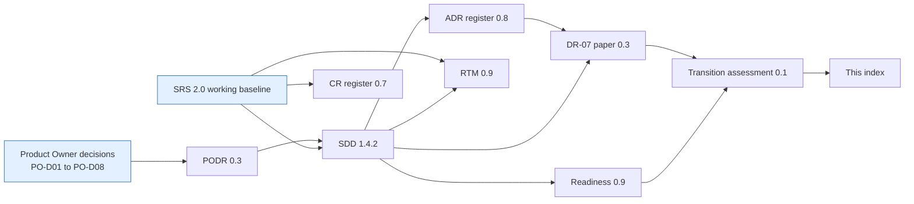

# Mindora Documentation Index

**ID:** MIN-IDX-001 | **Version:** 0.1 (draft) | **Date:** 2026-11-16
**Status:** Draft for independent review and Product Owner review. **It approves nothing.** It records the status, authority and relationships of the documents as found; it does not override any of them.
**Controlled:** yes (new document; this is the only index; no competing copy exists).
**Scope:** Mindora Stage One — Learning. CareerOps is not a Stage One dependency and its repository was not requested or inspected.
**Repository root used for paths:** the documentation folder, shown as `docs/…` (and `sources/…`, `superseded/…` in the handover ZIP).

---

## 1. How to use this index

1. Section 2 explains what "approved", "confirmed", "authoritative" and "controlled" mean here, and the order of authority.
2. Section 3 is the complete inventory. Section 4 gives the current authoritative version of each subject.
3. Section 5 gives relationships; section 6 the revision histories; section 7 the known discrepancies; section 8 the open decisions; section 9 the changes made in this handover task; section 10 how the baseline was verified.

---

## 2. Status vocabulary, authority and what is actually confirmed

### 2.1 Terms

| Term | Meaning in this baseline |
|---|---|
| **Controlled** | Has a document ID and version, is changed only through a recorded revision, and has no competing copy |
| **Authoritative** | The single current source for its subject |
| **Supporting** | Analysis, records or registers that support an authoritative document but do not define the design |
| **Input** | A supplied source kept for reference and not modified |
| **Superseded** | Replaced by a later version; kept only as history |
| **Draft / Proposed** | Prepared for review. Not approved |
| **Approved** | Approved by the Product Owner. **Nothing in this baseline is approved** except as listed in 2.2 |

### 2.2 What is confirmed, proposed, open, assumed and implemented

| Category | Content | Where recorded |
|---|---|---|
| **Product Owner-confirmed decisions** | PO-D01 to PO-D08 (directions only); Stage One scope is Learning; the six source categories; CareerOps and cloud are future-stage; CR-08 to CR-17 are aligned **design inputs** | MIN-PODR-001 §4; SDD §1; MIN-ASM-CR-001 |
| **Approved requirements** | **None established.** The SRS v2.0 is a *working baseline* ("Architecture and Implementation Validation Pending"); no requirement is recorded as approved; no SRS change request is approved | SRS front matter; MIN-ASM-CR-001 |
| **Proposed recommendations** | SDD v1.4.2 design; all 25 ADR proposals; MIN-DP-007 v0.3 recommendations; the candidate first milestone in MIN-ASM-DTA-001 | The respective documents |
| **Open decisions** | DR-01 to DR-27 (none closed); 0 of 19 Stage One ADRs approved; DR-07 sub-decisions; milestone decisions B1 to B11 | ADR register; SDD §18; MIN-ASM-DTA-001 |
| **Assumptions** | Examples: Windows 11 default platform (MIN-DP-007); one user on one machine (SDD §2.4); Stage and phase crosswalk (SDD Appendix A, DR-02) | The respective documents |
| **Implemented and verified behaviour** | **None.** No code, schema, configuration, connector, job or infrastructure exists | SDD Appendix F; MIN-ASM-RDY-001 |

The eight decisions were stated by the Product Owner; the register that records them (MIN-PODR-001) is itself still a draft, and the decision dates were recorded as provided (2026-11-15), not independently dated (DISC-09).

### 2.3 Order of authority when documents conflict

Conflicts are **never silently reconciled**. They are recorded in §7. When one must be resolved for work, use:

1. An explicit, current Product Owner instruction or approval (outside the documents).
2. Product Owner-confirmed decisions and the confirmed Stage One scope (MIN-PODR-001 §4).
3. Approved SRS, SDD and ADR revisions (**none exist today**).
4. The SRS v2.0 working baseline, for requirement content within the confirmed scope.
5. The SDD v1.4.2 and the current registers (draft design).
6. Supporting analyses (assessments, traceability, gap analysis, transition assessment).
7. Inputs and superseded documents (reference only).

---

## 3. Complete inventory

Package column "ZIP path" is the location inside `MINDORA-COMPLETE-DOCUMENTATION-BASELINE.zip`. Size is in bytes.

### 3.1 Requirements and Product Owner direction

| Document | Version | Date | Path (ZIP path identical unless noted) | Status | Controlled | Authority | Relationships | Known issues |
|---|---|---|---|---|---|---|---|---|
| MIN-SRS-001 Software Requirements Specification | 2.0 | 2026-11-14 | Supplied input; ZIP: `sources/requirements/MINDORA_SRS_2_0.docx` | **Working baseline; not approved** ("Architecture and Implementation Validation Pending") | Yes (unchanged; verified by hash, §10) | **Authoritative requirements baseline** (working), within the confirmed scope | Input to SDD, RTM, CR register. No requirement identifiers, no measurable targets | DISC-01, DISC-10, DISC-15 |
| MIN-PODR-001 Product Owner Decision Register | 0.3 | 2026-11-15 | `docs/02-requirements/PRODUCT-OWNER-DECISION-REGISTER.md` | Draft register of **confirmed** directions | Yes | **Authoritative record of PO-D01 to PO-D08** | Maps PO-D to ADRs, DRs, CRs, components, scenarios; conflicts C-P1 to C-P13 | DISC-09 |
| MIN-ASM-CR-001 SRS Change-Request Register | 0.7 | 2026-11-15 | `docs/07-assessment/SRS-CHANGE-REQUESTS.md` | CR-01 to CR-07 Proposed; CR-08 to CR-17 Aligned design input; CR-18 to CR-21 Proposed; **none approved** | Yes | **Authoritative register of proposed SRS changes** | Traces CRs to SDD; depends on PODR and SRS | DISC-10 |

### 3.2 Design and decision documents

| Document | Version | Date | Path | Status | Controlled | Authority | Relationships | Known issues |
|---|---|---|---|---|---|---|---|---|
| MIN-SDD-001 System Design Document | **1.4.2** | 2026-11-15 | `docs/03-design/SYSTEM-DESIGN-DOCUMENT.md` | Draft; **not approved** | Yes | **Authoritative design (draft)** | Depends on SRS, PODR; traced by RTM; reviewed by RDY and GAP | DISC-06, DISC-07, DISC-12, DISC-13 |
| MIN-ASM-ADR-001 Architecture Decision Register | 0.8 | 2026-11-15 | `docs/07-assessment/ARCHITECTURE-DECISION-REGISTER.md` | 19 Stage One ADRs Proposed or Open, 6 deferred; **none approved** | Yes | **Authoritative register of ADR records** | Aligned to PODR; summarized in SDD §16 | DISC-10 |
| MIN-DP-007 DR-07 Decision Paper | **0.3** | 2026-11-16 | `docs/03-design/DR-07-DECISION-PAPER-v0.3.md` | Draft; **every option "Recommendation, not approved"** | Yes | **Authoritative current DR-07 decision-preparation record** (recommendations only) | Prepared against SDD 1.4.2, PODR 0.3, ADR 0.8; inputs to ADR-002, ADR-009, ADR-010 and DR-21 | DISC-12, DISC-13 |
| MIN-DP-007 DR-07 Decision Paper | 0.2 | 2026-11-16 | `docs/03-design/DR-07-DECISION-PAPER-v0.2.md` | **Superseded by v0.3; preserved unchanged** | Yes | Superseded | Predecessor of v0.3 | |
| MIN-DP-007 DR-07 Decision Paper | 0.1 | 2026-11-16 | `docs/03-design/DR-07-DECISION-PAPER.md` | **Superseded by v0.2 and v0.3; preserved unchanged** | Yes | Superseded | Predecessor of v0.2 | Contains statements corrected in v0.2 (Windows 10 assumption, supervisor loop) |

### 3.3 Assessments, registers and traceability

| Document | Version | Date | Path | Status | Controlled | Authority | Relationships | Known issues |
|---|---|---|---|---|---|---|---|---|
| MIN-ASM-RTM-001 Requirements Traceability Matrix | 0.9 | 2026-11-15 | `docs/07-assessment/REQUIREMENTS-TRACEABILITY-MATRIX.md` | Draft | Yes | Supporting (traceability) | SRS to SDD; 60 rows; Part A keeps SDD v1.0 columns as history | DISC-10 |
| MIN-ASM-GAP-001 Architecture Gap Analysis | 0.9 | 2026-11-15 | `docs/07-assessment/ARCHITECTURE-GAP-ANALYSIS.md` | Draft | Yes | Supporting | Reviews SDD against SRS and PO scope | |
| MIN-ASM-RDY-001 Implementation Readiness Assessment | 0.9 | 2026-11-15 | `docs/07-assessment/IMPLEMENTATION-READINESS-ASSESSMENT.md` | Draft. **Global verdict: NOT READY FOR IMPLEMENTATION** | Yes | **Authoritative for the readiness verdict** (supporting for design) | Uses package quality gates; mirrors SDD Appendix F | DISC-08 |
| MIN-ASM-DOC-001 Documentation Assessment | 0.7 | 2026-11-14 | `docs/07-assessment/DOCUMENTATION-ASSESSMENT.md` | Draft; findings F-01 onward are about the v1.0 inputs | Yes | Supporting (historical assessment) | Source inventory of the original inputs | |
| MIN-ASM-REPO-001 Repository Assessment | 0.3 | 2026-11-15 | `docs/07-assessment/REPOSITORY-ASSESSMENT.md` | **Out of Stage One scope** | Yes | Supporting | Records that CareerOps is not required | |
| MIN-ASM-COR-001 Correction Log | no version number (rolling record) | 2026-11-14 (ID date); sections extend to 2026-11-16 | `docs/07-assessment/CORRECTION-LOG.md` | Record | Yes | Supporting (change record for SDD v1.3 to v1.4.2) | Records validation results and checker corrections | DISC-07 |
| MIN-ASM-DTA-001 Development Transition Assessment | 0.1 | 2026-11-16 | `docs/07-assessment/DEVELOPMENT-TRANSITION-ASSESSMENT.md` | Draft planning assessment; **not authorization** | Yes | Supporting | Builds on RDY, SDD, PODR, MIN-DP-007 v0.3 | DISC-08 |
| MIN-IDX-001 Documentation Index (this document) | 0.1 | 2026-11-16 | `docs/MINDORA-DOCUMENTATION-INDEX.md` | Draft | Yes | Supporting (inventory and status only) | Indexes all of the above | |
| Package README for the ZIP | n/a | 2026-11-16 | `README.md` (ZIP root only) | Package guide | n/a | Supporting | Explains the ZIP | |
| Checksums for the ZIP contents | n/a | 2026-11-16 | `MANIFEST.sha256` (ZIP root only) | Verification aid | n/a | Supporting | SHA-256 of every other file in the ZIP | |

### 3.4 Inputs and superseded sources

| Document | Version | Date | Path | Status | Controlled | Authority | Relationships | Known issues |
|---|---|---|---|---|---|---|---|---|
| MIN-SDD-001 System Design Document, first revision of the controlled lineage | 1.0 | 2026-11-14 | Supplied input; ZIP: `superseded/MIN-SDD-001_v1.0.md` (the `.docx` form was supplied but is **not** in the ZIP) | **Superseded** by v1.4.2 | Yes (as history) | Input | RTM Part A keeps its section numbers as history | DISC-05 |
| MIN-ENG-PKG-001 Engineering Specification Package (20 files, listed in 3.5) | 0.1 | 2026-11-14 | Supplied as a ZIP; ZIP: `sources/engineering-package-v0.1/…` | Draft working baseline; **partly superseded** | Package-level manifest only | Input / supporting | Source of the quality gates, the v0.1 SDD and governance drafts | DISC-02, DISC-03, DISC-04, DISC-11, DISC-15 |

### 3.5 Engineering package v0.1 files

All are **Input**, **draft v0.1**, not controlled by the current baseline, not modified.

| ZIP path | Size | Note |
|---|---|---|
| `sources/engineering-package-v0.1/AGENTS.md` | 1716 | Shared agent rules. Generic; consistent with PO-D02 role split. Mentions Claude Code and Codex roles |
| `sources/engineering-package-v0.1/CLAUDE.md` | 3845 | Agent instruction set. **Conflicts with the Stage One scope (DISC-02)**: tells agents to preserve CareerOps compatibility and inspect the repository. Do not use as project instructions |
| `sources/engineering-package-v0.1/PACKAGE-MANIFEST.json` | 973 | Manifest of the package (MIN-ENG-PKG-001 v0.1, 2026-11-14) |
| `sources/engineering-package-v0.1/README.md` | 2063 | Package start page. Pre-Stage One framing |
| `sources/engineering-package-v0.1/docs/00-governance/BASELINE-AND-STATUS.md` | 3230 | Baseline status from before the Stage One decision. Lists the CareerOps baseline and sources never supplied (DISC-02, DISC-11) |
| `sources/engineering-package-v0.1/docs/00-governance/SOURCE-REGISTER.md` | 2093 | Register of design diagrams and recordings. The diagrams and recordings are **not in the repository** (DISC-11) |
| `sources/engineering-package-v0.1/docs/00-governance/TRACEABILITY-AND-DECISIONS.md` | 4844 | Design-input traceability (DI-001 onward). Historical input to the SDD |
| `sources/engineering-package-v0.1/docs/01-product/PRODUCT-VISION.md` | 3145 | Product vision. Consistent in purpose with the current scope; includes CareerOps context |
| `sources/engineering-package-v0.1/docs/02-requirements/REQUIREMENTS-BASELINE.md` | 4922 | Compact requirements with package-originated FR- identifiers. **Not SRS identifiers** (DISC-15) |
| `sources/engineering-package-v0.1/docs/03-design/SYSTEM-DESIGN-DOCUMENT.md` | 9123 | **SDD v0.1 of MIN-SDD-001. Superseded** by v1.4.2 (DISC-04) |
| `sources/engineering-package-v0.1/docs/04-engineering/AI-ASSISTED-SDLC.md` | 3503 | Lifecycle and agent workflow. Engineering process input; usable; no scope conflict found |
| `sources/engineering-package-v0.1/docs/04-engineering/QUALITY-GATES.md` | 1416 | Quality gates 0 to 6. Process input used by readiness assessments |
| `sources/engineering-package-v0.1/docs/05-delivery/IMPLEMENTATION-PLAN.md` | 2956 | Phased plan. **Phase 0 and Phase 5 contradict the Stage One scope; phase order differs (DISC-02)** |
| `sources/engineering-package-v0.1/docs/05-delivery/REPOSITORY-AUDIT-PLAN.md` | 1451 | Plan to audit the CareerOps repository. **Out of Stage One scope** |
| `sources/engineering-package-v0.1/docs/06-operations/KNOWLEDGE-GOVERNANCE.md` | 1667 | Knowledge classes and update policy. **"Verified fact" definition differs from SDD §5.3.5 (DISC-03)** |
| `sources/engineering-package-v0.1/docs/06-operations/SECURITY-AND-OPERATIONS.md` | 1433 | Generic security and operations checklist. Compatible; not a claim of controls |
| `sources/engineering-package-v0.1/templates/ADR-TEMPLATE.md` | 536 | Template. Usable |
| `sources/engineering-package-v0.1/templates/DECISION-TEMPLATE.md` | 274 | Template. Usable |
| `sources/engineering-package-v0.1/templates/HANDOFF-TEMPLATE.md` | 341 | Template. Usable |
| `sources/engineering-package-v0.1/templates/TEST-CASE-TEMPLATE.md` | 284 | Template. Usable |

### 3.6 Referenced but not supplied

| Item | Referenced by | Needed for | Status |
|---|---|---|---|
| Design Input diagrams and the review record (Persistent Memory Architecture, AI Knowledge System infographic) | SDD, package `SOURCE-REGISTER.md`, ADR-001 wording | Confirming Design Input wording for ADR-001 | **Not supplied.** Open item; not a blocker for the candidate milestone (DISC-11) |
| 13 screen recordings | Package `SOURCE-REGISTER.md` | Workflow reference | **Not supplied; no audio or video analysed** |
| CareerOps repository | Package plan; SRS | Nothing in Stage One | **Out of scope; not requested; not inspected** |

---

## 4. Current authoritative versions at a glance

| Subject | Authoritative document | Version |
|---|---|---|
| Requirements baseline | MIN-SRS-001 | 2.0 (working; unchanged) |
| Product Owner decisions | MIN-PODR-001 | 0.3 |
| System design | MIN-SDD-001 | 1.4.2 |
| ADR records | MIN-ASM-ADR-001 | 0.8 |
| SRS change requests | MIN-ASM-CR-001 | 0.7 |
| Traceability | MIN-ASM-RTM-001 | 0.9 |
| Gap analysis | MIN-ASM-GAP-001 | 0.9 |
| Readiness verdict | MIN-ASM-RDY-001 | 0.9 |
| Runtime decision preparation (DR-07) | MIN-DP-007 | 0.3 |
| Transition assessment | MIN-ASM-DTA-001 | 0.1 |
| Documentation assessment; repository assessment | MIN-ASM-DOC-001; MIN-ASM-REPO-001 | 0.7; 0.3 |
| Index | MIN-IDX-001 | 0.1 |

---

## 5. Relationships

| Document | Depends on | Feeds |
|---|---|---|
| SRS 2.0 | Product vision (package) | SDD, RTM, CR register |
| PODR 0.3 | Product Owner decisions | SDD (§1.6, Appendix E), ADR register, CR register, RTM Part E |
| SDD 1.4.2 | SRS, PODR, CR-08 to CR-17 | ADR register, RTM, GAP, RDY, DR-07 paper, DTA |
| ADR register 0.8 | SDD, PODR | SDD §16, DR-07 paper (ADR-002, 009, 010) |
| CR register 0.7 | SRS, PODR | RTM Part D |
| RTM 0.9 | SRS, SDD, CR register, PODR | RDY, GAP |
| GAP 0.9 | SRS, SDD | RDY |
| RDY 0.9 | SDD, PODR, ADR, DR counts, package quality gates | DTA |
| DR-07 paper 0.3 | SDD, PODR, ADR register, readiness | ADR-002, 009, 010; DR-21 inputs; DTA gates |
| DTA 0.1 | RDY, SDD, PODR, DR-07 paper | Product Owner decisions B1 to B11 |
| Correction log | All SDD revisions | Evidence for validation results |

---

## 6. Revision history

### 6.1 SDD (MIN-SDD-001), from its own revision table

| Version | Date | Summary |
|---|---|---|
| 0.1 | 2026-11-14 | Initial logical design baseline (the package SDD) |
| 1.0 | 2026-11-14 | Expanded baseline with CareerOps integration views |
| 1.1 | 2026-11-14 | Re-scoped to Stage One; future-stage integrations removed |
| 1.2 | 2026-11-14 | Multi-source learning design; ADR-021 to ADR-025 |
| 1.3 | 2026-11-14 | Documentation corrections; canonical state vocabulary |
| 1.3.1 | 2026-11-15 | Consistency corrections; conflict-resolution authority |
| 1.4 | 2026-11-15 | Product Owner decision consolidation (PO-D01 to PO-D08) |
| 1.4.1 | 2026-11-15 | Consistency corrections (vault write ownership; direct-input promotion DR-27; §16) |
| 1.4.2 | 2026-11-15 | Consistency pass (DR-04, DR-07, DR-27 separated) |

(The 1.4.1 and 1.4.2 rows carry the date 2026-11-15; the work was done on 2026-11-16. See DISC-07.)

### 6.2 Other documents

| Document | History |
|---|---|
| PODR | 0.1 initial consolidation; 0.2 vault-ownership wording, DR-27; 0.3 DR-04 and DR-07 clarified (own revision table) |
| ADR register | v0.1 to v0.8; additions recorded in the register's "Additions in v0.x" sections |
| CR register | v0.1 to v0.7; change tables in its §7 to §11 |
| RTM, GAP, RDY | Each carries its own changes; the correction log records the SDD-linked ones |
| DR-07 paper | 0.1, 0.2, 0.3, each preserved; change logs inside v0.2 and v0.3 |
| Correction log | Sections 1 to 31 record SDD v1.3 to v1.4.2 |

---

## 7. Known discrepancies and unresolved questions

Recorded, **not reconciled**. "Material" means it could change what gets built.

| ID | Discrepancy | Documents | Authoritative source | Material | Proposed handling |
|---|---|---|---|---|---|
| DISC-01 | SRS v2.0 requires CareerOps, Chrome extension, Gmail, job discovery, Google Sheets and cloud capabilities; Stage One excludes them | SRS vs PODR, SDD §1, Appendix B | PO scope decisions; SDD; RTM (FUT) | **Yes** | SRS stays unchanged; read it through the RTM and CR register |
| DISC-02 | The v0.1 package plan, `CLAUDE.md`, status file and audit plan direct inspecting and preserving CareerOps, and order the phases differently | Package vs PODR, SDD, DTA | PO scope decisions; SDD | **Yes** (agent instruction risk) | Package kept only under `sources/` and labelled partly superseded; do not use its `CLAUDE.md` as project instructions. A Stage One instruction set is a possible future task, not created here |
| DISC-03 | Package defines "verified fact" as confirmed by an authoritative source **or the user**; SDD §5.3.5 separates user confirmation from independent verification | Package `KNOWLEDGE-GOVERNANCE.md` vs SDD | SDD §5.3.5; PO-D02 | **Yes** (when knowledge classes are built) | Follow the SDD; package is input |
| DISC-04 | The v0.1 SDD (MIN-SDD-001) survives as a separate file with the same ID | Package SDD | `docs/03-design/SYSTEM-DESIGN-DOCUMENT.md` v1.4.2 | Yes | Superseded; use only the current path |
| DISC-05 | SDD v1.0 survives as a separate file with the same ID; RTM Part A keeps its section numbers | `superseded/…v1.0.md`; RTM | SDD v1.4.2 | Low | Superseded; RTM "Current status" column gives v1.4.2 status |
| DISC-06 | The SDD's closing line reads "End of MIN-SDD-001 v1.4 (draft)", and Appendix E and F headings say "(v1.4)", though the document is v1.4.2 | SDD | SDD revision table | No | Editorial; correct at the next SDD revision (not changed here because controlled documents were not to be edited in this task) |
| DISC-07 | Revision rows 1.4.1 and 1.4.2 and several header dates read 2026-11-15, though the work was done on 2026-11-16; the correction log has an ID date but no version number | SDD, registers, log | Records of the work | No | Editorial; align dates and version labelling at the next revision of each |
| DISC-08 | RDY records a global verdict of NOT READY; DTA gives a milestone-scoped view | RDY vs DTA | RDY stands as recorded | **Decision needed** | Product Owner decides whether to adopt milestone-scoped gates |
| DISC-09 | The Decision Register is a draft; the eight decisions were stated by the Product Owner, but the register text has no recorded sign-off and the decision dates were recorded as provided | PODR | Product Owner statement | Low | Product Owner confirms the register text when convenient |
| DISC-10 | Open traceability items: documentation layout conflict (SRS §9.5 versus package layout versus the actual layout; ADR-017, C-05); SRS has no requirement IDs (DR-01); scalability not covered, no figures (§13.5) | SRS, package, RTM, ADR register | PO decision on DR-01, ADR-017 | Partly (not for milestone 1) | Keep open; actual layout is preserved in the ZIP |
| DISC-11 | Not supplied: Design Input diagrams and review record; screen recordings; CareerOps repository | SDD, package | n/a | Low to medium | ADR-001's Design Input wording stays unconfirmed; recordings and CareerOps out of scope |
| DISC-12 | All diagrams are validated for **syntax only**: 65 Mermaid blocks in the ZIP (SDD 39; DR-07 papers v0.1, v0.2, v0.3: 1, 3 and 3; transition assessment 1; this index 1; the package and SDD v1.0 inputs 3, 1 and 13). **None was rendered or visually inspected** | SDD, DR-07, DTA, index | n/a | Medium for review | A reviewer should render and inspect them |
| DISC-13 | DR-07 paper v0.3 proposals (job model, fencing, approved-change record, local interface security) are not in the SDD; v0.1 and v0.2 remain in the tree as superseded | DR-07 vs SDD §6.3, §7.13, §11, C-01, C-07 | Becomes authoritative only if approved | If approved | SDD reconciliation after approval |
| DISC-14 | The meaning of `confidence` is Open (ADR-019); the package's governance also requires it | SDD, package | n/a | **Yes** for milestone 1 | Decision B6 in DTA |
| DISC-15 | The package's FR- and NFR- identifiers are package-originated; the SRS has none; ADR-001 cites a package NFR identifier | Package, SRS, ADR register | DR-01 | Medium (traceability) | Do not cite them as SRS identifiers |

**Unresolved questions for the Product Owner:** DR-07 questions Q1 to Q12 (MIN-DP-007 v0.3 §17); milestone decisions B1 to B11 (MIN-ASM-DTA-001 §4.1); DR-01 to DR-27 and the ADRs (registers).

---

## 8. Open decisions (counts and pointers)

| Register | Content | Closed or approved |
|---|---|---|
| ADR register | 25 ADRs: 19 Stage One, 6 deferred (future-stage) | **0 approved** |
| Decision requests (SDD §18; RDY) | DR-01 to DR-27 | **0 closed** |
| SRS change requests | CR-01 to CR-21 | **0 approved** |
| Scenarios | AS-01 to AS-72 (proposed acceptance basis) | n/a |
| Components and interfaces | C-01 to C-14; IF-01 to IF-13 (proposed; none exists) | n/a |

---

## 9. Changes made in the handover task

| Change | Detail |
|---|---|
| **New:** `docs/03-design/DR-07-DECISION-PAPER-v0.3.md` | Q2a clarified (browser closed, host stopped, Windows sign-out); commit-time fencing and canonical-vault protection; implementation gates. v0.1 and v0.2 are unchanged (byte comparison) |
| **New:** `docs/07-assessment/DEVELOPMENT-TRANSITION-ASSESSMENT.md` | MIN-ASM-DTA-001 v0.1 |
| **New:** `docs/MINDORA-DOCUMENTATION-INDEX.md` | This index |
| **New (ZIP only):** `README.md`, `MANIFEST.sha256` | Package guide and checksums |
| **New:** `MINDORA-COMPLETE-DOCUMENTATION-BASELINE.zip` | The handover package |
| **Not changed** | SDD, PODR, ADR register, CR register, RTM, gap analysis, readiness assessment, documentation and repository assessments, correction log, SRS v2.0, and every Product Owner decision. No ADR approved, no DR closed, no CR approved |
| **Not changed (and why)** | Discrepancies DISC-06 and DISC-07 are editorial but sit in controlled documents; they are recorded here and not edited |

---

## 10. Verification performed

Results are in the final handover report and in `README.md`; in summary: the version-reference checks of the documentation set were rerun; every diagram was syntax-parsed (not rendered); every path listed in section 3 was checked against the ZIP contents; the SRS hash in the ZIP equals the supplied file; v0.1 and v0.2 of the DR-07 paper were compared byte for byte with their prior state; no code files and no secrets patterns were found.

*End of MIN-IDX-001 v0.1 (draft).*
