# MINDORA — SYSTEM DESIGN DOCUMENT

**Document ID:** MIN-SDD-001  
**Version:** 1.0  
**Date:** November 14, 2026  
**Status:** Complete design baseline — Draft for review and approval  
**Related baseline:** MIN-SRS-001 v2.0 (working baseline; reconcile against controlled SRS source)  
**Product:** Mindora — Personal Intelligence & Knowledge Operating System

---

## Document Control

| Item | Description |
|---|---|
| Document owner | Mindora Product Owner |
| Prepared for | Mindora engineering and AI-assisted development team |
| Status | Draft for review; not yet approved |
| Supersedes | MIN-SDD-001 v0.1 |
| Primary design reference | Mindora Persistent Memory Architecture |
| Supporting design reference | Mindora AI Knowledge System Infographic |

### Revision History

| Version | Date | Description |
|---|---|---|
| 0.1 | 2026-11-14 | Initial logical design baseline |
| 1.0 | 2026-11-14 | Expanded complete SDD baseline with component, data, integration, deployment, security, workflow and CareerOps architecture views |

## 1. Purpose

This System Design Document (SDD) defines the proposed system architecture, logical components, data concepts, information flows, integrations, trust boundaries, deployment considerations and verification approach for Mindora.

It translates the product and requirements baseline into an engineering design that can be reviewed before implementation.

This document is intentionally explicit about design status. It distinguishes:
- **Source-grounded design:** represented in the supplied Mindora diagrams or established project baseline.
- **Proposed design:** an engineering structure recommended to satisfy the requirements.
- **Open decision:** requires repository inspection, technical validation or Product Owner approval.

## 2. Product and System Overview

Mindora is a **Personal Intelligence & Knowledge Operating System (KOS)**. It builds persistent, traceable knowledge from authorized personal, professional, project and technical sources, then retrieves relevant context for the user's work and authorized AI agents.

Mindora addresses AI amnesia: repeated explanations of user context, projects, systems, decisions, technical environments and ongoing activities across separate AI sessions and tools.

The system is not limited to software-development memory. Engineering session continuity is an initial use case and foundation; the product scope also includes personal knowledge, continuous learning, technical intelligence, intelligent context routing and governed workflows.

### 2.1 Design Principles

1. Obsidian-compatible Markdown is the human-readable knowledge source of truth.
2. Knowledge must remain portable, inspectable and versionable.
3. Existing repositories and Git history are engineering context sources.
4. Agents load only relevant knowledge for the task at hand.
5. Knowledge updates are proposed, reviewed and approved before becoming authoritative.
6. Mindora separates source evidence from extracted claims and AI inference.
7. Mindora is model/provider-independent at the integration boundary where practical.
8. Existing CareerOps capabilities are audited and reused where suitable.
9. Access is least-privilege; consequential external actions require authorization.
10. The user remains the product owner and final decision-maker.

## 3. Scope

### 3.1 In Scope

- Persistent human-readable knowledge space.
- Personal, professional, project and technical knowledge domains.
- Source capture and ingestion from authorized inputs.
- Knowledge extraction, classification, linking, provenance and lifecycle.
- Context retrieval, ranking and bounded context assembly.
- Agent instructions, workflows, session handoffs and continuity.
- Human review and approval of consequential knowledge updates.
- Controlled interfaces for AI agents, including a later MCP capability.
- Reuse and integration assessment of existing CareerOps functionality.
- CareerOps operational intelligence as an initial applied domain.

### 3.2 Out of Scope for Initial Foundation

- Training a foundation model from scratch.
- Unrestricted autonomous access to all user accounts and files.
- Automatic promotion of uncertain inferences to verified facts.
- Rewriting CareerOps before a repository audit.
- Implementing every connector before the core knowledge/context workflow is validated.
- Production deployment before security, recovery and operational controls are approved.

## 4. System Context Architecture

The system context view identifies the people, agents, knowledge sources and engineering tools that interact with Mindora.

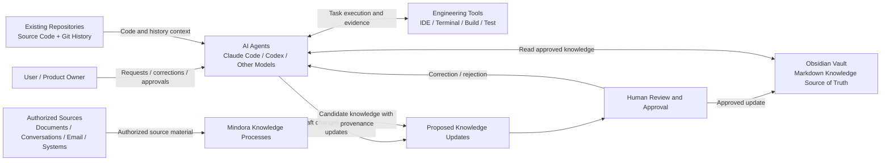

**Design interpretation:** The vault is the human-readable knowledge source of truth. AI agents consume relevant context and may prepare proposed updates. The approval loop is a source-grounded design element. The ingestion and agent tooling shown around it are proposed system boundaries.

## 5. Logical Architecture

### 5.1 Logical Component Architecture

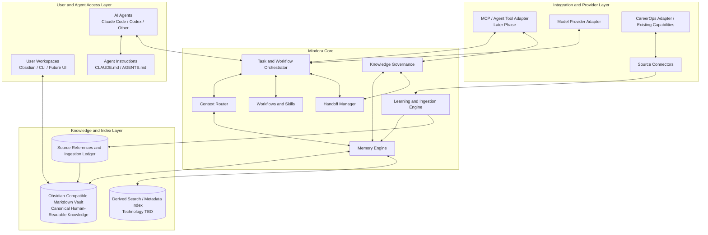

### 5.2 Component Responsibilities

| Component | Responsibility | Design status |
|---|---|---|
| User and Agent Access | User interaction and authorized agent entry points | Proposed boundary |
| Agent Instructions | Startup rules, authority hierarchy, workflows and constraints | Source-grounded |
| Task / Workflow Orchestrator | Coordinates task interpretation, context request, model call and workflow | Proposed |
| Context Router | Identifies relevant domains and retrieves task-specific knowledge | Source-grounded concept; detailed algorithm open |
| Memory Engine | Maintains, classifies, links and versions knowledge | Source-grounded concept; schema open |
| Learning / Ingestion Engine | Captures authorized sources and creates candidate knowledge | Proposed elaboration |
| Handoff Manager | Preserves session state, next steps and continuity | Source-grounded concept |
| Workflows and Skills | Reusable task procedures, templates and prompts | Source-grounded concept |
| Knowledge Governance | Provenance, confidence, review, authorization and lifecycle | Requirements-grounded |
| Markdown Vault | Canonical human-readable knowledge store | Source-grounded |
| Derived Index | Optional search/metadata projection for efficient retrieval | Proposed; technology undecided |
| Source Ledger | Tracks source identifiers, ingestion and processing status | Proposed |
| Provider Adapter | Separates Mindora orchestration from model providers | Proposed |
| Connector Layer | Controlled adapters to external data sources | Proposed |
| MCP Adapter | Agent-facing tools for scoped search/retrieval/update | Source diagram places this in a later phase |

### 5.3 Component Interaction Sequence

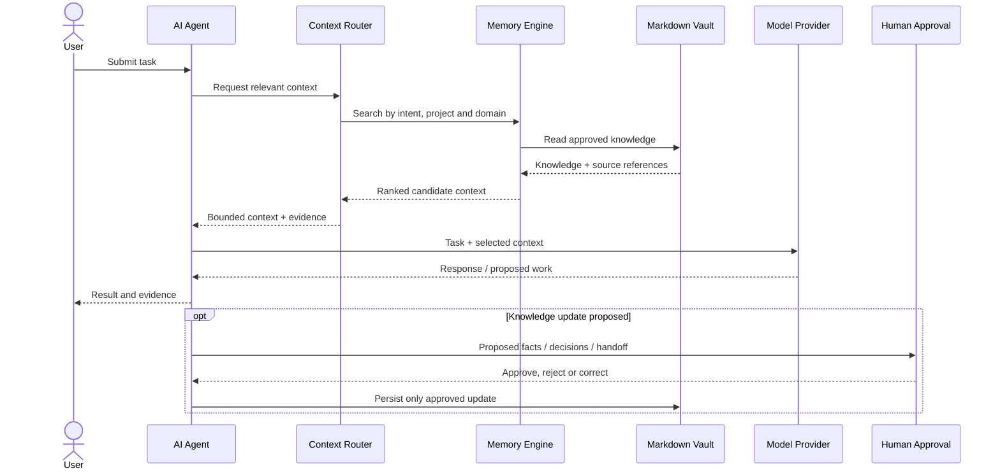

## 6. Knowledge and Data Architecture

### 6.1 Knowledge Domains

Mindora knowledge is organized across the following domains:

- Personal and professional profile.
- Career history, skills, qualifications and goals.
- Projects, products, ideas and activities.
- Organizations, people and relationships.
- Technical systems, repositories, applications and components.
- Languages, frameworks, dependencies and AI models.
- Infrastructure, cloud resources, networks and deployments.
- Databases, schemas, APIs, integrations and data flows.
- Documents, conversations, meetings and communications.
- Requirements, decisions, tasks, events, outcomes and lessons.

### 6.2 Conceptual Entity Relationship Diagram

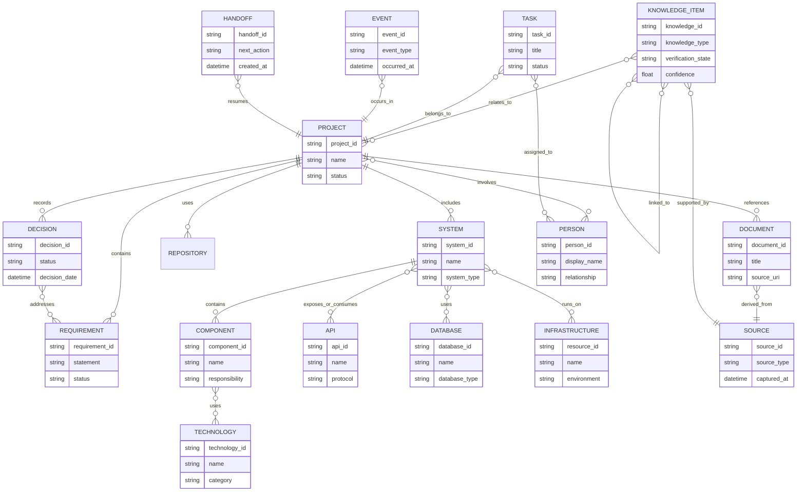

**Important:** This is a conceptual entity relationship view, not a finalized physical database schema. The vault's Markdown files remain the source of truth. Any structured index or database is a derived projection unless a later approved ADR changes that principle.

### 6.3 Common Knowledge Metadata

Candidate metadata for knowledge items:

| Field | Purpose |
|---|---|
| Stable ID | Unique reference to a knowledge item |
| Type | Fact, decision, project, system, task, lesson, etc. |
| Title / summary | Human-readable identification |
| Source reference | File, conversation, repository path or connector reference |
| Source authority | User-confirmed, approved document, extracted source, etc. |
| Captured / observed time | When the information was observed |
| Created / updated time | Knowledge record lifecycle |
| Verification state | Verified, extracted, inferred, disputed, stale |
| Confidence | Confidence estimate where meaningful |
| Lifecycle | Active, superseded, archived, disputed |
| Relationships | Links to projects, people, systems and other knowledge |
| Sensitivity | Public, internal, confidential or sensitive |
| Version / supersession | Historical traceability |

### 6.4 Knowledge Lifecycle

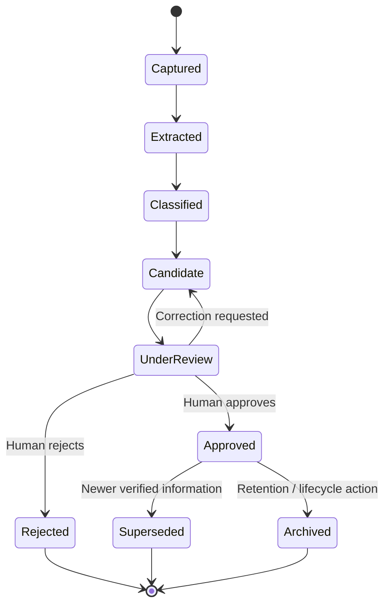

Knowledge classes must distinguish verified facts, source-extracted claims, AI inferences, plans, temporary states, historical records and disputed information. A source-extracted statement is not automatically a verified fact.

## 7. Learning and Ingestion Architecture

### 7.1 Ingestion Pipeline

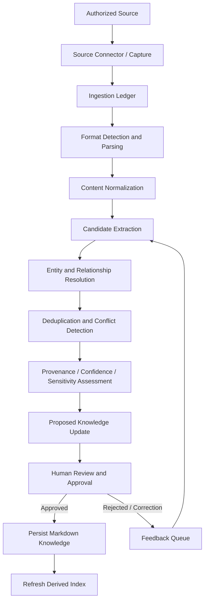

### 7.2 Ingestion Responsibilities

- Identify authorized source and access scope.
- Capture source reference, timestamp and connector identity.
- Parse supported formats without losing source linkage.
- Extract candidate facts, entities, relationships, decisions and actions.
- Detect duplicates and possible contradictions.
- Preserve source text separately from model interpretation.
- Classify sensitivity and verification state.
- Propose updates for human review when required.
- Persist approved content and refresh derived indexes.

### 7.3 Incremental Processing

The implementation should evaluate content hashing, modification timestamps, file filters, deduplication and incremental reprocessing. Large repositories and portfolios must exclude generated or irrelevant folders (for example, build outputs, dependency directories and version-control internals) according to an approved ingestion policy.

Specific file limits, supported formats, OCR and audio transcription capabilities require validation and performance testing.

## 8. Intelligent Context Retrieval Architecture

### 8.1 Retrieval Pipeline

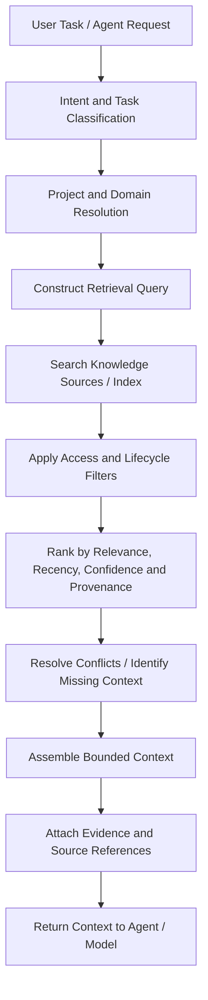

### 8.2 Context Selection Factors

Candidate ranking factors:
- Semantic and lexical relevance to the current task.
- Project and domain match.
- Source authority and verification state.
- Recency and whether a record is still active.
- Relationship distance to the primary project/entity.
- User-approved priority.
- Access permissions and sensitivity.
- Token/context budget.

Exact ranking weights, search technology, embedding strategy and context budgets are open technical decisions requiring evaluation against real user tasks.

### 8.3 Retrieval Output

The context service should return:
- Selected knowledge items.
- Short summaries where useful.
- Source references and evidence.
- Verification/confidence state.
- Timestamp and lifecycle status.
- Conflicts or missing information.
- A bounded context package suitable for the requesting agent.

The agent must not treat retrieved content as higher authority than current user instructions or approved project decisions.

## 9. Agent, Workflow and MCP Architecture

### 9.1 Agent Operating Model

The source-grounded engineering workflow is:

1. Start a fresh session.
2. Load relevant project memory and instructions.
3. Implement and test assigned work.
4. Prepare proposed knowledge updates and handoff.
5. Obtain user review and approval.
6. Persist approved updates for the next session.

### 9.2 Agent Access Model

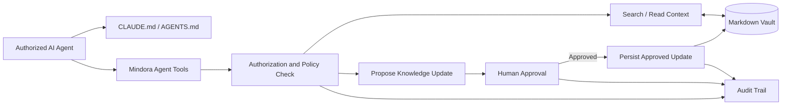

### 9.3 MCP Phasing

The supplied Persistent Memory Architecture places Mindora Memory Tools / MCP in a later phase. Therefore:
- Initial foundation: manual Obsidian/Markdown workflow and agent project instructions.
- Next capability: standardized handoffs and reviewed memory updates.
- Later capability: MCP tools for scoped search, retrieval and proposed updates.

MCP implementation, tool names, schemas, transport and authorization model remain to be designed and approved. Do not assume a generic filesystem MCP is the final solution.

## 10. Integration Architecture

### 10.1 Integration Context

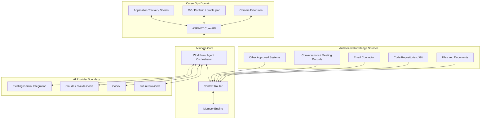

This view is conceptual. It does not imply every connector or provider is currently implemented or that every provider is directly integrated into a single runtime.

### 10.2 CareerOps Integration Architecture

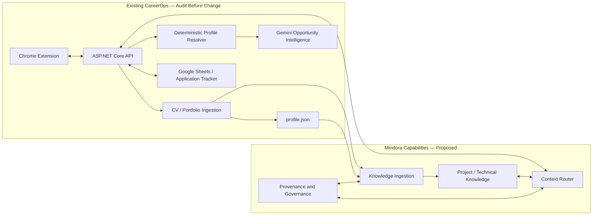

**Integration rule:** Existing CareerOps is not to be rewritten by default. The repository audit must determine which capabilities should be retained, extended, modularized or replaced. Preserve `profile.json` compatibility where practical; it may become a compatibility projection from a richer knowledge model, subject to an approved migration design.

### 10.3 External Integration Controls

- Use read-only access by default for new source connectors.
- Define scopes and consent before connecting personal accounts.
- Track source identity and synchronization state.
- Use idempotency and bounded retries for repeatable ingestion.
- Route ambiguous entity matching to human review.
- Require explicit authorization before sending messages, changing external records or triggering consequential actions.
- Keep connector credentials outside Markdown and source control.

## 11. Deployment Architecture

### 11.1 Proposed Deployment View

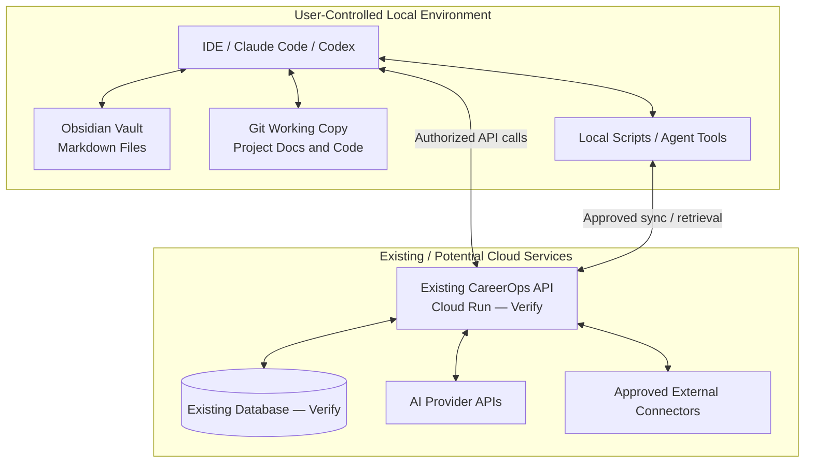

### 11.2 Deployment Position

The initial Mindora engineering continuity foundation is represented as local-first: Obsidian vault, Markdown, repository/Git history and Claude Code. The existing CareerOps API is known to use Google Cloud Run from prior project context, but its current deployment must be inspected.

A final topology (local-only, hybrid or cloud-backed) is an open decision. Evaluate privacy, data residency, availability, cost, synchronization, backup and multi-device requirements before selecting it.

### 11.3 Environments

The detailed environment model must define:
- Local development.
- Automated test/CI.
- Staging or validation.
- Production.
- Secrets and configuration per environment.
- Data separation and access boundaries.
- Deployment and rollback responsibilities.

Do not deploy Mindora services or change CareerOps production configuration as part of discovery.

## 12. Security and Trust Boundary Architecture

### 12.1 Trust Boundaries

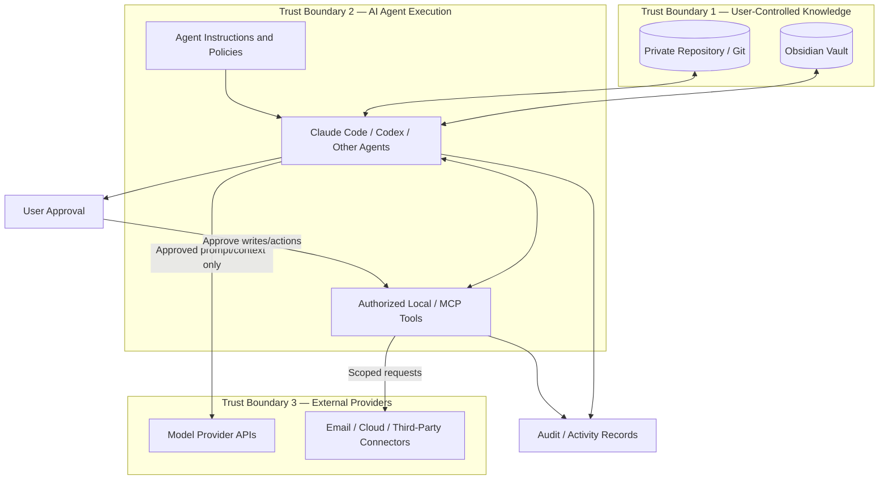

### 12.2 Security Requirements

- Authentication and authorization for any remote service or connector.
- Least-privilege agent access.
- Separate read, propose, approve and execute capabilities.
- Secrets stored only in approved secret-management mechanisms or secure local environment configuration.
- No passwords, API keys, tokens or private keys in vault documents, source control or prompts.
- Encryption in transit and at rest where supported.
- Sensitive data classification and minimization.
- Audit records for consequential operations.
- Retention, export, deletion and backup/recovery policy.
- Imported documents, source code, comments and external content treated as untrusted data, not instructions that override system or user policy.
- Explicit authorization for external writes, message sending, deployment and destructive operations.

## 13. Data Flow and Operational Behavior

### 13.1 Session Continuity Flow

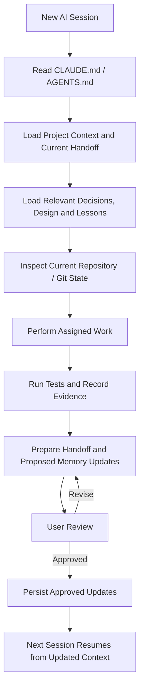

### 13.2 Error and Exception Paths

| Condition | Expected behavior |
|---|---|
| Source unavailable | Record source failure; do not fabricate content |
| Unsupported file format | Mark unsupported and preserve source reference |
| Parsing failure | Record error and allow retry/manual review |
| Duplicate content | Avoid duplicate persistence; link to existing record |
| Conflicting claims | Preserve both sources and mark disputed pending review |
| Low-confidence extraction | Keep as candidate/inference; request confirmation |
| Retrieval finds no evidence | State that context is unavailable; ask for required input |
| Provider unavailable | Report failure; use approved fallback only |
| Agent lacks permission | Deny action and record the denial where appropriate |
| Memory update rejected | Do not persist as approved knowledge |
| External action fails | Report status; apply retry policy only when safe and idempotent |

## 14. Technology and Design Decisions

### 14.1 Known Baseline and Proposed Direction

| Area | Current known baseline / proposed direction | Status |
|---|---|---|
| Human-readable knowledge | Obsidian-compatible Markdown vault | Source-grounded |
| Project instructions | CLAUDE.md / AGENTS.md | Source-grounded |
| Code and history | Existing repository + Git | Source-grounded |
| Existing backend | ASP.NET Core / C# | Existing baseline; inspect |
| Existing frontend | Chrome Extension | Existing baseline; inspect |
| Existing AI integration | Gemini | Existing baseline; inspect |
| Existing deployment | Google Cloud Run | Existing baseline; inspect |
| Knowledge schema | Conceptual entities in this SDD | Proposed; needs ADR |
| Search/index | Derived index may support efficient retrieval | Open |
| MCP | Later-phase Mindora Memory Tools | Source-grounded sequencing |
| Deployment topology | Local-first foundation; hybrid/cloud undecided | Proposed direction |

### 14.2 Architecture Decision Register

| ADR | Decision | Options to evaluate | Status |
|---|---|---|---|
| ADR-001 | Canonical knowledge storage | Markdown vault; structured database as source; hybrid | Proposed: Markdown source of truth |
| ADR-002 | Application/service boundaries | Extend CareerOps; modularize; separate Mindora services | Open; repository audit required |
| ADR-003 | Search and retrieval | Full-text; metadata index; embeddings; hybrid | Open; benchmark required |
| ADR-004 | MCP interface | Custom Mindora MCP; approved existing server; staged adapter | Deferred design |
| ADR-005 | AI provider abstraction | Existing Gemini-only; provider adapter; routed multi-provider | Open |
| ADR-006 | Canonical knowledge schema | Markdown frontmatter; structured projection; graph model | Open |
| ADR-007 | Local vs cloud execution | Local-first; hybrid; cloud-hosted | Open |
| ADR-008 | Ingestion architecture | File-based; connector services; event-driven pipeline | Open |
| ADR-009 | Identity and authorization | Local user context; centralized identity; scoped agent credentials | Open |
| ADR-010 | Deployment and operations | Local-only foundation; hybrid services; cloud deployment | Open |
| ADR-011 | Versioning and backup | Git; vault sync; independent encrypted backup | Open |
| ADR-012 | CareerOps data compatibility | Preserve profile.json; adapter/projection; migration | Open |

No open ADR is considered approved until the Product Owner explicitly approves it.

## 15. Non-Functional Design Considerations

### 15.1 Reliability
- Ingestion and synchronization should be retryable and idempotent where feasible.
- Failures must be observable and recoverable.
- Knowledge updates must not be silently lost.
- Backup and restore must be tested.

### 15.2 Performance
- Retrieval should return bounded, relevant context.
- Large source collections require incremental ingestion and filtering.
- Latency and relevance must be measured using representative tasks.
- Performance targets remain to be established from baseline measurements.

### 15.3 Maintainability
- Separate connectors, knowledge services, context routing and provider adapters.
- Use versioned schemas and documented interfaces.
- Maintain automated tests and traceability.
- Keep human-readable knowledge portable.

### 15.4 Privacy
- Collect only authorized data required for defined use cases.
- Make local/cloud processing boundaries explicit.
- Support review, correction, export and deletion policies.
- Avoid sending irrelevant personal context to model providers.

### 15.5 Portability
- Markdown documents should remain readable without Mindora runtime services.
- Keep knowledge exportable.
- Avoid coupling canonical knowledge to a single AI provider.

## 16. Verification and Validation Strategy

| Test level | Focus | Example evidence |
|---|---|---|
| Document / configuration validation | Folder structure, required instructions and metadata | Fresh-clone checklist |
| Unit testing | Parsing, normalization, classification, ranking utilities | Automated unit test results |
| Integration testing | Vault, index, connectors, providers and CareerOps adapters | Integration test report |
| System testing | End-to-end ingestion and context retrieval | Scenario execution evidence |
| Security testing | Access controls, secrets, trust boundaries and prompt injection handling | Security test report |
| Reliability testing | Retry, idempotency, backup and restore | Recovery test evidence |
| Retrieval evaluation | Relevance, provenance and context size | Evaluation dataset and metrics |
| User acceptance testing | Session continuity and practical task outcomes | Product Owner acceptance |

### 16.1 Initial Acceptance Scenarios

1. A new Claude Code session loads project instructions and relevant handoff without requiring a full manual recap.
2. The agent retrieves the correct approved project decision and identifies its source.
3. The agent distinguishes an approved fact from a proposed or inferred statement.
4. The agent proposes a handoff and knowledge update without silently persisting unapproved decisions.
5. A user correction updates the authoritative knowledge while preserving appropriate history.
6. A repository task uses actual code and Git evidence rather than assumptions.
7. CareerOps functionality is preserved when Mindora integration is introduced.
8. An unauthorized agent action is denied.
9. A source conflict is surfaced rather than silently resolved.
10. A backup can be restored and Markdown knowledge remains readable.

## 17. Implementation Phasing

### Phase 0 — Source and Repository Validation
- Reconcile approved Design Input, SRS and review records.
- Inspect the full CareerOps repository and deployment.
- Review all supplied diagrams and screen-recording references.
- Validate this SDD and open ADRs.

### Phase 1 — Obsidian + Markdown + Agent Instructions
- Confirm vault and folder structure.
- Establish CLAUDE.md / AGENTS.md.
- Create project context, architecture, decisions, lessons and handoff templates.
- Prove fresh-session continuity.

### Phase 2 — Handoffs and Human-Approved Memory Updates
- Standardize session summaries.
- Generate proposed updates.
- Implement review/approval workflow.
- Test corrections and rejected updates.

### Phase 3 — Mindora Memory Tools / MCP
- Define threat model, authorization and tool contracts.
- Implement scoped search/read/propose-update capabilities.
- Add audit and validation.

### Phase 4 — Core Knowledge and Context Intelligence
- Finalize schema and entity relationships.
- Build incremental ingestion and provenance.
- Implement search, ranking and context assembly.
- Evaluate retrieval quality and token efficiency.

### Phase 5 — CareerOps Operational Intelligence
- Reuse suitable CareerOps capabilities.
- Add approved email and job discovery intelligence.
- Match records with human review for ambiguity.
- Add controlled tracking automation.

### Phase 6 — Hardening and Expansion
- Security, privacy and access review.
- Backup/restore and recovery.
- Performance, reliability and monitoring.
- Additional domains and connectors.

## 18. Risks and Mitigations

| Risk | Impact | Mitigation |
|---|---|---|
| SRS / Design Input source gaps | Design may not fully trace to approved intent | Reconcile controlled source documents before sign-off |
| Existing repository not yet audited | Incorrect reuse or rewrite decision | Complete evidence-based repository audit |
| Knowledge duplication or contradiction | Inconsistent context | Provenance, deduplication, lifecycle and conflict review |
| Overly broad ingestion | Cost, noise and privacy exposure | Source allowlists, filters, incremental ingestion |
| Agent writes without approval | Corrupted or unsafe knowledge | Separate propose and approve/persist permissions |
| Provider lock-in | Reduced portability | Provider adapter and portable Markdown |
| Search/index becomes source of truth accidentally | Knowledge drift | Treat index as derived projection unless ADR approved |
| Sensitive data exposure | Privacy/security incident | Least privilege, minimization, secret management and audit |
| Uncontrolled scope expansion | Delayed delivery | Phase gates, traceability and change control |

## 19. Open Items Required Before SDD Approval

1. Confirm the complete approved Design Input and review record.
2. Reconcile the complete controlled SRS v2.0 and all requirement IDs.
3. Complete the CareerOps repository and deployment audit.
4. Confirm the physical Obsidian vault location, synchronization and backup approach.
5. Approve the canonical knowledge model and metadata requirements.
6. Decide whether a derived index/database is needed and select its technology.
7. Define agent authorization and MCP security model.
8. Confirm local/cloud processing boundaries.
9. Approve CareerOps integration boundaries and compatibility strategy.
10. Define measurable performance, reliability, retention and recovery targets.
11. Review source recordings and capture any additional user-approved requirements not represented in current written references.

## 20. Approval and Change Control

This SDD is a complete design baseline for review, but it is not approved for implementation until the open items and applicable ADRs have been resolved or explicitly accepted by the Product Owner.

Any material change to scope, component boundaries, canonical storage, data model, security, external integrations, deployment or acceptance criteria must be assessed, documented and approved.

### Approval Record

| Role | Name | Decision | Date |
|---|---|---|---|
| Product Owner |  | Pending |  |
| Technical Reviewer |  | Pending |  |
| Engineering Lead |  | Pending |  |

---

**End of MIN-SDD-001 v1.0**
