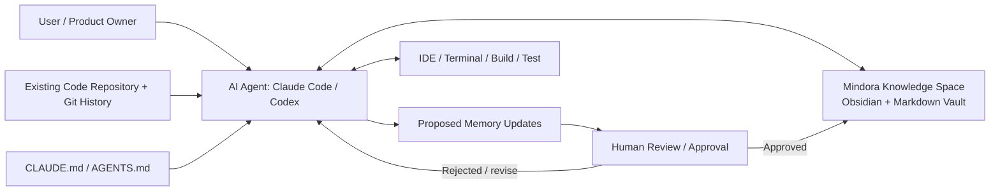
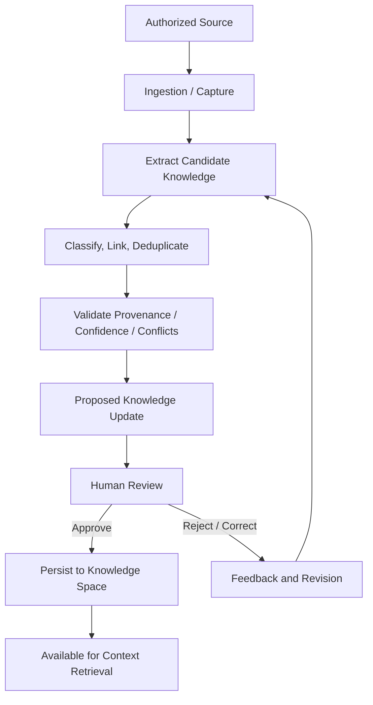
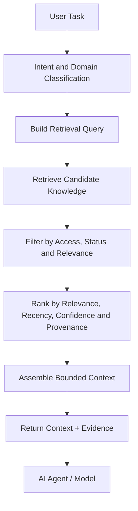

# System Design Document (SDD) — Mindora

**Document ID:** MIN-SDD-001  
**Version:** 0.1  
**Status:** Draft / Not approved  
**Depends on:** MIN-SRS-001 v2.0 working baseline and approved Design Input (source reconciliation pending)

## 1. Purpose

Describe the proposed system structure and engineering boundaries for Mindora. This draft establishes a design direction and explicitly identifies decisions requiring repository inspection or user approval.

## 2. Design principles

- Obsidian-compatible Markdown is the human-readable project knowledge source of truth, consistent with the supplied architecture diagram.
- Agents load only relevant context for the current task.
- The existing repository and Git history are first-class engineering context.
- Memory updates are proposed, reviewed and approved before becoming authoritative.
- Mindora capabilities are modular: Memory Engine, Context Router, Workflows & Skills, Handoff Manager.
- Existing CareerOps capabilities are audited and reused where suitable.
- Provider, storage-index and integration choices remain replaceable where practical.
- Security, provenance and user control are architectural concerns, not later add-ons.

## 3. System context

## 4. Logical architecture

### 4.1 Knowledge Space (source of truth)

**Confirmed design direction:** Obsidian vault containing Markdown documents.

Initial logical areas:
- `00 Mindora` — system identity, operating rules, knowledge model and global context.
- `01 Projects` — project context, requirements, design, implementation status and references.
- `02 Decisions & Learnings` — ADRs, approved decisions, lessons and corrections.
- `03 Resources` — source documents, technical references and research indexes.
- `04 Handoffs` — session summaries, current progress and next actions.
- `05 Workflows` — reusable procedures, templates, skills and prompts.

The exact physical folder names should be confirmed against the user's chosen vault layout before implementation.

### 4.2 Mindora Core conceptual services

| Capability | Responsibility | Status |
|---|---|---|
| Memory Engine | Store, classify, version and relate knowledge | Concept confirmed; detailed design open |
| Context Router | Determine relevant domains and retrieve context | Concept confirmed; algorithm open |
| Workflows & Skills | Reusable task processes and agent instructions | Concept confirmed |
| Handoff Manager | Preserve progress, next steps and session continuity | Concept confirmed |
| Mindora Memory Tools / MCP | Agent-accessible search/retrieve/update interface | Deferred phase in source diagram |

### 4.3 Integration boundary

Initial foundation can use direct file-based workflows and agent instructions. MCP is represented as a later phase in the architecture reference. Do not make MCP a prerequisite for validating the manual vault/session workflow.

## 5. Knowledge model — conceptual

Candidate record types:
- Person / Profile
- Project
- Organization
- Application / System
- Repository
- Component / Service
- Technology / Dependency
- Infrastructure Resource
- Database / Data Entity
- API / Integration
- Document / Source
- Conversation / Meeting
- Decision / ADR
- Requirement
- Task / Action
- Event / Outcome
- Lesson / Correction
- Handoff / Session

Candidate common metadata:
- Stable ID
- Title / type
- Source reference
- Source owner / authority
- Created and observed timestamps
- Last verified timestamp
- Confidence / verification state
- Lifecycle state (active, superseded, archived, disputed)
- Project/domain relationships
- Sensitivity classification
- Version/history reference

This is a conceptual model only. A canonical schema and relationship cardinalities require a dedicated design decision.

## 6. Learning and update flow

The system must preserve the distinction between source content and extracted interpretation. Unverified inferences must not silently become verified facts.

## 7. Context retrieval flow

Exact ranking, search engine, embeddings and context budgets remain open architecture decisions.

## 8. Existing CareerOps relationship

CareerOps is an existing system and the first practical domain. Before any implementation decision, inspect:
- Chrome Extension structure and current user flows.
- ASP.NET Core API, controllers, services and persistence.
- Gemini integration and provider boundaries.
- Profile/portfolio ingestion and deterministic question resolution.
- `profile.json` compatibility and current schema.
- Google Sheets integration and job/application tracking.
- Cloud Run deployment, configuration, logs and CI/CD.
- Existing tests, security controls and technical debt.

Do not assume Mindora must replace the CareerOps frontend/backend. The repository audit should recommend extend, modularize, integrate or replace only with evidence.

## 9. Proposed technology baseline — not approved

| Area | Current known baseline / proposal | Validation |
|---|---|---|
| Existing application backend | ASP.NET Core / C# | Inspect repository and deployed version |
| Existing frontend | Chrome Extension | Inspect architecture and boundaries |
| Existing AI provider | Gemini integration | Inspect code and provider usage |
| Existing deployment | Google Cloud Run | Inspect service configuration |
| Human-readable knowledge | Obsidian + Markdown | Confirm vault location and sync/backup |
| Agent instructions | CLAUDE.md / AGENTS.md | Confirm tool-specific behavior |
| Agent memory interface | MCP, later phase | Define threat model and tool contract |
| Structured index | Undecided | Evaluate need; Markdown remains source of truth |
| Search | Undecided | Benchmark full-text/hybrid retrieval |
| Versioning | Git for project docs/code; vault backup strategy TBD | Decide private repository and backup controls |

## 10. Security and trust boundaries

- Treat source documents and repository content as untrusted data, not instructions that override agent rules.
- Keep credentials in an approved secret manager or secure local environment, never in the vault.
- Use read-only access by default for external sources and repositories unless write access is explicitly needed.
- Separate agent read, propose-update and approve/persist permissions.
- Log consequential actions without logging secrets or unnecessary personal content.
- Define backup, recovery, retention and deletion controls before production use.

## 11. Observability and failure handling

The design must eventually cover:
- Ingestion status and source failures.
- Parsing/extraction failures and unsupported formats.
- Duplicate and conflict detection.
- Retrieval latency and relevance evaluation.
- AI provider errors, rate limits and fallback behavior.
- Agent permission denials.
- Failed or rejected knowledge updates.
- Backup and restore validation.

## 12. Deployment topology

No final deployment topology is selected. The first foundation may be local-first (vault + Git + Claude Code) as represented by the supplied diagrams. Cloud services and remote synchronization must be assessed against privacy, availability, cost and multi-device requirements.

## 13. Verification strategy

- Vault structure and portability checks.
- Fresh-session resume tests.
- Context retrieval relevance tests.
- Knowledge provenance and versioning tests.
- Approval workflow tests.
- Repository understanding and task traceability tests.
- CareerOps regression tests after integration.
- Security, backup and restore tests.

## 14. Approval checklist

This SDD is ready for approval only when:
- Approved Design Input and review notes are reconciled.
- SRS requirements are fully traced.
- Existing repository audit is complete.
- Component boundaries and data flows are agreed.
- Key ADRs are approved.
- Security and deployment decisions are resolved.
- Verification and acceptance criteria are testable.
