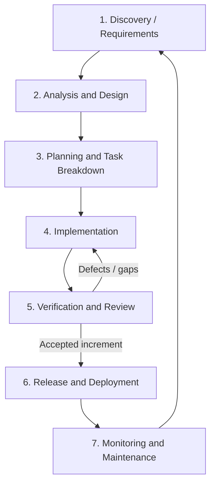

# AI-Assisted Software Development Lifecycle

## Purpose

Define how the team uses AI agents without removing engineering discipline, traceability, testing or human accountability.

## Lifecycle

The lifecycle is iterative. Each increment may revisit requirements, design and planning through controlled change.

## Phase gates

| Phase | Required inputs | Required outputs | Exit gate |
|---|---|---|---|
| Discovery / Requirements | Product vision, user needs, source evidence | Approved requirements, acceptance criteria, traceability | Scope and requirements reviewed |
| Analysis / Design | Approved requirements, constraints, repository baseline | SDD sections, diagrams, ADRs, risks | Design review and approval |
| Planning | Approved design and priorities | Epics, stories, tasks, estimates/dependencies | Work item is implementable |
| Implementation | Task, acceptance criteria, coding standards | Code, configuration, documentation | Build and developer checks pass |
| Verification / Review | Code, tests, requirement links | Test evidence, review findings, defect records | Quality gate passed |
| Release / Deployment | Accepted increment, release checklist | Versioned deployment, rollback evidence | Release authorized |
| Maintenance | Telemetry, incidents, feedback | Fixes, improvements, updated knowledge | Change controlled and verified |

## AI agent operating loop

1. Load instructions and current handoff.
2. Retrieve relevant requirements, design and decisions.
3. Inspect repository state and relevant implementation.
4. Produce a task plan before significant edits.
5. Implement a bounded change.
6. Run tests and report exact evidence.
7. Request independent review where risk warrants.
8. Update docs and propose memory changes.
9. Human approves consequential changes.
10. Create handoff for next session.

## Agent roles

- Claude Code: primary coding agent for assigned repository tasks.
- Codex: independent reviewer, test author, alternative implementation or bounded parallel contributor.
- User: product owner, technical authority and approver.

Do not assign both agents overlapping edits without branch/worktree isolation and explicit coordination.

## Definition of Ready

A task is ready when:
- It links to one or more requirement IDs.
- Scope and non-goals are explicit.
- Design approach is approved or low-risk and already specified.
- Acceptance criteria are testable.
- Dependencies and data/security impacts are known.
- Relevant repository context is identified.

## Definition of Done

A task is done when:
- Acceptance criteria are met.
- Relevant automated/manual tests are executed and results recorded.
- Build/static analysis/security checks are completed where applicable.
- Code is reviewed.
- Documentation and traceability are updated.
- No unresolved critical/high-severity issue remains without explicit acceptance.
- Handoff and implementation status are current.

## Change control

Any change affecting scope, architecture, data model, security, external integrations, cost, deployment or acceptance criteria must be assessed for impact and recorded. The user approves material changes.
